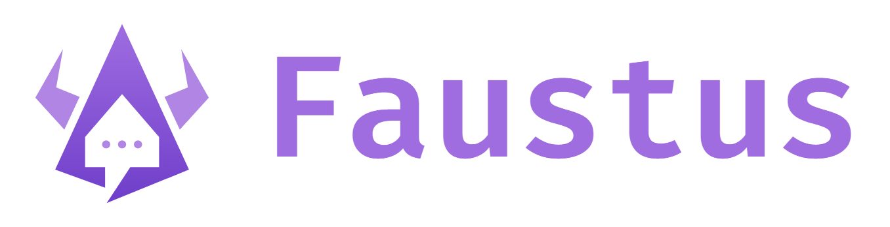
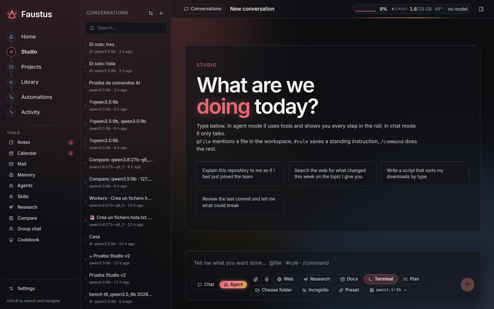
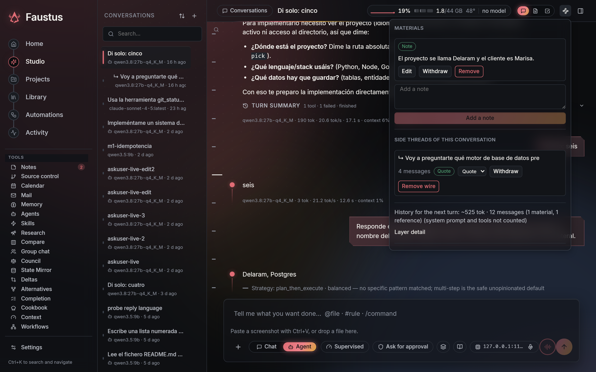
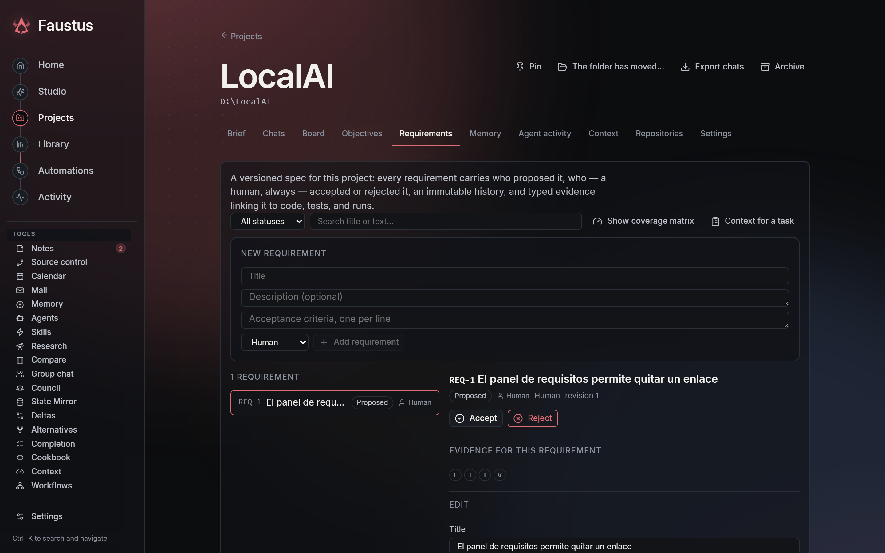
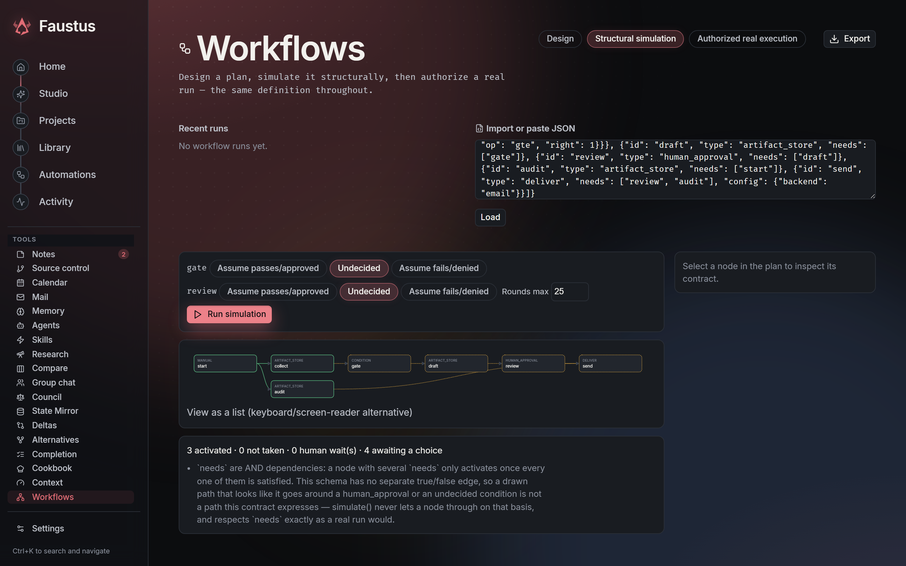
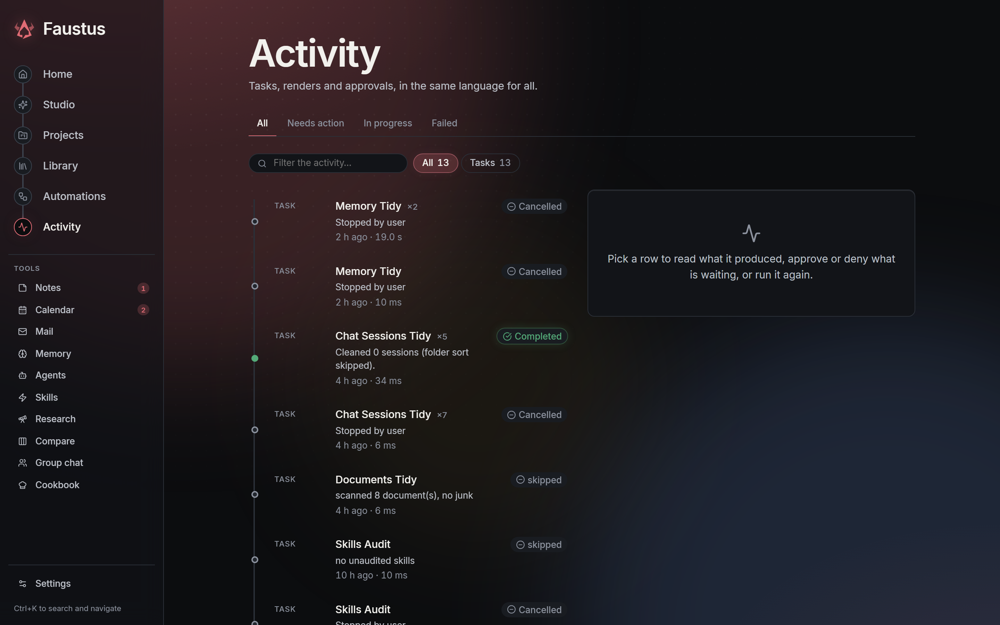
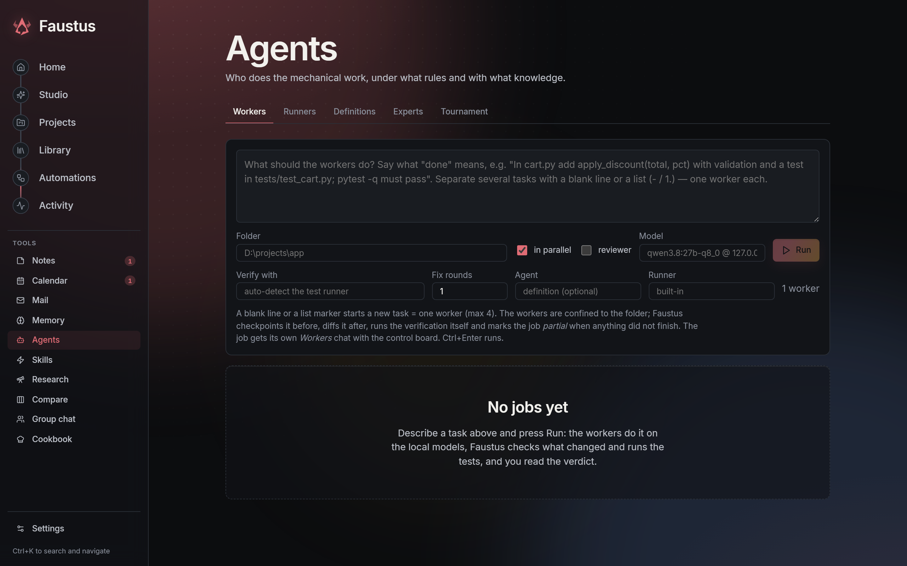
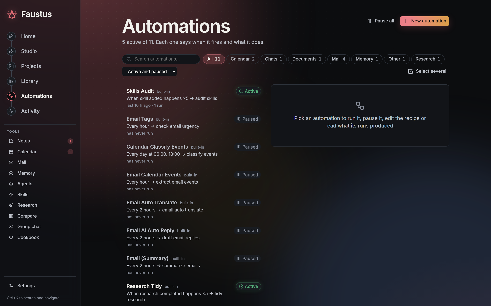

<p align="center">
  
</p>

<p align="center">Una estación de trabajo de IA autoalojada para modelos locales, proveedores en la nube y equipos de agentes.</p>

<p align="center">
  <a href="README.md">English</a> ·
  <a href="#inicio-rápido">Inicio rápido</a> ·
  <a href="#qué-puedes-hacer">Capacidades</a> ·
  <a href="#arquitectura">Arquitectura</a> ·
  <a href="website/setup.md">Guía de instalación</a>
</p>



## Qué es Faustus

Faustus reúne chat, agentes de programación, investigación, escritura, flujos de imagen y vídeo, voz y conocimiento de proyecto en un solo espacio de trabajo. Es un fork personal de [Odysseus](https://github.com/odysseus-dev/odysseus), con backend en Python/FastAPI e interfaz en React/TypeScript (Studio).

Usa modelos locales con Ollama, llama.cpp y otros servidores compatibles con OpenAI, o conecta APIs en la nube. Configura un orquestador y sus agentes especialistas dentro de una conversación. Mantén juntos el trabajo, las fuentes, los archivos generados y el contexto del proyecto, y mira qué se está ejecutando en lugar de adivinar si un modelo se ha colgado.

«Local primero» significa que tú eliges dónde ocurre la inferencia. Las APIs en la nube y los clientes oficiales autenticados usan la facturación o la cuota de suscripción de su proveedor; la inferencia local usa tu propio hardware. Elegir un proveedor remoto le envía el contexto necesario para esa petición.

Esta página es el resumen. [FAUSTUS.md](FAUSTUS.md) describe cada capacidad en detalle, y los documentos de API y de diseño están en [docs/](docs/).

## Inicio rápido

Instala Docker y Docker Compose y después:

```bash
git clone https://github.com/Luissalet/Faustus.git
cd Faustus
cp .env.example .env
docker compose up -d --build
```

En PowerShell, usa `Copy-Item .env.example .env` en lugar de `cp`.

Abre **http://localhost:7000**. La contraseña inicial de administrador aparece en `docker compose logs odysseus`. Compose incluye los servicios de búsqueda y de almacén vectorial; no descarga ningún modelo de lenguaje.

1. Conecta tu servidor de modelos en Ajustes o en Cookbook. Para un Ollama que corre en el anfitrión de Docker, configura su dirección con la [guía de instalación](website/setup.md).
2. Crea un proyecto y adjunta los archivos, documentos o fuentes que deba conocer.
3. Empieza una conversación. Elige **Chat** para conversar o **Agente** para herramientas y acciones.
4. Usa **Actividad** para seguir conversaciones en marcha, flujos, renders y aprobaciones.
5. Añade motores de imagen y vídeo, servicios de voz o clientes de agentes externos cuando los necesites.

En Windows sin Docker, `Start-Faustus-Desktop.bat` abre la ventana de escritorio y `Start-Faustus.bat` arranca el servidor y abre la interfaz web; los dos preparan las dependencias que falten en el primer arranque. Instalación nativa en otros sistemas, GPU, HTTPS y variables de entorno: [guía de instalación](website/setup.md). Conserva tu carpeta `data/` y haz copia antes de actualizar.

## Qué puedes hacer

### Chat y un banco de trabajo persistente

- Cambia entre modelos locales y de API en cada conversación; conecta proveedores en la nube con una configuración guiada que prueba la conexión.
- Pega capturas, sube adjuntos y menciona archivos del espacio de trabajo con `@`.
- Lee los documentos generados junto al chat, edítalos y guárdalos con detección de conflictos.
- Ten archivos, resultados, fuentes, contexto del proyecto, actividad de los agentes y capturas del navegador en un panel lateral redimensionable.
- Sal de una conversación mientras el servidor sigue con su turno; consulta la posición en la cola, la actividad, el uso de herramientas y las aprobaciones pendientes, y vuelve al mismo trabajo.
- Abre un hilo lateral desde cualquier pasaje y conecta referencias, documentos y notas a un turno de forma explícita.
- Busca y navega con **Ctrl+K**. Inglés y español, temas, densidad, tamaño de texto y movimiento reducido.
- Instala Studio en el móvil como PWA con notificaciones, o abre una ventana flotante de pregunta rápida desde cualquier aplicación de Windows.

### Programación, herramientas y equipos de agentes

- Define un orquestador y sus trabajadores desde el chat, eligiendo modelos, roles y restricciones de herramientas.
- Delega en conversaciones hijas con propiedad de archivos, progreso, cancelación y redirección.
- Usa el Consejo para primeras rondas a ciegas, crítica y síntesis entre varios modelos, con un ejecutor designado para las acciones.
- Usa skills, servidores MCP, herramientas de archivos, shell, control del navegador y control del escritorio con los permisos configurados.
- Conecta agentes de programación oficiales de línea de comandos como trabajadores mediante el sistema de ejecutores y despacho, eligiendo de forma explícita suscripción o API para cada uno.
- Revisa la evidencia de las herramientas, las comprobaciones de sintaxis, los tests del proyecto y los resultados de revisión. Los puntos de control en un git paralelo dan diffs y restauración sin tocar el repositorio del proyecto.
- Trabaja con repositorios desde el panel de Git y lleva incidencias tipadas en un tablero de proyecto que los agentes pueden leer y actualizar.
- Un enrutador de modelos elige en cada turno un modelo local o remoto según la velocidad medida y el historial, y nunca pasa a una ruta de pago sin permiso explícito. Consulta la [API del enrutador](docs/api/model_router.md).

### Conocimiento de proyecto y memoria

- Los proyectos guardan archivos, documentos, fuentes, objetivos e instrucciones con independencia del nombre de la carpeta en la barra lateral.
- El motor de contexto recupera, ordena y presupuesta material de las fuentes del proyecto, el historial y la memoria, y enseña con qué se construyó cada turno. El almacenamiento persistente amplía lo que se puede recuperar, no la ventana de contexto nativa del modelo.
- El segundo cerebro es una bóveda markdown de notas y entidades tipadas con enlaces wiki, retroenlaces, relaciones con fechas y una vista de grafo, sincronizada en los dos sentidos con el sistema de archivos. Consulta la [API del cerebro](docs/api/brain.md).
- Busca en el historial importado de otros asistentes junto al conocimiento local.

### Investigación, documentos y trabajo diario

- Investiga con seguimiento de fuentes, comprobación de citas y exportación de informes; las respuestas enseñan los enlaces a las fuentes junto a lo que afirman.
- Escribe y edita documentos y expórtalos a Markdown, texto, HTML, PDF, DOCX o JSON.
- Notas, tareas y calendarios; correo por IMAP/SMTP y calendarios por CalDAV.
- Conexiones de mensajería para leer y enviar en servicios de chat de equipo. Consulta las [conexiones de canales](docs/api/channel_connections.md).
- Notas de reunión a partir de una grabación: resumen, decisiones, tareas y la transcripción con tiempos.
- Tareas programadas con zonas horarias, ventanas de ejecución e historial de cada ejecución. Consulta las [tareas programadas](docs/api/scheduled_tasks.md).

### Imágenes, vídeo y audio

- Planifica y ejecuta recetas aprobadas de ComfyUI para imágenes, edición con referencia y vídeo corto, y edita una imagen adjunta describiendo el cambio.
- Con varios motores configurados, los renders se reparten según disponibilidad, cola y capacidad.
- Los artefactos generados conservan su receta, semilla, licencia del modelo y huella de la entrada. El servidor recoge los renders aunque no haya ningún chat abierto.
- Convierte y redimensiona imágenes, extrae audio, transcribe y subtitula vídeo local.

ComfyUI es un servicio aparte; los pesos de los modelos, los nodos personalizados y sus licencias no vienen incluidos. Consulta las [recetas de medios](config/media_workflows/) y la [documentación de trabajadores](website/fable-workers.md).

### Flujos de trabajo duraderos

Compón disparadores, condiciones, esperas, aprobaciones humanas, pasos de medios, pasos de script e informes guardados en un lienzo. El servidor hace avanzar los flujos iniciados y despierta los pasos con temporizador; los intentos llevan un arriendo para que un resultado tardío no pise una cancelación ni un intento más nuevo. Los pasos de script se ejecutan en Docker con permisos ligados al código y al comando exactos. Consulta la [configuración de skills con script](docs/design/workflow-script-skills.md).

### Voz

Una sesión de voz con reconocimiento en inglés y español, respuestas habladas, interrupción y una esfera reactiva, con motores de voz del navegador, del sistema o locales. La entrada por voz pasa por el mismo flujo de conversación y de permisos que la escrita. En la aplicación de escritorio de Windows, un atajo global dicta en cualquier programa. Consulta la [guía de voz](docs/design/voice-jarvis.md).

### Ágora

Los proyectos tienen un espacio compartido donde varios agentes y modelos toman tareas, debaten, se revisan el trabajo y registran decisiones, con roles y un tablero de tareas. Consulta la [API del Ágora](docs/api/agora.md).

### Aplicaciones Hoard

Faustus se conecta mediante plugins y MCP a una familia de aplicaciones locales independientes (los Hoards): finanzas, enlaces, personas, análisis de datos, diseño, comparación de modelos, gestión del clúster de GPU y otras. Cada una vive en su propio repositorio y se documenta allí. En Conectores, descarga un Hoard con un botón o enlaza una carpeta existente; el Hoard Hub arranca las aplicaciones cuando hacen falta y comparte entre ellas un único modelo local cargado. Los procedimientos de agente de cada aplicación están en el [catálogo de flujos de agente](docs/AGENT-FLOWS.md).

### Ejecución en otras máquinas

Faustus puede usar máquinas DGX Spark como backend de modelos, y el Hoard Hub puede mover el propio servidor de Faustus a una Spark y traerlo de vuelta, de modo que el móvil y el portátil siguen funcionando con el PC apagado.

## Arquitectura

| Área | Código |
| --- | --- |
| Aplicación HTTP y persistencia | [app.py](app.py), [routes](routes/), [core](core/) |
| Interfaz Studio y su estado | [studio/src](studio/src/) |
| Aplicación de escritorio | [desktop](desktop/) |
| Transporte y enrutado de modelos | [llm_core.py](src/llm_core.py), [model_router.py](src/model_router.py) |
| Motor de contexto y segundo cerebro | [context_engine](src/context_engine/), [brain](src/brain/) |
| Despacho de trabajadores y supervisión de procesos | [dispatch.py](src/dispatch.py), [external_worker.py](src/external_worker.py) |
| Consejo | [council](src/council/) |
| Flujos de trabajo duraderos | [workflows](src/workflows/) |
| Motores de medios | [media_runs.py](src/media_runs.py) |
| Artefactos | [artifact_store.py](src/artifact_store.py) |
| Servidores MCP integrados y plugins | [mcp_servers](mcp_servers/), [plugins](plugins/) |
| Tests de regresión y de interfaz | [tests](tests/), [studio/checks](studio/checks/) |

Los nombres internos como `odysseus`, `ODYSSEUS_*`, las rutas de API existentes y las claves de almacenamiento se conservan por compatibilidad. El nombre del producto es Faustus.

## Desarrollo y verificación

Usa el entorno de Python configurado para el proyecto e instala las dependencias de desarrollo que describe [tests/README.md](tests/README.md).

```bash
python -m pytest
npm ci
npx tsc --noEmit
npm run build
python -m src.doctor
```

La suite cubre aislamiento por propietario, persistencia, concurrencia, cancelación, migración, integración HTTP y comprobaciones de interfaz sin navegador visible. Los motores que dependen de hardware y las integraciones con cuentas necesitan además pruebas en su entorno configurado. Lo que queda abierto está en [PENDIENTES.md](PENDIENTES.md).

## Capturas

<details>
<summary>Cables de contexto, requisitos y flujos de trabajo</summary>







</details>

<details>
<summary>Actividad, agentes y automatizaciones</summary>







</details>

## Seguridad y datos

Mantén `AUTH_ENABLED=true` en cualquier despliegue accesible por red y `LOCALHOST_BYPASS=false` fuera del desarrollo local.

Los lanzadores locales escuchan solo en localhost y funcionan con un único usuario sin inicio de sesión. No expongas públicamente puertos de modelos, de ComfyUI ni de servicios internos sin autenticación. Mantén las credenciales y los archivos privados de `data/` fuera de Git.

Las credenciales guardadas están cifradas y son de solo escritura: los ajustes muestran la clave enmascarada y nunca vuelve al navegador. Protege `data/.app_key`; el cifrado no protege frente a un equipo comprometido.

Los permisos de herramientas, las restricciones por agente, las aprobaciones, el sandbox y la supervisión de procesos son controles independientes. El contenido de páginas web, correo, documentos y servidores MCP remotos se trata como no fiable. Los servidores MCP de terceros y las skills importadas se analizan antes de poder confiar en ellos.

Consulta el [modelo de amenazas](THREAT_MODEL.md), la [política de seguridad](SECURITY.md) y las [notas de seguridad de la instalación](website/setup.md#security-notes).

## Créditos y licencia

Faustus se basa en [Odysseus](https://github.com/odysseus-dev/odysseus). Consulta [ACKNOWLEDGMENTS.md](ACKNOWLEDGMENTS.md) para los demás créditos, [CONTRIBUTING.md](CONTRIBUTING.md) para contribuir y [LICENSE](LICENSE) para la licencia **AGPL-3.0-or-later**.
