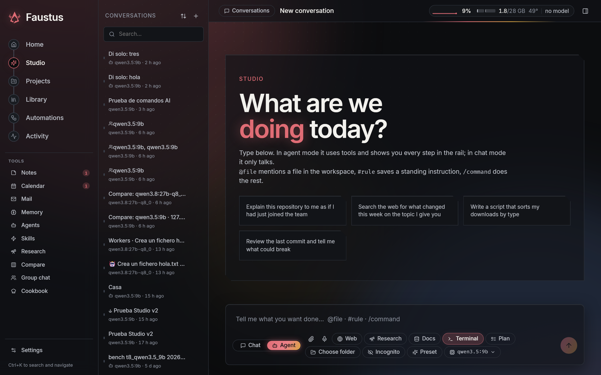
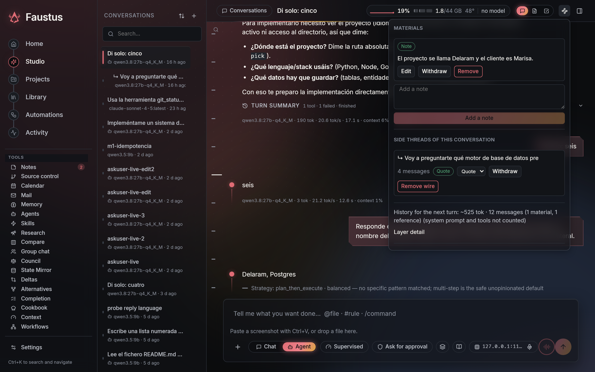
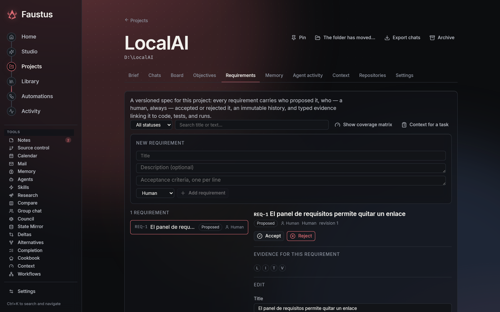
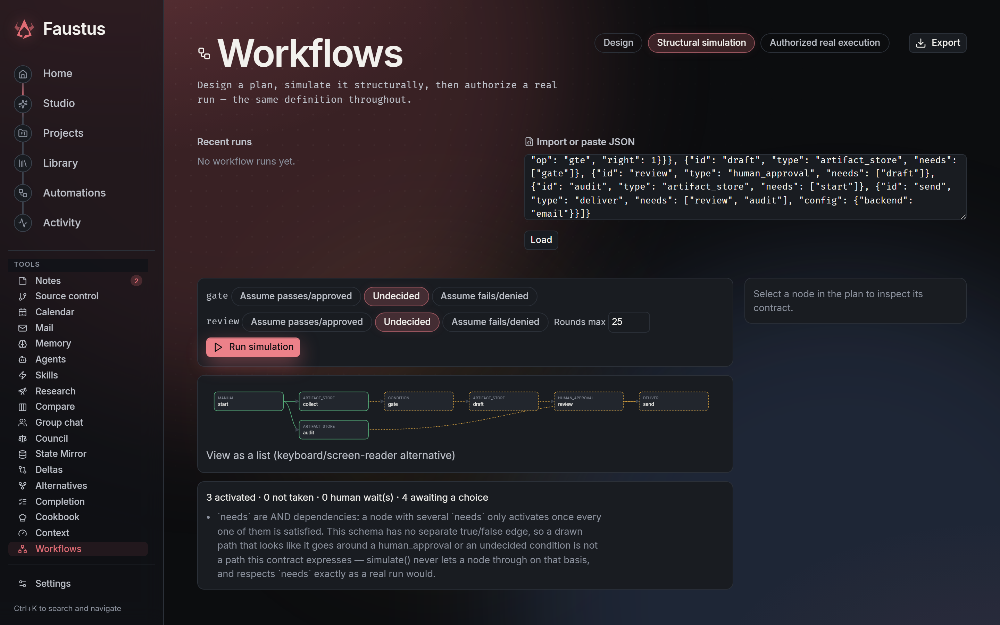
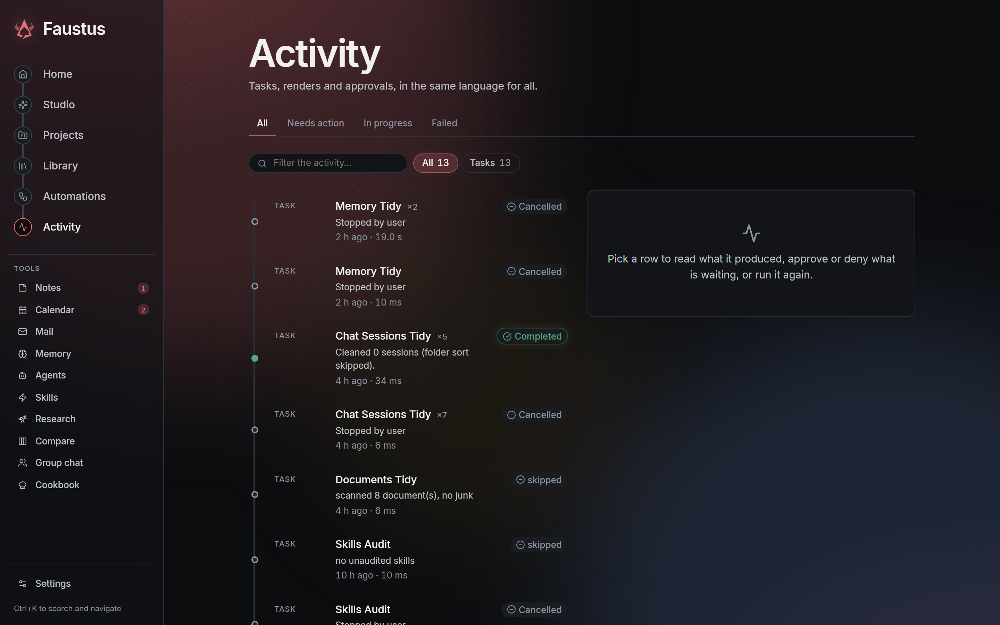
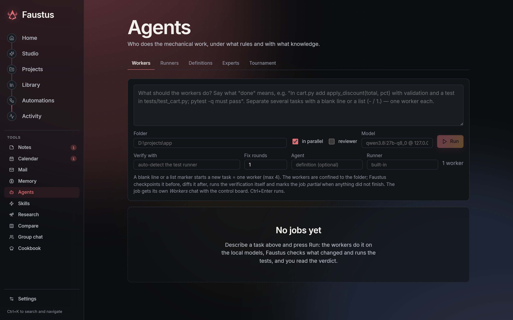
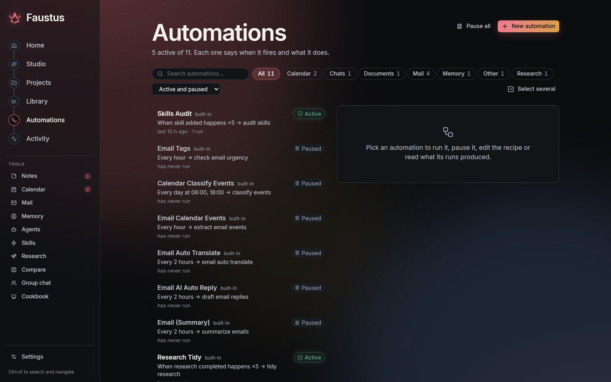

<p align="center">
  

Navigation now follows the work: chat actions and document workspaces in Studio, repositories inside each project, specialist apps under Hoards, and five searchable settings areas. All existing tools and saved data remain accessible. See [navigation](docs/ui/navigation.md).

The bundled skill library includes eight local workflows for reverse engineering,
Blender assets, motion composition, media revisions, code impact, entity
investigations, historical evidence and speech comparison. Worked scenarios and
supporting text files survive installation and remain available through the skill
reference and project workspace tools. These procedures do not install engines
or add application capabilities by themselves. [Library](skills/library/README.md).

Code impact follows Python import bindings and function scope, and re-resolves
unchanged callers when definitions appear or disappear. The existing impact
query is available through HTTP as well as MCP and chat, with optional history
and risk computation. [Code resolution](docs/api/code-resolution.md).

Studio is the single starting workspace. New conversations show personal assistants, pending decisions, pinned results and recent projects above the ordinary composer. Repository radar, fleet and usage remain in Workspace overview; personal tools retain mail, calendar, notes and messaging. Old Home links preserve their query and fragment. Existing chats, assistant identities and automation results use the same stores and tools. [Studio start](docs/ui/studio-start.md).

Projects → Chats now lists the project’s existing Agora conversations beside ordinary chats. Opening a room returns to the same full Studio conversation list, members, composer and collapsible debate. Projects → Tasks is one shared board for people and agents: open a card in a wide modal to edit its objective, description, acceptance criteria, priority, assignment and clarifications. Existing local objectives, requirements and issues are imported once with original records and revisions retained; subsequent edits use the shared task identity. The native project task API and MCP use that same ledger. [Project tasks](docs/api/project-tasks.md).

Agora uses the regular Studio chat: Project → Chats → Agora opens its conversation list, transcript and composer, with the usual project button and a Tasks shortcut. Attachments, slash commands and composer controls use the native chat harness. Use @mentions and Members to choose models, supported reasoning and discussion settings or inspect each participant's activity. Members can answer each other until the discussion ends; optional round limits remain selectable. Existing conversations, deliberation and coordination tools remain available. Visible answers remain on screen while a replacement is drafted; stopping a group keeps queued user messages visible with their stopped status. [Agora workspace](docs/api/agora.md) · [compatible group API](docs/api/groups.md).

New Studio rooms collect model replies in an expandable **Debate**, show live participants and necessary decisions, and publish one separate final answer from the chosen reporter. **Group chat** remains selectable in the room editor. Stopping keeps queued instructions visible; @mentions use a distinct color.

The existing output guard also detects strongly collapsed vocabulary without an identical repeated phrase and uses the normal typed error and recovery. This is a narrow output-pattern check, not a semantic quality guarantee or a diagnosis of the model server. [Output collapse](docs/OUTPUT_COLLAPSE.md).
</p>

<p align="center">A self-hosted AI workstation for local models, cloud providers and agent teams.</p>

Dictation shares the Studio editor, saves recoverable text before pasting and keeps general/project vocabulary with conservative learning from spelling corrections. Manage vocabulary and recent dictations in Voice settings or MCP. Studio's personal assistants keep ordinary persistent chats, with configurable working instructions, selected published skills and native proactive schedules. Chat and Agent apply the same profile; scheduled results return to that chat. Configure mission, recurrence, timezone, notifications and silence without updates; pause, run now or inspect recent activity from the assistant editor. Removing an assistant pauses its schedule and preserves the chat; restoring it keeps proactivity paused. Faustus must be running for scheduled work. [Dictation](docs/api/dictation.md) · [Personal assistants](docs/api/personal-assistants.md) · [Inspected references](docs/ASSISTANT_REFERENCES.md).

A temporary retryable Sparks service outage before output keeps the task alive
on the same configured model. Completed tool results are retained; Stop and
requested initial deadlines remain available. [Service continuity](website/SPARKS-SERVICE-CONTINUITY.md).

Persistent groups can pair the resident GLM implementer with an independent Qwen
reviewer on a fourth Spark. Participant routes, read-only execution and input
budgets survive saving and reloading presets. Correction turns remain directed
native group messages; review is opt-in. [GLM and Qwen review](docs/api/glm-qwen-review.md).

Delegated workers have no implicit deadline and queue every requested task by
default. They inherit the coordinator's configured model route unless a task
selects another one. Reading and research return reports without being retried
as file edits; final reports discard narration before tool results and consume
response corrections. Explicit limits, endpoint concurrency and Stop remain
available. [Delegation continuity](website/DELEGATION-CONTINUITY.md).

Configured MCP HTTP/SSE connections recover on demand without restarting the
agent. Healthy connections stay intact; a write whose response was lost is
reported as uncertain and is not replayed. [Remote MCP recovery](docs/design/REMOTE-MCP-RECOVERY.md).

Native Slack, Discord and Matrix tools list conversations, read full history,
send/edit text and add reactions using saved Integrations credentials. Eight
built-in MCP tools and the API share the same implementation. Incoming push,
binary attachments and Matrix encryption are pending; real accounts have not
been tested. [Channel connections](docs/api/channel_connections.md).

Autonomous tasks continue while the browser is open by default. The previous
foreground preemption policy remains opt-in; explicit task Stop stays available.
[Background continuity](docs/design/BACKGROUND-CONTINUITY.md).

<p align="center">
  <a href="README.es.md">Español</a> ·
  <a href="#quick-start">Quick start</a> ·
  <a href="#what-you-can-do">Capabilities</a> ·
  <a href="#architecture">Architecture</a> ·
  <a href="website/setup.md">Setup guide</a>
</p>




**Plugin marketplace:** in Connectors, download Hoards with one button or link existing folders. Required HoardLink downloads first when missing. Faustus ships the catalogue; source checkouts live in `plugins/<id>/repository/`, outside Git. Watch and Book remain independent. [Collaborator setup and cloning](docs/api/plugin-marketplace.md).

## Sparks verification (20 October 2026)

The active backend includes the reviewed single-user conversation ownership fix:
HTTP and native MCP recover the same completed conversation, and Studio reload
preserves its answer. Long tasks continue through the configured global Sparks
service; no PC text-model fallback is used. The native weight downloader now uses
serial HTTP without Xet; its measured memory result is scoped to the recorded jobs.

A corrected Workledger project passed 17 original independent cases, 61 producer
tests, six Windows CLI checks and the extra mutation/large-integer regressions.
The initial Docsite delivery failed independent HTML-link and browser checks
although its 45 producer tests passed. After three guided corrections, the fourth
delivery passed the independent API/CLI cases, seven edge cases, 54 producer tests,
nine real browser queries, two keyboard navigations and the title-only regression.
This is scoped acceptance after corrections. Earlier failed deliveries remain
recorded; general semantic reliability is unproven.

A fresh Workledger generation on 20 October completed 38 rounds in 1113.8 seconds
but failed acceptance: 16 of 17 original cases and five of eight supplementary
groups passed. It accepted a plan declaration without the required colon and
raised RecursionError for cyclic metadata. The six baseline Windows CLI cases
passed, while a Japanese/emoji error produced invalid JSON on stderr. Its 52
producer tests passed with forced UTF-8; one failed on native Windows. The failed
delivery's original source pins and oracles remain recorded. The change verifier's
100% confidence is a heuristic score, not requirement coverage.

Task 969 is reviewed, integrated and active: a later unrelated command cannot
erase an earlier failure, and trusted approval snapshots retain result states,
pending execution, Code Mode and process evidence. Known new mutations invalidate
old test results; checks have no three-run cap and retain their history. A check
that did not execute remains due at the next normal closing point. Independent
CPU checks passed 48 prepared cases, four complete scripted streams with real
fixture subprocesses/SQLite and 259 area tests (six execution tests excluded).
These are separate runs, not proof of model quality. Native API correction R2
on that same project completed 33 rounds and 45 tools in 571.7 seconds. After
reading all final source, the independent evaluator obtained 17/17 original
cases, 8/8 supplementary groups, 65 producer tests on native Windows, six CLI
checks, the Unicode-error check and the README examples passing. The producer
retained all 52 earlier tests and added 13 regressions. This is acceptance after
guided correction; the fresh R1 failure remains recorded. Native MCP recovered
the exact completed run and Studio displayed it automatically without reload.
The harness persisted a real 65-test PASS at source epoch 19, while retaining
UNVERIFIED for an earlier Python operation without confirmed comparable recovery.
That operation history is distinct from independent contract acceptance.

The reviewed no_skills correction also suppresses the shared preface catalog.
Its source is active and has 109 passing independent/area CPU checks. All five
context ledgers of the native API correction contain zero skill/index tokens,
against a nonempty 18-skill catalog. The native MCP start catalog does not expose
this option; this flag check covers the API profile. Native MCP status and Studio
restored the prior conversation after activation; this does not reverify its old delivery.
The existing no_memory option
suppresses personal recall, while retaining project context and conversation
history; it does not disable the entire context engine.

A separate CPU investigation reproduced the default one-repair budget closing
with failed tests, while an explicit larger fixture budget reached a passing
fourth check. The reviewed automatic-budget correction is now active: -1 uses the
current turn budget, 0 remains report-only and positive values retain their fixed
repair count. Stop and test freshness remain intact. Independent review passed
22 oracles and 31 new tests; its area run had 125 passes and three reproduced
pre-existing failures. This installation deliberately selected -1 through the
native API, with its value and help verified in Settings. Other saved positive
values are not silently migrated.

Direct typed endpoint discovery now also preserves the current task's reasoning
without starting Prometheus. Verified GLM controls default to clear_thinking=false
so internal user-role messages do not erase earlier reasoning; explicit overrides
and other model profiles remain. Independent CPU review passed 13 contract cases
and 147 area tests. These results do not establish model quality.

The fresh Docsite run completed 34 rounds and 60 tools. Its independent core,
seven edge cases, 22 extra checks, 32 producer tests on native Windows, nine browser
queries, keyboard navigation and README API/CLI/HTTP examples passed. Two separate
contract witnesses failed: the second paragraph reused the first paragraph's link
target, and the advertised skip link had no target element. The delivery remains
incomplete. All candidate bytes and original oracle pins were preserved. Studio
displayed the terminal answer automatically without reload. Closed trace metadata
retained up to 21 reasoning messages; this observes the wrapper, not server cache
or an explanation for program quality.

Activation of 991/995 preserved other setting values, 24 manual stops and the
selected model/connection identity, but its full descriptor guard detected vision
changing from true to false. That failed receipt remains recorded. Reviewed fix
1007 now consults existing exact durable capability evidence before the legacy
cache/name fallback. One native vision probe stored a scoped positive result;
after one Faustus stop/start, the first descriptor read returned true with no
additional generation. Five other descriptor fields, settings, all 37 disabled
MCP connections, 24 manual stops and the Hub/model process identities remained.
This is minimum image-capability evidence, not general visual comprehension.

The reviewed review-freshness correction 1010 is active. A late result cannot
approve a newer source epoch, and reviews no longer have a separate two-run
scheduling cap. A review attempt is recorded before awaiting its result, so an
error does not repeatedly review the same source epoch. Policy, off/same selection,
explicit repair budgets and Stop remain unchanged. Independent review passed 31
cases and 402 area tests, with three pre-existing failures reproduced separately.
A synthetic research fixture had wrongly treated mutation events as unique paths;
that premise was corrected before code changes and remains in the history.

The reviewed grouped-review correction 1029 is also active. Each partial group
receives the complete changed-file inventory and explicit scope instructions.
Empty or invalid replies retain errors and failed-file coverage after compaction;
attempts and successful reviews are distinct. Independent review passed 11 frozen
cases and 326 area tests, with two explicit exclusions checked against the base.
This validates assembly and error reporting, not the model's semantic accuracy.

A separate fresh Docsite run with the native critic completed 41 rounds and 68
tools but failed independent acceptance: the generated index.html for index.md
was overwritten by the general index, and
the landing-page search did not load its index correctly. Its 34 producer tests,
22 extra checks and nested-page browser searches passed. A separate volume corpus
passed with 1,001 documents, 3,003 headings/links and 14 queries in 111.435 seconds;
that result does not erase the functional failures. The critic also inferred
missing files from a partial group and had at least one empty response; the cause
of that empty response
remains unproven.

A separate unassisted project after 1029 passed the original independent API/CLI
checker, seven edge cases, 35 producer tests, 22 extra checks and the two-paragraph
link witness. Nine searches on both root and nested pages matched the API in the
real browser; keyboard navigation opened the intended result. Its README examples,
Unicode error JSON and eight served files also passed. A separate 1,001-document
corpus passed 3,003 headings, 3,003 links and 14 queries in 82.127 seconds. Sources
and oracles stayed unchanged. Studio reached terminal without reload and retained
review:error and UNVERIFIED; one critic group remained incomplete. These results
support this delivery's exercised contract, not universal semantic reliability.

A fresh local DAG pipeline project completed 47 rounds and 72 tools without
external checker feedback. Its unchanged source passed all 45 prepared external
cases: 1,315 API calls, 22 separate CLI invocations, 1,001 nodes, 1.26 MB of exact
UTF-8 data, retries, cancellation and recovery after an abandoned durable claim.
The checker first supplied Path objects, a type its task did not require; that
failed attempt remains recorded. Only four checker arguments were normalized to
strings after independent review, with every semantic assertion unchanged.
The 49 producer tests and README API examples also passed. Additional targeted
malformed inputs nested 1,500 levels deep raised RecursionError instead of the
required ValueError. That original delivery remains failed for these inputs.
Studio and native MCP recovered the same terminal run, retaining UNVERIFIED.

Actual response metadata also identified one internal critic call whose entire
1,200-token output budget was consumed by reasoning: finish_reason=length and
no final content. Two other groups finished normally. Reviewed repair 1058
removes that reviewer-specific cap and uses the existing service/model output
budget. Reviewed repair 1052 also propagates a source cancellation to the waiting
consumer while retaining ordinary task cancellation. Both are integrated and
loaded by the recovered server. The combined 30-module area passed 354 tests
and six subtests; one known pre-existing connection denial remains recorded.
The first cold start failed its health deadline. A separate diagnostic start
recovered the same configured service, preserving settings, disabled connections,
manual stops and the model process. Activation counters recorded one extra
generation token and one length-finished request, so the zero-generation check
remains failed. Catalogue vision probing is the inferred source, not a captured
request attribution. Native reviewer revalidation then correctly identified the
line-2 arithmetic defect in 2.57 seconds, with one real request, 107 output tokens,
finish reason stop and no 1,200-token cap in the observed request controls. This
small case does not exercise a reasoning response longer than 1,200 tokens.
See the durable Pipeline report under
research-inbox/sparks835/runtime-audit/resume-20261020/PIPELINE-FRESH-RESULT.md.

The reviewed non-stream compatibility fix 1036 also accepts vLLM's `reasoning`
field through the existing legacy fallback/filter, preserving final-content
precedence. Independent checks passed 90 cases against 39 failing base cases.
Its area had 191 passes and six subtests; the guard wrapper retained a failed
status for a denied Git call reproduced identically on base and revision. This
does not establish why the earlier critic returned an empty response.

Reviewed fixes 1044/1045/1047 are integrated and active. A failed critic stage now
keeps the aggregate review in error with incomplete coverage, preserving earlier
findings. Review diagnostics retain metadata from the actual non-stream HTTP
response: finish reason, token usage, channel shape/size and final controls, with
no reasoning text or prompts. Cache/CLI results do not invent HTTP evidence.
Scheduled Skills Audit forwards its real stage/current-item/completed-count
progress through the existing task callback; callback failures do not change the
audit result. These changes passed 298 combined area tests and six subtests;
one denied connection was reproduced on the base and remains recorded.

One native API review on the configured global Sparks correctly identified a
two-line arithmetic defect in 3.36 seconds. Its receipt reports 108 output tokens,
finish reason stop and a complete final response. This scoped success does not
exercise every compatibility branch or explain earlier critic failures. Native
MCP and Studio also recover the same ongoing large-project run and display its
real progress. The Pipeline acceptance and additional failures are recorded above.
General reliability remains unproven.

A fresh notebook web project completed 39 rounds and 64 tool calls. Independent
acceptance passed 52 API cases and seven browser/delivery cases, including 1,001
notes and a body larger than 1 MiB. Two UI cases failed: a valid unbroken title
overflowed the mobile viewport, and a failed import retained an earlier success
message. Its 28 producer tests passed with resource warnings. That original source
and its failed receipts remain preserved.

After directed corrections, the notebook passed all 61 original independent
API/browser checks and its 28 producer tests without the earlier resource
warnings. The browser exercised 1,001 notes, a body larger than 1 MiB, exact CRLF
preservation, conflicting edits, invalid imports and the mobile title case.
The corrected Pipeline passed the same 45 external cases, both depth-1,500
regressions and its README examples; its 51 producer tests had no recorded
resource warnings. These are corrected deliveries, not consecutive fresh passes.

Reviewed UI-check repairs 1072/1074 preserve the public root and HTML entry and
extract JavaScript references only in the appropriate HTML/script context. Repair
1075 lets a project declare its actual server in `.faustus/ui_smoke.json`, with
literal argv substitution and explicitly directed temporary test data. On the
unchanged notebook, a native component check used the real backend and browser:
HTML and both real assets passed, no console errors, and temporary data was
removed after process termination. Earlier static-preview API404 failures and
Playwright pending-task/TargetClosed warnings remain recorded. This verifies the
checker component, not the two failed UI cases or the installed running server.
See [project startup for UI checks](docs/api/ui-smoke.md).

The three UI-check repairs are now active and were also exercised by a normal
native turn: the model supplied the notebook startup declaration and the normal
harness ran Playwright against that backend, checking one page and two assets
with zero console errors. Its temporary database directory and listener were
gone afterward. HTTP/MCP recovered the same completed run and Studio retained
its partial-coverage result; the smoke does not override missing evidence.

An older model-written test command failed before terminating its nested server.
The surviving process was identified from the original command, creation time
and listener, then stopped separately. A later model answer incorrectly called
it a harness process. Process-lifecycle handling remains under investigation;
this scoped UI success does not prove orphan containment. General reliability
remains unproven. Evidence:
`research-inbox/sparks835/runtime-audit/resume-20261020/`.

On 21 October, the approved execution-effect correction was activated and tested
through the normal agent API, MCP and Studio. One unchanged PowerShell command
wrote a marker and intentionally exited with code 1. Its failed status, both output streams
and `effect_certainty=unknown` were preserved; independent reading confirmed the
exact 24 marker bytes. Studio displayed the warning, and the model distinguished
the command failure from the completed write without executing the command again.
This verifies that case, not general execution correctness. The turn took 180 s,
seven rounds and six tools; the generic UNVERIFIED label remained. A later QA
supervisor assertion is retained with its cause unknown; the same completed turn
was reconciled without replay. Activation preserved configuration and boots but
failed its zero-inference check by one token and one request ending at its output limit;
that failure and unknown attribution remain recorded.

A fresh local mail archive passed 13 of 15 frozen independent groups. One failure
demonstrated malformed Message-ID information loss; the other concerned an
ambiguous CLI usage-error exit code. Separate checks found an unstructured file
write error, incorrect README output and resource warnings despite 37 passing
producer tests. After two directed corrective turns, the same frozen groups pass
14 of 15; only the historical exit-code discrepancy remains (the CLI returns
usage-error code 2, consistent with the task). Seven separate CLI/recovery cases,
native Windows Unicode/error checks and the file-write error check pass. The
actual README API block and CLI example now execute successfully. All 42 producer
tests also pass independently with the complete stderr free of tracebacks,
reader-thread decode errors and resource warnings. Source hashes remained unchanged
through acceptance. The original failures and the strict 14/15 result remain
recorded; this corrected delivery does not establish unassisted repeatability.
The same native review produced 2106 reasoning tokens and a nonempty final answer,
exercising the critic-budget correction beyond its former 1200-token cap. Neither
that evidence nor the corrected notebook/pipeline deliveries establishes reliable
first deliveries across new ambitious projects.

The fifth corrective KV delivery completed a 78-round task. Its 61 producer tests
passed in 347 seconds, but the frozen R2 oracle failed recovery followed by append.
A public-API witness reproduced this after truncating only the last byte; the
binary corpus passed 40 cases and failed eight. Writer locking, actual writer
process death and the observed post-snapshot-install crash passed separately.
That fifth delivery remains failed; evaluator source edits did not repair it.
The sixth corrective delivery passed the seven independent R2 groups. On
20 October, the unchanged final source also passed all 48 frozen binary cases,
corruption preservation and five public-API capacity/atomicity cases, including
128 MiB values and an exact 192 MiB batch payload. These results do not establish
reliability for every project or replace the earlier failures.

All 52 pinned QAD checkpoint files are SHA-verified on both Spark1 and Spark2
(177.52 GB per node). QAD was loaded and tested on 19 October with the same
3.19-million-character input: plain output still failed the JSON-only contract
with Markdown fences; a separate explicit JSON-mode call returned the exact
object. The JSON-mode timing followed a warm prefix and is not a cold comparison.
QAD remains unvalidated for general use; the global model was restored to NVFP4.
Studio now follows external
MCP turns in an already-open conversation, including a new turn arriving while
the previous observer drains and an older history response arriving late.
[Detailed evidence and continuation](D:/LocalAI/research-inbox/sparks835/latest-status-path.txt).

Native background continuations retain the project's workspace, attached roots,
harness options and standing instructions, including the legacy path when no
context-engine packet arrives. Real MCP/API checks on separate projects verified
relative file access, distinct project instructions and the automatic project
test command; a no-project chat retained the default context. Studio displayed
the completed continuation without another send or reload. The standing-instruction
correction passed independent source/CPU review and a separate native check after
activation. The model was not restarted; disabled connections and manual stops
were preserved.
[Research history and retained failures](D:/LocalAI/research-inbox/sparks835/HISTORIAL.md).

The configured global model also has a stateless OpenAI transport with descriptor
pins for endpoint, model and connection revision. A real Sparks streaming call
completed with the expected JSON and accents; this is a short transport check,
not proof of large-task reliability. [Global model](docs/api/global-model.md).

The global completion route is now exempt from the ordinary 45-second HTTP
deadline. The reproduced cutoff fix passed 24 area tests and a 74.6-second
native isolated request while API, MCP and browser remained responsive. Both
this fix and the Studio refresh are active, with disabled connections and manual
stops preserved. The original 3.19-million-character input completed in 452.3
seconds with all three amounts correct, but fenced its JSON in Markdown: it still
fails the JSON-only contract and does not establish general semantic reliability.
A separate invocation with explicit native JSON mode returned the exact object
and amounts in 43.5 seconds using the same full input. This is a scoped result
after an identical-prefix request, not a cold timing or a replacement plain verdict.

## Current verification (9 October 2026)

Normal chat and agent turns continue partial responses after an interrupted
model stream, retaining the text and prior tool results in the same run. Group
participant replies use the same recovery. See [response continuity](docs/design/STREAM-CONTINUITY.md)
for the synthetic HTTP, native MCP and browser checks and the remaining group scheduling work.

**Global approvals** is available beside Settings, in Settings and as a clearly global Studio shortcut. Its saved value applies to every conversation and synchronizes across open tabs. **Ask** and **Automatic** currently apply the same existing tool checks; Automatic can still ask for approval. **Full access** runs tools without approval prompts. Tool availability and execution configuration remain separate. See [global approval settings](docs/api/global-tool-approval-ui.md).

Git tools honor the saved global **Full access** approval mode, including repositories whose Git agent policy otherwise requires explicit approval. They do not ask for a second Git confirmation or require a model-supplied confirmation flag in that mode. Ask/Automatic retain their existing behavior; disabled tools, repository identity, paths and Git validation still apply. [Git approval contract](docs/api/git-global-full-access.md).

Full access also satisfies argument rules that request approval. Deny rules remain active, and Ask/Automatic retain their existing behavior. See [argument approval rules](docs/api/tool-argument-full-access.md).

Projects can save an Agora coordination connection once in **The agent here**. Conversations inherit scoped native tools, automatic per-chat identity, durable pending messages and revision-aware progress and review. The normal composer shows availability; shell and file permissions remain separate. See [project coordination and verification boundaries](docs/api/coordination.md).

Agora is available inside each Faustus project. Chats lists its saved conversations and opens the original Studio interface; Tasks opens the shared native board and wide task editor. The original development space keeps its `ecosystem` identity and history, while each bound project has its own rooms and tasks. The existing Hub database remains the compatible room and coordination persistence layer; Faustus provides the project interface and native model/tool execution. File, model and application reservations and account quotas remain shared. Existing Council/Group APIs and bookmarks stay compatible. Drafts survive uncertain acknowledgements, room selection is remembered per Agora/mode, and the last deliberation close survives reload. The installed Rust/Tauri shell's native window launch remains unverified. [Workspace and verification](docs/api/agora.md).

Faustus with resident GLM on three Sparks has delivered reviewed code and independent reviews of tasks216/217 through its native tools. Session reasoning follows explicit turn request, saved session preference, then project/global defaults; Studio persists and hydrates it and protects a recent choice from a delayed read. The controller rotates after twelve turns while retaining the project, actor and prior history. This does not establish universal agent parity or a million-token input benchmark. Native GLM child execution and preference rebinding have been verified in tasks218/219; the child result retained explicit language and citation-quality limits, and provider authentication limits remain visible. See FAUSTUS.md for evidence and current limitations.

Ordinary final answers preserve their text when evidence is unavailable or a factual claim cannot be verified, with persisted notices and an honest verification status. Test fixtures are not classified as delivered user files merely because a test writes them. These diagnostics do not introduce another model approval turn. See [harness evidence](docs/design/HARNESS-EVIDENCE.md).

A successor under verification replaces automatic runtime questions with persisted advisories and distinguishes priority routing rules from mandatory plans. Genuine model questions, security approvals and real pending work retain their behavior. Deployment remains pending final native UI verification and independent review; see [FAUSTUS.md](FAUSTUS.md), section 289.

GLM on three Sparks is the configurable default. Thinking, engine-specific effort and the initial response deadline are active. Studio now includes saved JSON schemas and document extraction with evidence, inferred and dropped fields, conflicts and validation limits. Design canvases receive a persisted closing check, and read-only permissions resolve tool aliases before allowing reads. These changes were independently reviewed and activated. The earlier isolated Q4 evaluation is historical; model-backed QA now uses the Sparks and leaves all PC GPUs available to the user. See [verification and measured limits](FAUSTUS.md) and [remaining objectives](OBJETIVOS.md).

## What Faustus is

Faustus brings chat, coding agents, research, writing, image and video workflows, voice, and project knowledge into one workspace. It is a personal [Odysseus](https://github.com/odysseus-dev/odysseus) fork, with a Python/FastAPI backend and a React/TypeScript interface.

Use local models through Ollama and compatible servers, or connect cloud APIs. Configure an orchestrator and its specialist agents inside a conversation. Keep work, sources, generated files and project context together, and see what is running rather than guessing whether a model has frozen.

Studio answers can show source links beside their claims, a complete sources disclosure,
subject summaries with an image, and expandable supplementary Markdown. Search and
direct page reads retain all observed sources after reload. Charts keep the existing
native renderer; answer rules request real data, units and a nearby source caption
([response formats and scope](docs/ui/response-quality.md)).

The recurring idea is that the agent has to show its work: which context a turn was built from, which tool produced which evidence, which model answered and what it cost, which approval unlocked which action. Every feature below has a test that fails when that stops being true, and a section in [FAUSTUS.md](FAUSTUS.md) that explains why it exists.

Local-first means you choose where inference happens. Cloud APIs and authenticated official clients use their provider's billing or subscription quota; local inference uses your own hardware. Selecting a remote provider sends it the context needed for that request.

### Local generation defaults

Local agent turns default to temperature `0.6`. The `agent_local_temperature_cap` setting defaults to `0.4` and applies when coding intent is accompanied by code-shaped evidence (for example a source path or function call) together with a programming action; prose requests for documents, reports, poems, chapters, recipes, or chats take precedence. Creating or organizing a project, files, documents, pages, or menus alone does not trigger it. Short neutral follow-ups such as “continue” inherit the cap through consecutive acknowledgements only when the latest real request in that conversation history is a coding request; a new document, recipe, or chat request ends the scope. An explicit per-turn temperature takes precedence, and remote endpoints are unaffected. The cap changes temperature only; it does not lower reasoning effort or token budgets.

For local OpenAI-compatible requests, a positive `max_tokens` value sets the output limit. Zero or a negative value means Faustus adds no output limit; provider limits and the model's context window still apply. This works for synchronous, asynchronous and streaming requests. See [output limit configuration](docs/api/local-output-budgets.md).

The connected Hoard family includes local [CookHoard](https://github.com/Luissalet/CookHoard) and [GamerHoard](https://github.com/Luissalet/GamerHoard) MCP tools, [HomeHoard](https://github.com/Luissalet/HomeHoard) for finding belongings from a photo-free local inventory snapshot, and [Mercator's Hoard](https://github.com/Luissalet/Mercators-Hoard) for a local usage and sales dashboard. HomeHoard's web inventory refreshes its Faustus snapshot after the first manual connection while its localhost bridge is running; its mobile copy is transferred manually. Scribe's audio capabilities live in Funes.

## Quick start

Install Docker and Docker Compose, then:

```bash
git clone https://github.com/Luissalet/Faustus.git
cd Faustus
cp .env.example .env
docker compose up -d --build
```

On PowerShell, use `Copy-Item .env.example .env` instead of `cp`.

Open **http://localhost:7000**. The initial administrator password is printed in `docker compose logs odysseus`. Compose includes the search and vector-store services; it does not download a language model for you.

1. Connect your model server in Settings or Cookbook. For Ollama running on the Docker host, configure its reachable address using the [setup guide](website/setup.md).
2. Create a project and attach the files, documents or sources it should know.
3. Start a conversation. Choose **Chat** for conversation or **Agent** for tools and actions.
4. Use **Activity** to follow running conversations, workflows, renders and approvals.
5. Add image/video engines, voice services or external agent clients when you need them.

Native installation, Windows/macOS instructions, GPU setup, HTTPS and environment configuration: [setup guide](website/setup.md). Preserve your `data/` directory and back it up before upgrades.

## What you can do

### Windows desktop and web launchers

Launchers live in this repository and resolve paths relative to the checkout:

| Launcher | Action |
| --- | --- |
| `Start-Faustus-Desktop.bat` | Open a native Electron window with theme-aware minimize, maximize/restore, full-screen and close controls. It registers `faustus://` links, so another app can open a chat, document or board issue in it (`faustus://studio?s=<id>`); links only reach reading pages and never send anything. |
| `Start-Faustus.bat` | Start Faustus and open the web interface in your browser. |
| `Stop-Faustus.bat` | Stop the server managed by these launchers. |
| `Restart-Faustus.bat` | Restart that server and open the web interface. |

Python and Node.js are required for first-time setup. The launchers prepare missing dependencies, rebuild stale Studio assets and install the pinned desktop runtime when needed. `Start-Faustus.ps1 -NoBrowser` starts web mode without opening a tab; `-Port 7001` selects another port.

Closing the desktop window stops the backend **only if that window started it**. An already-running web server is reused and remains running when the window closes. Process ownership is verified; unrelated Python processes and external model servers are not stopped.

The managed local launchers bind to localhost and default to `AUTH_ENABLED=false`: open the app and use its models and settings directly. Account and user-management pages are hidden in this mode, and no credential store is created. Profiles organize your work and setup; they do not require a login. Existing data is preserved. An installation explicitly configured with `AUTH_ENABLED=true` uses separate desktop and browser sign-in sessions.

Scheduled work requires a running Faustus server and an awake computer. Use web mode to leave the backend running after closing browser tabs; closing an owning desktop window stops scheduling too. In Agent chat, request a recurrence in English or Spanish, specify a time and time zone, and manage the saved task under **Automations**. Recurring tasks support IANA time zones and daylight-saving changes; existing tasks without a zone retain their UTC behavior. A schedule can also carry an optional run window after its due time, a once-per-day/week/month limit and a pause, and every run or skip is closed with a status and a short reason in its history (`docs/api/scheduled_tasks.md`).

### Install Faustus on your phone

Studio installs as a standalone app (a PWA) straight from the browser — no app store, no build step. On Chromium browsers (desktop or Android), **Settings → This device** offers an "Install Faustus" button once the browser has offered to; on iOS/iPadOS Safari, which never offers natively, the same screen shows the manual step (Share → Add to Home Screen). Once installed it opens full-screen with its own icon, keeps the shell working offline, and can receive real OS notifications — turn finished, an approval waiting, a reminder due — even with the app closed, via the standard Web Push protocol (VAPID + `aes128gcm`, implemented directly on `cryptography`, no third-party messaging service). Reaching it away from your own network still needs the server exposed over HTTPS (a VPN or tunnel to it), which "This device" mentions but does not set up. Below 767 px wide the navigation becomes a five-tab bottom bar (Home, Studio, Calendar, Notes, Settings). [Mobile API](docs/api/mobile.md) · mobile layout notes.

### Creative tools inside the conversation

- **Point-to-edit:** select a point in a captured browser frame and describe the change. An annotated screenshot and capture provenance are added to the draft, not sent automatically. The agent must inspect the current page and project; screenshot coordinates are not invented source-code mappings.
- **Edit an attached image by asking.** Drop a photo into the chat and say what to change ("put a hat on him", "make it anime", "harmonize this cut-out"): the gallery ID reaches even a model without vision, `edit_image` is offered at once, the render runs in the selected image studio after approval, and the result shows live, stays after reload and links to its real gallery URL. A later round never renders the same edit twice, and a reply that claims an edit no tool made is replaced by an honest one. `image_job` checks, collects or cancels one request (cancelling stops only that render, never another job on the same GPU), and renders a restart interrupted are collected into the gallery when the app comes back. With the studio selected, `edit_image` also upscales (x2 or x4, a Real-ESRGAN model) and removes backgrounds (BiRefNet, a PNG that keeps its transparency) there; upscaling a cut-out keeps it a cut-out.
- **Project visual references:** save named `@references` as project context links, distinguish subject, style and composition, and explicitly attach them from the picker. Removing a reference link does not delete its gallery image.
- **Learn a style:** derive editable style rules from TXT/Markdown examples using the selected model, compare baseline and styled answers, then save and select a preset. Comparison makes two model calls using the selected connection.
- **Presets you can always see:** a preset replaces the system prompt of every new chat, so the active one is a chip in the composer bar (next to +) with an × to remove it. Pick one from + › Preset or `/preset`.
- **Local video:** transcribe with an already-installed Whisper model, edit timed segments or request a translation draft from the configured chat model. Review the original and translation side by side, accept or discard the draft, export SRT/VTT, and render narration using installed Windows English or Spanish voices. Translation preserves segment timing and flags text that may be too long for its slot. No automatic model downloads. Inputs are bounded to 64 MB, 3 minutes and 1080p; FFmpeg/FFprobe are required for video processing. This is practical local narration, not voice cloning or lip-sync. Original audio is replaced in the narrated export.
- **Meeting notes:** record or upload an audio file and get back Markdown notes — summary, decisions, action items (owner/due date when stated), open questions and the full timestamped transcript — from a background job that chunks long recordings, transcribes each chunk with the configured STT engine, and runs one local-model pass to write the notes. If that model pass is unavailable, the transcript is still saved with a warning instead of being lost. Listed under Library → Meetings. From a saved meeting, preview its explicit action items and add them to a project board in one step; each issue links back to the source, and repeating the transfer reuses existing issues. Project chats can do the same with `meeting_actions_to_board`.
- **Hand a todo to an agent:** every todo in Notes has an "Assign to an agent" action that opens a new agent conversation with the todo as the task and runs it in the background (`POST /api/todos/{id}/assign-agent`, MCP `todo_assign_agent`). The todo shows who is on it and, when the run ends, its summary and a status (done, needs review, failed); autonomy is never wider than the project's, and a todo is never reported done without a completed run. See `docs/api/todo-assign-agent.md`.

### Chat and a persistent workbench

- **Correct a calculation across turns:** revise which rows or document pages contribute to a total, or ask to repeat the calculation. A bound workspace does not turn these follow-ups into requests to edit files; arithmetic can use the available Python tool.

- Switch between local and API models; connect OpenAI, Claude, Gemini and OpenRouter through guided API setup with connection testing. OpenRouter calls report their real cost, per-endpoint preferences (data collection, provider order, web search only when asked) are explicit, and a local-only privacy profile refuses outbound calls instead of downgrading silently.
- A switch in Settings → Default AI (mirrored in Settings → Local models) chooses whether the default chat model loads at startup and stays resident — flips live, no restart: on loads it now, off releases it right away (VRAM freed within seconds, never mid chat turn). Works for both local backends: kept resident in Ollama via `keep_alive`, or a managed llama.cpp `llama-server` started and exempted from its own idle-unload timer while the switch is on. Every model listing (Default AI, Local models, the chat picker) shows who actually serves it — Ollama, llama.cpp, or a remote API — detected once and shared everywhere.
- **Who holds the GPUs**: the usage gauge in the header names the biggest model in memory with its size (and `+N` for the rest); its panel lists every model — Ollama or llama.cpp — with who loaded it (Faustus, one of its engines, Ollama, or the script or program that started it), the memory it holds measured per process, and how much sits on each card, then every other process holding GPU memory. [model_residency.py](src/model_residency.py).
- Constrained decoding on both local backends: when an internal pass asks for a JSON object, the schema goes on the wire as a grammar — `format` on native Ollama, `response_format` on llama-server — so the model cannot emit a token that breaks it. Forcing plain JSON is not enough: it returns valid JSON carrying a value outside the allowed set.
- When the engine that serves the default chat model is stopped, Settings → Local models says so above the engine list and offers a button that starts it, instead of letting the next chat fail with nothing to act on.
- A local model stays loaded between agent turns: the keep-alive refresh sent when a run ends (or pauses on an approval or a question) carries the runner's own context size, so Ollama never mistakes it for a reload and evicts the model. Long batch runs no longer pay a full model load on every turn.
- **Reasoning mode per turn: Auto, Fast, Think, Deep.** A chip in the composer (for models that can think) and `/think auto|fast|think|deep`. Auto is a deterministic Spanish/English rule: small talk answers without thinking, short lookups and questions about dates or quantities think lightly (low effort, small budget: measured on the local 27B, no thinking got 6 of 24 objective checks right, thinking got all of them), code, maths (word problems included), planning and analysis think with a budget, and an explicit "in depth" gets the large budget and a longer watchdog. The budget reaches llama-server and OpenAI-compatible engines; what Auto chose shows on the chip after the turn (spec). Auto also looks at the previous turn: a correction ("no, that's wrong", "try again") after a quick answer thinks, after a full think goes deep, and a failed tool makes a short follow-up think; history only ever raises the mode. Each reply records the mode it really ran with and why, so a Deep picked by hand counts as the previous mode and a deep pass that ended without an answer is not asked for again. `GET /api/diagnostics/think-mode` and the MCP tool `think_mode_calibration` report, per mode and per rule reason, how often the next message was a correction and how the daily battery did, and flag the reasons corrected well above the average ([calibration](docs/api/think-mode-calibration.md)). Fast really means no reasoning: the off switch goes to the engine in each provider's own field (`enable_thinking` on llama-server and vLLM, `think` on Ollama, `reasoning_effort` on Mistral and GPT-5, `reasoning` on OpenRouter, `thinking` on DeepSeek and Kimi), the reasoning that still leaks out of a fast turn is measured and stored with the turn, the calibration reports the leak rate per model, and a model that kept thinking gets a reasoning cap on its next fast turn (`think_leak_threshold_tokens`, `think_leak_cap_tokens`).
- **The model's own reasoning levels, next to the model picker.** When the selected model's server template declares reasoning efforts (a local llama-server), the reasoning chip lists them (Low, Medium, Maximum) plus "Follow the mode" and "Off"; the level picked wins over the mode for that chat. An effort the template does not accept is fitted to the nearest one it does instead of failing the request.
- **Images reach a model that cannot see them.** When the chat model has no vision (a llama-server without a projector, a text-only API model), a vision model describes attachments and tool screenshots for it: the one configured in Settings → Default AI → Vision (endpoint + model), or else one found on your local servers, preferring a model already loaded or a small dedicated vision model over a big general one, called with a small context window so it does not take the chat model's VRAM. Older images in the history reach a text-only route as their saved description instead of an image the server would reject; `/api/models` lists which models see (`models_vision`) ([API](docs/api/vision.md)).
- **A plan step that eats the clock gets a nudge.** A step left in progress with the plan unchanged is asked to close with what it has after `agent_todo_stall_nudge` rounds or `agent_todo_stall_minutes` minutes, whichever comes first. The time limit is what matters on a slow local model.
- **A turn that gathers without fixing anything gets asked for a first version.** Whatever the tools (reads, probes, image questions, alternating sources), `agent_no_progress_rounds` rounds (15) in which nothing was written, no plan step closed and no question asked bring one note asking for a first version of the deliverable now, with gaps marked; twice that insists once. It never blocks a tool and stays out of plan mode ([progress_watch.py](src/progress_watch.py)).
- **Follow-up rounds can think less.** `agent_followup_reasoning_budget` (Settings → Agent, off by default) caps the reasoning of agent rounds that follow clean tool results. The first round keeps the full budget, and so does any round after a failed tool, a refusal or a harness note.
- **Six questions about one image, then write it down.** `inspect_image` counts the questions about each image since the last successful write; every `vision_write_every` of them (6 by default, 0 = never; Settings → Agent → Vision) the answer asks the model to write its current best answer first and then ask only about the gaps that could change it. Across the whole turn, every twice that many images looked at by any means (crops opened with `read_file` included) with nothing written brings a harness note asking the same.
- **A local model server stuck on garbage restarts itself.** When a server on this machine answers with one symbol repeated (`////`, `????`) — in a chat stream, an agent turn or a short background call — Faustus asks it for a one-line greeting and, if that is garbage too, restarts it: a managed engine is stopped and started, a server whose launcher script is still running is ended so the launcher starts it again, and any other uses a restart command from Settings → Agent → Local model servers. Instances sharing a server restart it once between them, and one that comes back broken is not restarted in a loop. `GET /api/engines/heal/status`, `POST /api/engines/heal` and the `model_server_check` tool of the workers MCP server check one on demand.
- **Ask the assistant to change the screen.** "Use the forest theme", "make me a volcano theme with embers", "open my notes", "turn on web search", "switch to chat mode", "use qwen" or "draft a reply to that email saying I'll go": the `ui_control` tool's request is applied in Studio as the turn runs (theme, saved custom theme with its background effect, toggles, mode, model, a highlight on an element) and the page it opens waits until the reply has finished; a reply draft opens in Mail with the recipient, subject and thread filled in (and, for an AI reply with no text, the model's draft). [uiEvents.ts](studio/src/shell/uiEvents.ts)
- **Prompt-cache reuse per round, in the log.** llama-server rounds carry `cache_n` next to `prompt_n`, and the agent loop logs `[engine] round N: prompt X tokens processed, Y from cache, prefill Z ms`, so a slow prefill shows whether the cache was lost.
- **The prompt a local server has cached is not rewritten.** Older tool images are dropped four at a time on large windows (`agent_keep_images_batch`), and the reply-language reminder gets a new copy instead of being moved, so each round's request starts with the previous one byte for byte and llama-server only processes what is new. Across turns, a chat keeps its tool set (saved across restarts, up to `agent_sticky_toolset_max` tools), and plugin tools that only semantic retrieval picked do not widen it on a follow-up.
- **Prompt-cache reuse per turn.** Each turn's metrics carry `prompt_cache` (tokens processed, reused, and rounds whose cache stopped short); Studio shows it under "Why did it take this long?", and `scripts/daily_eval.py` reports the reuse share for the whole run.
- **MTP drafting on a local engine, measured.** An engine with `mtp` on starts llama-server with `--spec-type draft-mtp`. On a 27B with four parallel slots, 3 draft tokens took one request from about 10 to 18–21 tokens/s and still helped a little with two at once, so there is no need to drop to one slot.
- **Each chat keeps its own llama-server slot.** On a llama-server with three or more slots, every round of a chat names the same slot (`id_slot`), so when an early part of a long prompt changes (old images folded, a retry) the server re-reads only what follows the change instead of the whole prompt on another slot; typed decisions share one slot no chat holds. After a reasoning loop the retry keeps the turn's context, which sits near the start of the prompt. Setting `llamacpp_pin_session_slot`; `FAUSTUS_DUMP_LLM_PAYLOADS=<folder>` writes what each streamed round sent, to see why a cache missed.
- **A pinned document survives losing its llama-server slot.** With `llamacpp_slot_cache` on and a server started with `--slot-save-path`, the slot of a chat with a pinned document is saved after the turn that read it and loaded back when another chat took the slot or the server restarted, so the document is not read again (on a 1.8B model on CPU, a 2.4k-token prefix went from 29.5 s to 3.8 s of prefill); the turn details show `restored`, `saved` or `warm`, and the admin route `/api/engines/slot-cache` and the `workers` MCP tool `slot_cache` show and clear the files (`docs/api/slot_cache.md`).
- **The context count includes the model's own kept reasoning.** Qwen3-family templates replay every assistant turn's reasoning since the last question. The token estimate and the per-turn context ledger count it now, on its own line. Token calibration relearns after an estimator change instead of carrying a skewed factor.
- Reasoning that goes round in circles is cut short: when the model's thinking restates the same long sentence for the third time, the round is retried with the sampler pushed out of the loop instead of burning the whole reasoning budget.
- **Room for an answer after thinking.** If an automatic local reasoning round uses every output token without producing text, the existing continuation retries first reserve at least half the token budget for the answer; a second such stop disables thinking for that turn. Explicit reasoning choices and visible partial answers are preserved.
- **A turn that gets stopped still answers.** When the loop breaker ends a run for repeating itself without progress, everything needed for an answer is already in the conversation, so one tool-free pass writes it — on the route that was actually answering, so the cost lands where the work did. A stopped turn is never a blank reply.
- Asking a question is not treated as dodging work: with a workspace open, a request to explain something is answered in prose without being sent back for a tool call, and the standing reply-language reminder is placed so the last thing the model reads is the step it was just given.
- Paste screenshots directly with **Ctrl+V**, upload attachments and reference workspace files.
- Navigate long chats with the message rail: hover previews, click/drag to jump, or use arrows, Home/End and Page Up/Down. Browsing older messages pauses automatic stream following.
- Read generated Markdown beside the chat, edit it and save it with conflict detection. Unsaved drafts belong to their conversation and survive panel navigation. Three Studio layouts (conversation, document, review) share one document session, so a selection in the document becomes a context chip in the composer and a suggestion from the agent lands with its anchor, never on the first matching line.
- A model answer can include a chart: a fenced ` ```chart ` block with small JSON (bar/line/pie/area, series, an optional unit) renders inline as an SVG with axes, legend, tooltips and a "Show data" table — no charting library, and anything malformed just falls back to a plain code block ([spec](docs/ui/charts.md)).
- Keep files, generated outputs, sources, project context, agent activity and browser captures in a resizable side panel. Its Files tab shows the workspace tree and lights up, live, the files the current turn has read and written.
- Move to another conversation while the server keeps the current turn running. See queue position, current activity, tool use and permission requests; reconnect to the existing work. An approval card whose permission died with a restart says so instead of offering dead buttons.
- Every turn shows the strategy the agent chose (direct edit, plan then execute, research, specialised review, explore alternatives) and why; a turn worth repeating can be saved as a recipe with its real inputs.
- **See every model call a session made** — a "Model calls" panel shows the exact request sent (secrets redacted), the assembled response, tool calls, timings and errors for each call, and any recorded call can be re-sent unchanged to a different model to compare answers side by side.
- Search and navigate with **Ctrl+K**: from the second character it also searches everything you own at once (chats, brain, notes, documents, images, skills and board issues), mixed by relevance, with a filter row by type; each hit opens its own screen ([unified_search.py](src/unified_search.py)). Use English or Spanish, themes, density controls, adjustable text and reduced motion.
- **Library → Knowledge** groups the existing Memory and Brain workspaces in one section, with their full editing, search, provenance and graph tools. Chat keeps its Memory shortcut; existing URLs and stored data are preserved ([navigation](docs/ui/library-knowledge.md)).
- Pick a **behaviour mode** — a named conversational stance (adversarial, socratic, terse, mentor, red team, outside observer, editor, or one you write yourself) that changes how Faustus argues, never what it is allowed to do; it sits after the task preset and strictly before the untrusted-content policy in every turn's prompt, agent mode and Incognito included ([Behaviour modes API](docs/api/behavior_modes.md)).
- Plug in your **own local apps as plugins** — every connector is now one manifest (`plugins/<id>/plugin.json`), and an application can ship its own `faustus-plugin.json` so it is offered for connection on sight, with the form already filled in, without a patch to Faustus ([Plugins](docs/api/plugins.md)). Faustus can list them, start one that is down from a launch profile you saved, and show it when you ask — it adopts an app that is already answering instead of restarting it, and nothing lets it stop one. Naming one of your apps in a request brings these tools along, and an app that comes up at a different address than its connection says is named as such instead of waited on. What you ask for in so many words ("start Jobhunter", "what do you remember about me?", "remember that I work from home on Mondays", "put a dentist appointment in my calendar on Tuesday at five", "write me an email for my landlord") runs without an approval card, and so does fetching a link the search itself returned when you asked to look something up; anything the model decides on its own after reading untrusted content still asks, and after web text is in the turn, writing a document, a memory or an event asks again. The same holds for work inside a project folder: running its tests, a command you wrote in backticks, looking at its files with the shell, a data analysis in Python that provably stays inside the folder, running the script you asked it to write and test when its code provably stays inside the folder, and writing the file you named; installing packages, capturing the screen or code that could reach outside the folder still asks. A `/connectors` screen over the existing MCP manager with real states that keep "the app is off" apart from "the adapter failed its handshake", user-configured launch profiles (structured argv, no shell, readiness, idempotent), and a per-chat / per-project / per-scheduled-task connector allowlist that the tool dispatcher enforces rather than merely hides ([Connectors API](docs/api/connectors.md), [tool selection](docs/api/tool_selection.md), [candidature recipe](docs/api/candidature_recipe.md)).
- **Ten more of your own apps as plugins** — Cassandra's (observability for the whole local stack: which service is up, what went down and when, what else changed in that minute, what the logs said, what the GPUs were doing, opt-in restarts, and your public websites: uptime, certificate days left, DNS and domain expiry), Nightingale's (a data workbench: bring files, folders or URLs in, clean them with versioned steps you can undo and replay, check them with quality rules, chart and dashboard them, train quick models and forecasts), Echo's (your clipboard history, searchable, with secrets hidden before they are stored; the assistant can also put text on your clipboard), Hypatia's (spaced-repetition flashcards the assistant writes from what you read and quizzes you on in chat), Vulcan's (your 3D-printable models: dimensions, thumbnails, duplicates and marketplace listings the assistant writes; it also reorganises a folder into one folder per group from a reference list you paste, previewed first, never overwriting, with undo, and drafts every listing in one call), Ledger's (household money), Links (read-later with the extracted text), People's (who is who, last contact, birthdays), Argus's (private screen memory with local OCR) and Borges's (your documents indexed with local embeddings + BM25, answers with file and page). Scribe's audio tools are part of Funes, rather than a separate plugin app. Each standalone app ships its own `faustus-plugin.json`, is recognised on its port and was driven end to end from a chat with a local 27B ("create two accounts and note 12,50 € of taxi", "save this link and tell me what it says", "what was I doing ten minutes ago?", "add this folder to my library and quote what it says about plugins"). Five library skills read across them: `hoard-family-recap` ("what happened in the hoards": watched arrivals, rules and jobs, backups, incidents), `hoard-what-happened` ("what broke at 4 am": a sourced timeline from the audit trail), `hoard-daily-digest` ("how did my day go": screen, money, reading, people, meetings, study), `hoard-meeting-prep` ("I have a meeting with X": who they are, the last conversation, what you saved, the exact library passage, when it last came up on screen) and `hoard-study-cards` ("make me flashcards from my notes on X" and "quiz me"). Since Hoard Link 0.4 the family is one system: every app posts events to the Hoard Hub's bus (each tool call the assistant makes, each finished transcript or new watched release), the hub runs rules ("when a transcript finishes, draft flashcards") and scheduled jobs (nightly deduplicated backups of every app's data), any app can call another's tools through the hub without knowing its port or token, Cassandra keeps the whole audit trail and checks the repositories for leaked secrets, Links follows feeds, GitHub releases and page changes for you, and Borges indexes the links you saved as citable documents. Manifest keys that start with `x-` are extensions for those readers and are skipped here, not refused. A machine can start an app differently from how it ships, a developer build of Writer's Hoard whose library lives in the dev server's origin for example, through the hub's `launch_overrides`, and a manifest may list several executables (the installed copy first).
- **Vitruvius's Hoard: design criterion, not guesses** — a twelfth plugin app that gives the assistant the design sense a code model lacks: a library ingested from 22 open design-skill repositories (rules, UI styles, palettes, font pairings, motion recipes; every hit cited by source and heading), a render → capture → critique loop on headless Chromium (screenshots at any width, 29 deterministic design-lint checks for contrast, generic fonts, the stock purple-to-blue gradient, hero-plus-three-cards, missing reduced-motion, lorem ipsum…, plus an optional local vision critique scored 0-10), an OKLCH design-system generator exported as CSS variables, a Tailwind theme and W3C tokens with a live playground, and a reference gallery that captures any web page with a scroll video, its fonts and palette. The loop the assistant follows is write → `render_preview` → `design_critique` → fix → render again → `page_assay` (does every control actually work), and it ships as the `hoard-design-loop` library skill. Library search is hybrid: BM25 plus local multilingual embeddings fused by rank, so a Spanish question finds English criteria.
- **Cicero's Hoard: presentations you can check and edit** - a plugin app (port 5194) that turns a brief and your documents into an editable deck: an outline you can change, slides with speaker notes written by a local model from numbered excerpts of the sources, per-slide approve / regenerate-with-feedback / revisions, seven themes, and exports to a deck file with real text boxes, notes and native charts, to PDF, to one HTML file and to Markdown. Charts are kept only when every value appears in a source, and the check lists any figure on a slide that no source contains. Pictures for a slide come from the image studio when it is running. The 25 MCP tools (`deck_create`, `outline_generate`, `slides_generate`, `slide_regenerate`, `deck_check`, `deck_export`, ...) let the assistant build and export a deck from the chat.
- **Tantalus's Hoard: restocks, prices, second-hand finds and news** - a plugin app (port 5197) that watches products for you: stock state, price, seller and evidence on every check of a product page or a retailer's search page, typed events (restock, pre-order, price drop, price under your limit, new product in a search) with a confidence score, a second check before a high-priority alert and a cooldown against flapping; Wallapop and Facebook Marketplace searches scored by explainable packs (the free-books radar is one of them); news sentries over Google News and Bing News with confirmed / leak / estimate verdicts. Sites behind CAPTCHA or login are reported as needing a person and never bypassed. The dashboard opens on what is new since the last visit, alerts go out as Windows notifications, family bus events, ntfy, Telegram or email (sent through the mail account configured in Faustus, whose password never leaves Faustus), It also reads, read-only, the sale mails of game stores and book retailers from the Faustus mailbox and alerts only when one matches a wishlist or a watch, and its noise report lists the promotional senders nobody reads with their unsubscribe link (shown, never followed). 53 MCP tools (`tantalus_overview`, `inspect_url`, `target_add`, `secondhand_search`, `watcher_create`, `mail_deals`, `mail_noise_report`, ...) let the assistant check a page or set up a watch from the chat.
- **Phileas's Hoard: your parcels and when they arrive** - a plugin app (port 5199) that reads the shipping mail in the inbox configured here (the password stays in Faustus), turns shops', Amazon's and carriers' mails into one shipment per parcel, asks the carrier (UPS, Correos, DHL, 17TRACK for the rest) and estimates the arrival day from the carrier's date corrected by how that carrier did on your past parcels, the shop's date and promise, and similar past parcels, counting delivery days with Spanish and regional holidays. Every estimate shows its sources and confidence and flags late parcels; the first mail read files 120 days of history so the statistics work from day one. Notifications (new, on its way, arriving today, ready for pickup with place and code, delivered, incidents, new date, no news) go out once by Windows notification, family bus, ntfy, Telegram or email, and 29 MCP tools (`phileas_overview`, `shipment_get`, `eta_explain`, `shipment_add`, `mail_scan`, ...) answer "when does my order arrive?" from the chat. **Trips too**: booking mails (schema.org markup, airline, train, hotel and car-rental rules; the local model only for travel mails the rules cannot read) become trips grouped by place and dates, with online check-in reminders per airline, a check that your ID or passport outlives the trip (from Kafka's Hoard), shared expenses with settle-up and your share sent to Ledger's Hoard, and a calendar file. Marketing mail from travel companies stays out.
- **CookHoard: your kitchen** - a plugin app (port 5210) with recipes, a pantry with expiry dates, a weekly menu, the shopping list by aisle and a cooking mode with timers. Recipes come from a web page, pasted text or a video or reel link (captions, subtitles, a transcript from Funes's Hoard, on-screen text when a vision model is loaded), always as a draft with the line each ingredient was read from. Supermarket tickets (text, photo or PDF through Kafka's Hoard, or the receipts Kafka already filed from mail) fill the pantry and a price book per shop, which prices recipes and the menu; "what can I cook tonight?" uses what expires first and the leftovers.
- **HomeHoard: where things are and what they need** - the home lives on this computer (port 5196 serves the app and keeps every device in sync); each appliance has its card (brand, model, serial, purchase, warranty, spare parts), its papers in Kafka's Hoard and a search inside its manual; maintenance tasks come from templates (gas boiler service every 2 years and gas installation inspection every 5 under Spanish rules, air conditioning, and plain advice) and are sent to Kafka's Hoard as deadlines with their reason.
- **Who promised what** - Funes's Hoard writes the minutes of each recorded meeting (summary, decisions, action items with the literal quote and its time) and People's Hoard turns them into commitments both ways ("I owe", "they owe me") with a review queue for anything uncertain, a digest and a calendar file.
- **Hypatia's teacher role** - classes, exams from the question bank and from your own material with a citation per new question, A/B versions, rubrics, batch correction against the rubric that the teacher reviews before anything counts, per-student feedback and class analysis. Student data never leaves in a public export.
- **One app at a time per site** - the Hub keeps one browser lane per registrable domain; Faustus' browser reads and the shared browser take it before opening a page, and a site another app is reading answers "ocupado por X desde HH:MM:SS" instead of being automated twice (no-op when the Hub is away).
- **One local model for every app** - Hoard Hub 0.6 serves chat and vision from the model already loaded to any family app, Node apps included, with the same VRAM lease, reasoning level and "no model" answer as everywhere else.
- **Kafka's Hoard: paperwork and its deadlines** - a plugin app (port 5200) that files invoices, contracts, insurance policies, receipts, fines, tax letters, ITV and ID documents from uploads, watched folders and the mail configured here (attachments too; the password stays in Faustus), extracts issuer, amounts and every date that matters, and turns them into deadlines with their reason: Spanish working days for administrative deadlines, 20 natural days to pay a traffic fine with 50 % off, one month's notice to stop an insurance renewal, the 3-year legal guarantee (never for private second-hand sales), end of commitment periods, expiries and the next ITV. Reminders by Windows toast, the family bus, ntfy, Telegram or mail; price rises across a series; full-text search with document and page; identifiers masked for the assistant. Delivered parcels from Phileas's Hoard become warranties.
- **Galton's Hoard: which local model to use for each task, measured** - a plugin app (port 5201, [repository](https://github.com/Luissalet/GaltonsHoard)) that runs checkable tasks on the models of this computer (reasoning, maths, Python with hidden tests, JSON extraction, tool calls, instruction following, long context, citations, vision, translation, summaries, Spanish writing and your own cases), serves GGUF files on a llama-server of its own on the allowed GPUs under a hub lease (or on the CPU for small models when no GPU is free), waits for shared servers to be idle, gives reasoning models a thinking budget and flags cut answers, and ranks models with confidence intervals, paired comparisons and a blind arena. It publishes `~/.hoard/routes.json`, which Hoard Link 0.6 reads to pick the measured best model for a task among the ones already loaded; an interrupted measurement continues without asking again what it already measured. 45 MCP tools.
- **Pygmalion's Hoard: tune and extend local models** - a plugin app (port 5202, [repository](https://github.com/Luissalet/PygmalionsHoard)) with versioned datasets (files, folders, other family apps, a teacher model), LoRA/QLoRA training on the allowed GPUs with a live loss curve, adapter and model merges (linear, SLERP, TIES, DARE), GGUF conversion, importance matrices from your own text, quantization and perplexity, YaRN context extension, publishing to Ollama or the hub, and evaluation through Galton against the base model at the same quantization and on the dataset's held-out records. 44 MCP tools.
- **Silver's Hoard: Pokémon battles with your own trainers, gyms and leagues** - a plugin app (port 5230) on Showdown's open battle engine, every generation, singles and doubles: trainers with a team, an AI level (random to expert, which plays battles forward on copies, and master, which searches hundreds of thousands of futures a turn with the optional poke-engine) and a style, battles you play against the AI or watch AI against AI with animated sprites and a Spanish or English log, series with win rates and MVPs, bracket or round-robin tournaments, gyms with level rules and badges, leagues with an Elite Four and a hall of fame, and the in-game teams of Crystal, FireRed/LeafGreen and Emerald installed as whole leagues. A trainer or a gym travels to a friend as a file, a share code or one HTML page with the engine inside that they play offline; the page gives a result code that records their badge here. Trainer sprites come from a photo (pixel art, or drawn by Prospero's Hoard). It also has a real-time mode after Legends: Z-A, 214 characters with their teams game by game, an expert AI that searches singles and doubles, a damage calculator in the team builder, battle facility streaks and the Battle Factory, whole leagues of every region, a progress page with achievements, back-view and victory poses of your own drawn sprite, the AI explaining each choice (and advising you in live battles), replays recorded as MP4 clips with sound, popular sets with ladder usage in the team builder, teams by pokepast.es link, and Pokémon Showdown's own animation of every move with its battle backdrops and weather overlays on the turn-based screen. 123 tools shared by its UI, REST and MCP. Team variants face identical rivals and seeds with per-rival deltas. Replay positions become portable exercises with turn goals, independent attempts and explained adaptive or manual difficulty. Completed replay decisions are compared with a trainer using revealed information to suggest positions to practise or save as exercises. Lateral notices show actual ability activations in normal and real-time battles, including exported pages; real-time rules 6 repair selected interactions and preserve older replays.
- **Gulliver's Hoard: printable 3D maps of any place on Earth** - a plugin app (port 5206, [repository](https://github.com/Luissalet/GulliversHoard)): pick an area on a map (or ask for a place by name, or hand it a GPX route) and get a closed solid with the relief (bare-earth LiDAR in Navarre, Gipuzkoa, the Netherlands and France; national Spanish elevation and open terrain tiles as fallbacks), every building at its height (Spain: the cadastre part by part; elsewhere OpenStreetMap completed with worldwide building footprints and, in Africa, Asia and Latin America, the roofs and heights seen from space; laser heights with towers and spires where the surface model is open, Spain included through the national and regional LiDAR services, Denmark with a token in Settings; roofs fitted to their measured gables, hips or stepped levels, and trees with the height, width and kind the laser sees), mapped roofs, 3D trees with their real heights from the global canopy map (conifers as cones), woods, meadows, rock, snow and lakes from satellite land cover, farm fields parcel by parcel with crop rows (in Spain in the direction each field shows on the aerial photo), squares, water lowered, streets cut along their real outline, railway beds, paths, bridges on arches and over streets, weirs, piers and breakwaters, tunnel mouths, shore lines in the water, patchy snow, contour lines; your home in gold and your route as a raised ribbon; frames with a plaque (title, coordinates, north arrow, scale bar), framed multi-panel pictures, tiles cut along the streets with holes for filament pins; one STL, a 3MF with a coloured part per filament in five palettes (classic, sand, grey, white, alpine, tall buildings in their own colour), STL and 3MF per tile, a 3D preview with product photo and turntable video, a printability score with advice that can be previewed and applied as parameter changes, the last builds kept with their parameters and compared side by side, and filing in Vulcan's Hoard. 32 tools: the assistant can find a place, check scale and tiles before building, build, and hand over the files. Bare-earth LiDAR terrain where available has measured/interpolated/fallback coverage in the report. Saved printer/material profile snapshots, per-part geometric cost estimates and temporary thin-feature rings support print preparation. An assembly guide uses the original STL bases, files and material snapshot of a kept build: numbered north-up plan, dimensions and colours, downloadable self-contained HTML and browser printing. Earlier generations retain their guides after edits. Pin-hole positions are not drawn; missing historical parameters remain unknown.
- **Downloads, ZIP parts and PDF work from chat** - "download this: <link>" goes to Links Hoard, which saves the video, the audio as MP3 or the photos of a post (one at a time, cancellable, keeping title, author and caption, and updating its downloader when a site changes); DiskHoard splits a folder into ZIP parts under a size limit for upload sites (a file bigger than the limit is cut into .zip.001 volumes); and the Taller in Kafka's Hoard merges, splits, rotates, compresses, protects and watermarks PDFs, turns images and office documents into PDF and compresses images under a size limit. Each one also has its own page in its app.
- **Shared Hoard services (0.8.2)** - page fetching goes through the Hub, local speech recognition through Funes, and scanned PDF attachments through Kafka with page evidence. Local fallbacks remain available when an owner cannot be reached. The Services tab identifies the owners and checks their catalogues; an optional rule downloads audio, saves a stateless transcript and requests indexing in Borges. Public URL checks, RSS/Atom parsing, calendar escaping/folding and media binary discovery share the vendored HoardLink implementation. See `claude/hoards-commons-02-10.md` for the Windows validation record.
- **Hoard Hub: Repos** - the hub's Repos tab lists every repository next to the apps and Faustus's own: commits not pushed, uncommitted changes, stray branches, half-done operations, drift of the vendored hoard_link, the theme and the plugin manifests, README/LICENSE, GitHub CI and portfolio presence. Read-only git, never pushes; it hands over the push command.
- **DGX Sparks as the default backend** - with Prometheus's Hoard running (the family app that drives a cluster of DGX Spark computers: explorer, live panel, recipes, power), Faustus keeps one endpoint per recipe (`Sparks · <recipe>`), enabled while that recipe serves, and while one serves it becomes the default for new chats; when nothing serves, the selected global model stays configured and no PC text-model fallback is chosen. Local GPUs keep their content-generation models and their pill. A second pill in the Studio header, next to the one for this PC, shows the Sparks (GPU trace, one unified-memory tank per Spark, the loaded model) and opens a panel with each Spark, what is loaded, the recipes to load or unload (a recipe whose Sparks are busy asks before unloading the other one) and the default switch. Settings → Sparks holds the address of Prometheus, the switch and the preferred recipe; choosing another default by hand turns the switch off. Routes: `GET /api/sparks/status`, `POST /api/sparks/deploy`, `POST /api/sparks/sync`, `PUT /api/sparks/settings` (the last three need an admin).
- **Accountable agents in the family apps (HoardLink 0.8.2)** - when an agent changes something in Cicero's, Prospero's, Lumiere's or Kafka's Hoard over MCP it must say why; every write lands in the app's journal with the agent and session, the Hub's «Agent sessions» page lists them and undoes a whole session (dry run first, conflicts flagged), and apps can hand an agent a read-only, drafts-only or full token. Writes that go through the Hub carry the caller's reason and identity. Prometheus's Hoard adds a «Serving» tab with live tokens/s, queue, KV cache and speculative acceptance of every model server and which machines and APIs use it; Galton's Hoard imports the IFMTBench translation benchmark.
- **Sparks availability checks** - when Prometheus is unavailable, a timeout, HTTP error or malformed model catalogue preserves the selected Sparks endpoint and default. The sync API and MCP response report unknown availability with an advisory. A valid catalogue that lacks the selected model reports unavailable while preserving the global selection. Disabling synchronization or automatic selection also keeps the current model; another default can still be chosen explicitly. This does not start another model or certify that an unreachable server is healthy. The built-in `sparks` MCP server exposes native status, synchronization, preferences and explicit recipe deployment controls.
- **Side servers on the Sparks** - a Prometheus recipe can declare a small server that runs beside the main model (`"coexist": true`) and what it is for (`"kind"`: decision, embedding, rerank). Faustus never offers those as chat models or makes them the default; it keeps them by kind (`sparks_aux_endpoints`) for the features that use them, and removes a chat endpoint that was created for one by mistake.
- **Hoard Hub spheres in the Studio header** - a chip next to the machine vitals shows the active sphere of the Hoard Hub (personal, work or any you add there) with its colour; click it to switch sphere or to open the Hub. It hides itself when the Hub is not running, refreshes every minute and when the window regains focus, and Faustus reaches the Hub through its own `GET /api/hoard/spheres` and `POST /api/hoard/spheres/active` (switching needs an admin). When the Hub has answered recently, the date-and-time context of each turn also says `Active sphere (Hoard Hub): <name>`. The Hub is found through the Hoard Hub connector, then `HOARD_HUB_URL` / `HOARD_HUB_TOKEN_FILE`, then the `url` file in its data folder, then `http://127.0.0.1:8810`.
- **Turn receipts on the Hub bus** - when a reply is saved, Faustus posts one `faustus.turn.completed` event to the Hoard Hub's bus: id (`session:message`), session, time, status (`ok`/`error`/`cancelled`) and the counters the turn really has (rounds, tool calls, tokens, seconds, model, project). Never the prompt, the reply, the chat title or any file content, never for incognito turns, and fire-and-forget: a Hub that is down is not started and the turn never waits. `HOARD_EVENTS=0` turns it off. See `docs/api/turn-receipt.md`.
- **Mailbox between agents** - an agent (a chat, a sub-agent, a dispatch worker or an outside caller over MCP) can leave a message for another chat with a sender, an `urgent` flag and a reply chain: a normal one waits for the next turn, an urgent one wakes an idle chat, and it reaches the model framed as coming from that agent, never from you. At most 3 relays and a wakes-per-hour cap per chat (both refusals are reported to the sender), mirrored on the Hub bus as `faustus.agent.msg` (short preview only), shown in Studio as a card with an urgent badge plus an inbox chip. A message from another agent is never an approval: it cannot answer a tool-approval card or change a setting. See `docs/api/agent-mailbox.md`.
- **Ledger's Hoard reads payments from mail** - every 15 minutes it records clear charges (orders, receipts, card charges) as expenses of the month, leaves doubtful ones and those over 500 EUR for review, never counts a charge twice (same mail, same order, or the bank statement that brings it later), tracks subscriptions with their price history and warns about rises, trials ending and failed payments.
- **Lumiere's Hoard: video editor** - a plugin app (port 5198) for editing video by hand or by asking: a multitrack timeline with ripple, slip and roll edits, speed, keyframes, transitions, titles and effects; text-based editing on word-level local transcripts (cut words, filler words, silences, rough cuts from a script); vertical reframing that follows the subject, burned captions, cuts on the beat, highlights of long videos; edit plans from plain language reviewed before they apply; chunked parallel renders with the NVIDIA encoder, loudness to -14 LUFS and a check of every export; 32 MCP tools. Also speed curves, nested sequences, animated shape masks, multicam synced by sound with automatic switching to whoever speaks, local speaker separation, templates with slots, model-read highlights, background music picking, b-roll suggestions, subtitles translated by the local model, several formats in one export and a WebGL preview measured against the render.
- See **what is running because of Faustus and stop it** — a `/processes` control center: listening ports with the process behind them, the agent's shells and MCP servers, background jobs, launched profiles and watched apps (Cursor, ChatGPT, node…), each with its origin and a Stop that only a person can press (the agent token is refused, the pid's creation time is the proof, the OS and Faustus itself are never targets). The same screen starts with **Apps**: your own local projects as cards with their icon, live status, Start / Stop / Restart, a console tail, and Open in a desktop window of their own (a generic Electron shell with the app's icon and taskbar identity) — add, edit and remove them freely; apps without an MCP server become connectors through a generic REST-to-MCP adapter fed by their OpenAPI or a small manifest.
- **Review your mail and update your job hunt** — `review_candidature_mail` reads the last N days of mail (never marking anything read), finds the employer replies (rejections, interviews, offers), matches or creates the application in Jobhunter's Hoard, records the reply there (idempotent by message id) and puts each interview with a stated date on the calendar (one event per interview slot); ambiguous employers and undated interviews are reported for manual review, never guessed. One tool call, so a local 27B does it in one turn.
- **Ask for things that repeat, and see them on Home** — "what's the weather in my town tomorrow, every day", "a daily news briefing on X", "tell me when this shop has it back in stock", "summarise my mail each morning": built-in watcher actions (weather from Open-Meteo, page watch that reports only on change, news brief with sources, mail digest) run on the scheduler without needing a model to browse, and any automation can be pinned as a card on the Home screen with its latest result, a Refresh button and its next run.
- **Your WhatsApp, read and answered from here** — pair your own account by QR (WhatsApp Web multi-device protocol, a local Node bridge on the loopback with a token), then ask "what did people write me today", "summarise what Ana said", or "tell Ana I'll be ten minutes late" — every send is approved by you; voice notes arrive transcribed; a daily WhatsApp digest can be a Home card; Tools → WhatsApp is a real chat client (profile pictures, groups, older messages, replies with quotes, reactions, forward, edit, delete, ticks, typing, search, attachments, recorded voice notes, dictation) with an "Ask Faustus" panel that summarises, drafts a reply in your voice or translates — text only, never sends by itself. Opt-in, off by default and switched on only by a person (the agent cannot), it can also hand the messages of the chats you choose to People's, which keeps promises and debts it finds ("I'll send it Friday", "you owe me dinner") as commitments with the quote and the due date; message text goes only to that tool, never to the event bus.
- **Your agent in a Telegram chat** — opt-in bridge on the official bot API with long polling (no public address): create a bot, paste its token (stored encrypted) in Settings → Agent → Chat bridges, list the chat ids that may talk to it (empty = nobody; a stranger gets one reply with their own id) and each chat becomes one conversation in Studio named `Telegram · …`. Answers come back split to Telegram's limit with generated images attached; messages sent during a turn queue in order; `/new`, `/status` and `/help` work. Text from the chat is outside text, so a tool that changes something stops at an approval card — the bot never approves, it replies with a link to the conversation in Studio. The token is scrubbed from the request log. Details in `docs/api/chat-bridges.md`.
- Sync **Google Calendar the way Google allows it** — OAuth2 ("Connect with Google", the same client as Gmail) and the Calendar API v3, incremental `syncToken` pulls, recurrences and cancellations, etag-guarded write-back; iCloud, Nextcloud and any other CalDAV server keep the password form. The Google OAuth client is set up from Settings — the wizard hands you the exact redirect URIs, takes the `client_secret.json` Google downloads, and checks it against Google, no `.env` edit or restart ([Google Calendar](docs/api/google_calendar.md), [guide](docs/api/google_oauth_setup.md)).
- **Drive Faustus from your own code** — `sdk/ts` is a zero-dependency TypeScript client (ESM + CJS, typed events generated from the versioned SSE catalogue in `docs/api/sse_events.json`): create a session, stream a turn, answer questions and in-turn approvals, cancel with the run's fencing token, and resume by cursor after a dropped connection without ever repeating a POST. API tokens get a `sessions` scope for exactly that surface (`docs/api/sdk_surface.md`); the A20 acceptance test installs the packed tarball into clean CJS and ESM projects and runs them against a real server with auth on.
- **Parity with the reference harness, measured, not claimed** — a public parity matrix and 36 acceptance recipes from an independent audit live in `docs/spec/paridad/`; `scripts/acceptance_run.py` runs the ones that have real tests and writes one evidence row per case (commit, config hash, model, outcome, cost status). All 36 are green as of 16 September 2026 — tool discovery, code execution, artifact offload, sandboxing, MCP OAuth, the embeddable component, OIDC login, service identity, scheduling, skill sources, loop-breaking, learning with rollback, benchmarking, migration and distribution lifecycle — with the remaining honest gaps (SDK registry publication, a clean-machine install, session sharing, a git-backed sandbox for skills) named in the matrix rather than hidden ([acceptance runner](docs/api/acceptance_runner.md)).
- **See how long everything actually took** — every tool result starts with wall time (this call, the turn so far, the clock) so a slow command is visible to the model, not just to you; the same numbers ride the `tool_output` event and the Studio's step card.
- **Reach — eyes on the internet across 9 channels** (web, YouTube, GitHub, Reddit, X, Hacker News, RSS, arXiv, Wikipedia), each with an ordered, real fallback chain and no dependency on a third-party CLI.
- **Code graph** answers architecture and call-tracing questions — trace a path between two symbols, see what a diff's callers are, get a repo's route/hotspot map — without reading whole files. **Impact queries** (`code_graph_impact`) walk incoming call edges from a symbol or from everything a diff touches, follow aliased imports, and hand back the affected test files with a ready `pytest` command instead of a guess.
- **What is this repo made of, and which paths matter** — `code_graph_communities` clusters the code into named modules and coarser areas (deterministic Louvain over the call/import graph, tests attached to what they exercise, names taken from real paths), and `code_graph_flows` walks every entry point (HTTP routes, agent and MCP tools, `main`) through its call tree with a 0-1 criticality score, the tests that reach it and the `pytest` command to run them. Impact queries also list the flows a change touches.
- **Reuse, adapt or write — verified** — before building something, `prior_art` gives the model a decomposition checklist, then checks every `owner/name` it proposes live against the GitHub API (exists, renamed, archived, fork, last push, licence against yours) so no invented or dead repository reaches you; licence mismatches downgrade "reuse" to "adapt: study it, write your own". Reports are saved and searchable ([Prior art API](docs/api/prior_art.md)).
- **Live public data, no keys** — earthquakes near you or worldwide, active hurricanes and storms, the aircraft flying over a place (who they are, where they go, the path they flew), wind now and by the hour, and when the ISS or any satellite passes over you, to the second. Built-in `public_data` server; a source that is down answers with its last data, marked stale.
- **How is this website feature built?** — give a URL, what to click or type, and a question: Faustus watches the page do it in a
  clean headless browser and answers with numbered evidence — the requests and the code that issued them, the DOM changes, the
  functions that ran mapped back to the original source files and packages through published source maps — each marked
  observed, inferred or unknown. Also static bundle analysis and minified-position tracing. Built-in `web_explain` server.
- **Architecture drift check** — `code_graph_drift` records a baseline (communities, coupling, flows) and later compares the current graph against it: new/removed modules, files that moved between them, a new dependency into a previously isolated module, a dependency cycle introduced, flows that changed shape or criticality, a removed public symbol still referenced — as a 0-100 score with the top findings explained. Wired into the agent harness (`code_graph_drift_check`, on by default, never blocking): a baseline is taken before the turn's first edit and compared after the last, with a short note on the turn's summary when drift crosses the threshold.
- **Fan-out** races one prompt across N candidate models (local and paid mixed freely), each in its own isolated worktree, and scores the results automatically instead of asking you to eyeball N diffs. Each candidate (and each alternative's test run) also gets its own pip/npm/uv/Yarn/pnpm/Poetry/Go/NuGet caches and temp folder next to its worktree, so one cannot leave a package for another, and a candidate that names a sibling's folder or the shared caches is noted in its report (`cross_reads`).
- **PDF operations** transform an existing PDF — merge, split by arbitrary range, rotate, reorder, compress, watermark, rasterize, OCR — the one thing the rest of the PDF layer never covered.
- **PDF structure navigation** (`pdf_outline`/`pdf_find_section`/`pdf_read_section`) builds a table-of-contents tree from a PDF's own bookmarks (or heading detection, or fixed chunks as a last resort) so a long PDF can be jumped to by section instead of read page by page, with page numbers that always come from the tree, never guessed by the model.
- **Documents read as documents** — `read_file` on a PDF returns its text page by page (with the outline/section tools for long ones and `inspect_image` for scanned pages), on a Word, PowerPoint, Excel or EPUB file returns it as Markdown, decodes UTF-16 exports, and names any other binary instead of dumping it; an image comes back as the picture itself.
- **Look closely at an image, not a generic caption** (`inspect_image`) — crop a region, rotate, zoom, enhance (autocontrast/sharpen/grayscale/threshold), overlay a labelled grid, ask a SPECIFIC question, count people, figures or objects tile by tile and in one look (both numbers, and a note when they differ), or detect circles/rectangles/lines with no model at all; works on a local image, a PDF page, or a fetched URL, and compares two images with a shared crosshair point. A vision-capable model gets the processed image attached directly; a text-only main model gets the same question answered by the configured Vision model instead of the fixed "describe this image" caption `read_file` falls back to.
- **Precise RAG locators for PDFs** — every chunk indexed from a PDF carries a stable, deterministic `p12#b3` (or `p12-13#b3` when it spans pages) locator pointing at its exact page and block, shown alongside citations in retrieved context so an answer can point at the exact spot it came from. Optional `rag_pii_redaction` setting (off by default) sanitises emails, phone numbers, IBANs, card numbers (Luhn-checked), Spanish DNI/NIE (control-letter checked) and IPv4 addresses out of chunk text before it's embedded/indexed, without touching the original uploaded file.
- **Agent personas** — 16 built-in identities (backend, security, writing, product, ML…) that slot into an agent's own AGENT.md without replacing its tool permissions.
- **MCP tools per agent** — an AGENT.md `tools:`/`deny:` list can name MCP tools with wildcards (`mcp__github__*`, `mcp__*`); an allowlist is exclusive for MCP tools too, a coordinator's allowlist reaches the workers it starts, and a refused MCP tool is neither offered nor executable.
- **Code Mode** (`run_code`) composes tool calls inside an isolated subprocess under the same policy gate as a direct call, with wall-time, call-count and output-size quotas.
- **Tool-catalogue footprint** — `GET /api/tools/footprint` (and MCP `tool_footprint`) breaks down prompt cost by source, flags name collisions and near-duplicate descriptions, and lists descriptions over 250 tokens; native descriptions are kept under that budget so each turn pays less for the same capabilities ([FAUSTUS §277](FAUSTUS.md)).
- **Tool-catalogue footprint in Settings** — Settings → Tools shows cost by origin, name collisions, near-duplicate descriptions and descriptions over 250 tokens (`GET /api/tools/footprint`); read-only, for thinning the catalogue MCP servers are shown by name (e.g. Funes's Hoard), not by id. ([FAUSTUS §277](FAUSTUS.md)).
- **Tools offered per turn** — every saved reply records which tools that turn really offered the model and what they weighed (distinct tools and tokens, per source, the heaviest, and the cost of each round), shown under the turn as «Tools offered: N · X tokens», at `GET /api/tools/footprint/turns` and through MCP `turn_tools`. ([FAUSTUS.md §339](FAUSTUS.md))
- **Embed Faustus in your own page** with `<faustus-chat>` (`studio/embed/`), a Shadow-DOM Web Component with its own SDK client, no global router or CSS, and a token that never touches `localStorage` or the DOM. Replies render as Markdown (no model HTML is ever parsed), tool lines show the tool's own name, and a turn the server refuses mid-stream keeps its reason on screen. Every Hoard opens this same panel from its Faustus button.
- **Sign in with your corporate identity provider** — OIDC with Authorization Code + PKCE, one-shot state/nonce, and email-verified account mapping.
- **Creator** (flag `creator_enabled`, off by default) — a media production domain, 27 of its 43 work packages implemented and mounted: document model with revisions, library and lineage over the existing artifact catalogue, model identity vs. deployment, capability and parameter contracts, pure preflight, an adapter port with a generic contract test-harness, non-destructive ops on an exact rational clock, timeline and clocks, a deterministic FFmpeg render graph, aligned ASR transcription, a subtitle editor with its own SRT/VTT/ASS exporters, voice casting with consent records, a layered image canvas, storyboard and production plan (validated DAG), a music studio, a model explorer, expressive ComfyUI recipes, goals with typed completion criteria, physical resource inventory, safe plugin lifecycle, and preset evaluation/discovery. No engine is bundled: every adapter reports `available=False` honestly until one is installed.
- **Answers checked before you read them** — without a model: a weekday named for a full date is checked against the calendar, visible working and second thoughts ("…wait, let me recount…") are spotted, and a slot suggested as free is checked against the calendar the turn just listed; any of these asks for one clean rewrite, and a draft the model is asked to write again is taken off the screen instead of staying above the corrected answer ([answer_checks.py](src/answer_checks.py)).
- **A harness for long implementations** — what 24 real chats of a from-scratch project taught it (FAUSTUS.md §95): a turn with red tests, a failed UI smoke test or a contradicted changeset can never close as complete; the harness itself starts the project's web server and checks every page and asset (status *and* Content-Type, console errors with Playwright) instead of trusting the model to open a browser; missing dependencies are reported before the first command; a delegated worker that returns nothing is retried once and then reported, never silently accepted; the second whole-file rewrite of a large file is refused in favour of a targeted edit; tests excused as pre-existing become high-priority todos after three turns; and a big implementation plan attached to a message is parsed once into a per-task tracker (`plan_status`/`plan_task`/`plan_done`…) so the model sees the current task and its acceptance criteria, not 172 KB of plan again — and "keep implementing the plan" that ends with zero tool calls is rejected, not accepted as an answer.
- **A pasted or attached plan keeps the agent working until it is done.** A checklist pasted in the message, a plan inside a `.zip`, or a large `.md` attachment (parsed in full even when the prompt copy is trimmed) becomes the chat's tracked plan, and a turn that stops after a task, or asks "shall I continue?", is sent on to the next one inside the same turn (`agent_plan_autocontinue`, capped by `agent_plan_autocontinue_max`) until every task is closed with evidence; it stops with a concrete question after three continuations that close nothing, on Stop, a steer or an approval card (FAUSTUS.md §257).
- **Every requirement of a long task statement needs its own evidence.** On an unattended run with a long statement (`agent_contract_criteria`, default `unattended`), the normative sentences (must, should, never, only, exactly, limits with units, exit statuses, error codes and formats in backticks, concrete imperatives such as "Create `out.csv`…"; English and Spanish) become numbered criteria, one per subject ("`put`, `get` and `compact` stream…" is three). Every criterion stays in the book and counts; what the model is shown is paged in priority order, sections in turn (`criteria_check {"list": true, "section": …, "page": …}` walks the rest). The model links each one with `criteria_check` to a tool call of the turn; the harness accepts the link only if that call ran after the last change, does more than print text the model wrote (echo, `print('…')`, `| tee`), and its output shows the criterion: a limit as a measurement in its unit (not bare digits), a format such as `YYYY-MM-DD`, `...Z` or a JSON shape as a pattern matched in the output, an HTTP status in the response (a 200 never proves a 404 rule), a JSON shape only with all its keys. A command or route template (`python -m pkg cmd --opt <x>`, `GET /api/x?...`) only locates the call: it must have really run the program (not `--help`/`help`, not a grep/ls/cat of a file, not a failing call that printed usage), and it proves a rule on its own only when the rule is purely about the invocation form; exit codes, error codes, statuses, outputs and file effects must still show in the output. Regexes taken from the task are translated into a safe subset (or refused) and matched off the event loop on a window of the output with a per-link deadline, so a pathological pattern ends as "not proven (matcher timeout)" instead of stalling the server. The completion audit keeps its generic text and appends the open ones, one `contract_gap` round follows if some stay open, and the turn summary reports counts per state with the gate reason `criteria_unverified` — it never asks and never blocks. Proofs are not carried across turns, and claiming "not applicable" for more than a quarter of the criteria settles none of them.
- **A plan task can carry typed goals that `plan_done` actually runs.** A `test_passes: <command>` or `http_ok: <url> [status]` line in a plan task is executed when the model closes that task: tests through the harness test runner (no shell, confined to the workspace, time-bounded), URLs through the public-only outbound broker; a failing goal keeps the task open and hands back its evidence, and a goal the policy or sandbox forbids is reported as skipped, never as passed (FAUSTUS.md §279, `docs/api/plan_goals.md`).
- **UI accessibility and performance audit** — the headless smoke check that already catches console errors now also flags missing alt text, unnamed buttons/links, unlabelled inputs, missing `lang`/`title`, duplicate ids, heading skips and WCAG AA contrast, plus navigation timing, LCP and JS/CSS byte counts. Findings surface as quality warnings and only block the turn when `agent_ui_smoke_a11y_blocking` is turned on; performance findings never block.

### Side threads and context wires

What the model sees next is exactly what is wired to the conversation — a rule borrowed from [ThoughtDAG](https://github.com/chenxiachan/thoughtdag) and applied to ordinary linear chats. The human draws the graph; no agent creates wires on its own.

- **Explore separately:** select a passage in a reply and open a side thread that sees the conversation up to that turn plus the passage, then grows on its own. The original conversation does not change. The thread list indents side threads under their parent, and a thought map shows the tree. Forks and clones of a chat (`/fork`, "fork from here", `manage_session fork`) record their source (`forked_from` in `/api/sessions`) and sit indented under it too, a fork of a fork one level deeper.
- **Bring it back:** wire the side thread into its parent as an explicit reference block — latest exchange, or the whole thread — change its depth, withdraw it or remove it. A withdrawn wire keeps the thread.
- **Materials:** pin a document selection (or the live document) and free-form notes as context that stays until you withdraw it. The *Context wires* panel previews the next turn layer by layer with token counts, and says what it does not count.
- **Replay under a button:** every reply records which wires it was written against. When a side thread or document moves on, the affected replies say so and offer *Regenerate with the current version*; nothing regenerates by itself.
- **Every answer keeps its earlier versions:** regenerating or editing a question no longer loses the answer it had. The reply shows ‹ 1/3 › to flip between them in place, with when, which model and the question as it was asked; *Use this version* makes one current and keeps the one it replaces. The `answer_versions` MCP tool lists them for an orchestrator comparing a retry with a first attempt ([chat_versions.py](src/chat_versions.py)).
- **Condense by hand:** pick a range of settled turns and fold them into one summary row using the same summarizer as automatic compaction, on your own model. *Expand* restores the originals byte for byte; the turn in progress is never eligible.
- **Compaction that cannot be hijacked, or that never rewrites.** The automatic summary is stored as a system message, so every line is scanned for injected orders first: a line the conversation never contained is dropped, one copied from a tool result stays as a quote marked as data. Settings › Agent › *How old messages are folded* = `extract` folds the older half into short quoted excerpts with no model call at all: nothing is rewritten, it costs nothing and it works offline ([compaction_guard.py](src/compaction_guard.py)).



### Coding, tools and agent teams

- Define an **orchestrator and its minions from the chat**, choosing models, roles and tool restrictions.
- Delegate to child conversations with file ownership, progress, cancellation and steering.
- Use **Agora → Deliberation** for blind first rounds, critique and synthesis across multiple models, with a designated executor for actions. Native optional budgets default to0/unlimited; the compatible Council MCP tools retain rooms, tasks, decisions and controls. See [native coordination](docs/api/council-native.md).
- Use skills, MCP tools, filesystem tools, shell execution and browser capabilities under the configured permissions.
- **Drive desktop apps, including ones with no accessible controls** (Blender, games, canvases): the agent sees screenshots (LAN servers are asked whether they accept images, so GLM on the Sparks sees them), clicks a visible label by its text (`desktop_click {"text": "Load profile"}`, found with local OCR), captures a window by title, and a model that cannot see gets the screen text with coordinates. A multi-step task (scroll a panel, expand a section, load a profile, run it, read the error, switch mode, select the mesh, run again) runs to the end in one turn: acting on the screen counts as progress, repeated screenshots after actions are not a loop, and announced-but-not-done steps are pushed through in Spanish as well as English.
- **An advisor that reads the whole session** (opt-in, `src/advisor.py`): a second model is consulted before a plan or a write, when the loop breaker would nudge, and before the final answer of a turn that wrote files. It never acts; its advice shows folded in the turn activity and in the cost breakdown.
- **Typed decisions at three loop forks** (after a tool error, a tie between candidate tools, what extractive compaction keeps), each with a receipt; **declared risk** on state-changing calls that can only raise the approval gate; a **stuck watch** for monologues, repeated request-too-long errors and calls that keep failing; and **path-scoped project rules** delivered once, with the first matching file touch, editable in Project → Rules.
- **Confined Code Mode by default**: code runs in a container with no network and only the granted folders, and is refused rather than moved to the host when no container backend answers. `sandbox_probe` tries real allowed and forbidden accesses and says what is actually confined; its descendant check observes only containers mounted on its own temporary workspace, preserving other sessions and reporting Docker observation failures as unavailable. Process handles give long commands a bounded output cursor, stdin and a stop that only touches their own tree. A `run_code` call can also carry `allowed_hosts`: that run reaches only those hosts (an empty list means no network). In the container runtime that is a real boundary (an internal network whose only neighbour is a filtering proxy); on the host runtime it is a proxy plus an in-process socket guard and is reported as best effort, and the result's `network` field says which one applied.
- **Effects with a written intent**: an email, a message or a connector write is sent only after its intent is committed; an outcome the tool cannot confirm stays `unknown` instead of `failed`, an append-only execution ledger replays a run call by call and resumes an approved call by its own id after a restart, and **Where did the cost go?** splits a turn's time and tokens by cause (also `run_report` over MCP).
- **Sub-agent transcripts**: a read-only tab per worker with its messages, tool calls, results and token use.
- Connect official **Codex CLI and Claude Code workers** through the existing runner/dispatch system. Both also have private text-model connections for the Faustus chat loop, with an explicit subscription/API choice. Codex chat uses an ephemeral, environment-less App Server thread; Faustus retains tool execution and approvals.
- **External workers outlive a restart of Faustus.** A dispatched external agent writes its output to a log with a record of its process (pid plus creation time) under `data/external_runs/`. If Faustus restarts while it works, the job is adopted instead of being called interrupted: its log is followed back onto the Workers board, the workspace stays held, cancelling still stops it (only after checking it is the same process), and when it ends the job settles as `partial` with the agent's own report and the files observed against the job's checkpoint, saying that verification did not run. An agent that ended while Faustus was down is settled from its log. Shown in Workers as "resumed after a restart".
- Keep subscription and API routes explicit. Official-client authentication is checked before work; a subscription error does not silently fall back to paid API usage.
- Inspect tool evidence, syntax checks, project tests and review results. Shadow-git checkpoints support diffs and restoration without replacing the project's own repository.
- Reopen original change evidence from a turn's summary. Owner-scoped receipts survive restarts, distinguish saved evidence from verified success, and feed the project's State Mirror; incognito turns are excluded. [Evidence history](docs/design/durable-change-evidence.md).
- **Source control** without leaving the workspace: repositories discovered from linked folders, identities from `~/.ssh/config`, manual entries and `gh` accounts, create/clone/publish on GitHub, branches, merges and pushes from a panel with a draggable edge, and a per-repository policy the agent's `git_*` tools obey (the shell refuses `git commit`/`push` on their behalf). A **git radar** watches every repository — linked project folders plus any folders you choose — and shows which ones still have uncommitted or unpushed work, as a strip in Source control, a badge in the sidebar and a block on Home that only appears when something is waiting; ask the agent "what have I not pushed?" (`git_radar`) or schedule it to notify you only when that set changes. [Git API](docs/api/git.md).
- **Budgets and guards for unattended work.** A period budget per hosted provider (day or week, with a pace line and a margin) and a daily allowance of local GPU seconds pause dispatch jobs, night-shift tasks and scheduled tasks with a clear resume time; they also wait while you are chatting. After several failed unattended runs in a row a breaker stops new starts and notifies you, a provider that answers 429 is skipped for its Retry-After, and a delegated job is linted for named files, an exact verify command and a single outcome before it reaches the local model (`GET /api/budget/period`, MCP `budget_period` and `workers_lint`). `GET /api/farm/state` shows everything running at once — chat turns with their sub-agents under them, dispatch jobs and workers, night shift, workflows, scheduled tasks and the budget — with an ETag and a read-only `farm:read` token scope; Cassandra's Hoard shows it as an "Agents running" card, and Studio's usage popover has a **Period budget** section with the same meters (spend against the pace line, local GPU seconds, the breaker, cooldowns), which says so when no target is set instead of drawing an empty meter.
- **Lean chats, pinned.** `/mode lean` (or the Lean/Normal chip in the composer) drops the skills index, repo map, instincts and MCP/plugin tools for that chat — on the local 27B the first-round prompt went from 16.4k to 7.5k tokens — and every chat pins the settings that shape its prompt, so changing a global setting never breaks the prompt cache of a conversation in progress (`agent_default_chat_mode` for new chats).
- **Fewer wasted rounds.** A shell command such as `python server.py` or `npm run dev` whose target lives in one subfolder runs from there (several candidates are listed instead); short hints are appended to a tool result, never to the cached prompt, when the agent re-scans what it just searched or repeats the same edit across files; and rule files written for other coding agents (`.clinerules`, `.windsurf/rules`, `.github/instructions`, `GEMINI.md`, with their glob, always and manual activation) are read too.
- **Autonomous engineering, end to end.** Hand the agent a GitHub issue (`github_issue`: URL, `owner/repo#N` or `#N` against `origin`) and it can finish with a pull request (`git_open_pr`, only on a pushed branch and only where the repository policy allows remote writes). A **bug hunter** (`bug_hunt`) first runs the correctness linter over the target files (undefined names, syntax), then writes edge-case tests for a file or symbol, runs them in isolation and separates real bugs from wrong expectations, keeping the tests that expose real bugs as regressions. A **CI failure analyzer** (`ci_failures`) reads the failed jobs' logs of the last GitHub Actions run, extracts the concrete pytest/jest/tsc/cargo/go failures and maps them to the files in the workspace, and a five-agent **deployment team** in the agent library (`deploy-lead` + reviewer, dependency auditor, CI analyst, log monitor) correlates findings into one action list. A **fix memory** records what each solved task changed, which errors it saw and how it was verified, and recalls the closest past fixes before the next similar task. **Handoff lanes** make who-may-delegate-to-whom (and with which tools) an explicit, inspectable policy with a Mermaid graph (`off`/`shadow`/`enforce`), and a **night shift** runs a queue of tasks unattended under a time/task budget and leaves a morning report. `code_history` adds churn, blame, co-change and a risk score per file or symbol. APIs: [bug hunt](docs/api/bug_hunt.md), [CI failures](docs/api/ci_failures.md), [fix memory](docs/api/fix_memory.md), [handoff lanes](docs/api/handoff_lanes.md), [night shift](docs/api/night_shift.md), [code history](docs/api/code_history.md). **`/github`** in the composer (alias `/gh`) works on the `gh` CLI and local git: `/github labels` lists the repository labels, `/github labels sync <file>` creates or updates them from a YAML/JSON file (a remote write: it needs the repository policy to allow remote writes and an explicit approval card), `/github notes [<from>..<to>]` drafts release notes from merged PRs and commits since the last tag grouped by type, and `/github release-check [<tag>]` checks a clean tree, tag state, CI of HEAD, open blockers and consistent version strings. It never pushes and never creates a release or tag; the read-only subcommands work on local data even when `gh` is missing or unauthenticated, and say so clearly. Also available as agent tools (`github_labels`, `github_labels_sync`, `github_notes`, `github_release_check`) and a built-in read-only `github` MCP server ([API](docs/api/git.md)).
- **Wide and long runs.** `swarm_map` applies one instruction to many items (40 companies, 30 files, 100 URLs) in parallel — one model call per item, or one small tool-using worker per item — as many at once as the model server actually has free (llama-server `/slots`, minus the slots other chats are using), retrying each item once, never aborting the run for one failure, with an optional reduce pass and a Markdown/CSV/JSONL results table; runs resume after a restart and show in Workers (recipe). In long runs the model can manage its own context: `context_status` shows what fills the window with stable handles, and `context_pin`, `context_drop` and `context_note` keep, move out (reacquirable with `read_overflow`) or summarise earlier tool results; they are only offered when the window fills or the run gets long, so a short turn pays nothing for them ([API](docs/api/context_tools.md)). Every turn now records input and total tokens, tokens per tool call and per round.
- **Wide review fan-outs, bounded workers.** Each `delegate_agents` task can name a **tool category** (`web`, `files`, `git`, `mcp:<server>`…, the names `lookup_tools` lists) and that worker gets only those tools, enforced on what it is offered, at execution and by the workspace floor. Tasks can also name a **tier** (`local`/`fast`/`mid`/`frontier`, each mapped to a model in Settings › Agent › Sub-agents) instead of a model; an **allowed-model list** is enforced before a worker starts (a worker naming anything else is refused and the coordinator is told why); `read_only` reviewers read and report a few findings in a short reply with a 6-round leash while editors own disjoint files; each task can carry its own rounds and timeout; the width is the owner's (up to 128) and workers on a hosted API wait on that API's own lane instead of the GPU slot. In one round, **file edits on paths nothing else touches run side by side** with the other independent calls (keyed dispatch); anything that could see another call's effect keeps its order, and a write that the approval gate might stop is never run ahead of it.
- **Small apps run right in the chat.** An `html` or `svg` block in a reply has a Run button: a generated calculator, quiz, timer or diagram runs in place, in a sandboxed frame with its own content policy (no network, no access to Faustus, its cookies or storage). The document editor's HTML preview uses the same runner, so its scripts run too.
- **Answers you can click.** When there is a real choice, a reply can end with a `choices` block (buttons, single or multiple pick) or a `decision` block (side-by-side cards with pros, cons, cost and one recommendation). A click writes the answer into the composer and you send it; nothing sends by itself ([reply blocks](docs/ui/reply-blocks.md)).
- **A style check in the document editor** lists the patterns that make a text read as machine-written, in Spanish and English (stock phrases, "not only… but", "it's not X, it's Y", rhetorical questions answered at once, stacked hedges, dash-heavy paragraphs). Each entry selects the passage; nothing is rewritten.
- **The agent reviews its own turns.** `turn_review` reads what the last turns of a chat saved (tools, failures with exit codes, rounds, writes, slowest calls, prompt-cache reuse) and names what went wrong: the same failure twice, a loop over one tool, many rounds without writing, a lost cache. The agent uses it before retrying; you can ask "why did the last answer take so long?" or type `/why [N]` ([turn_review.py](src/turn_review.py)).
- **Failure sweep over every assistant turn.** Settings → Diagnostics (and MCP `faustus_failure_sweep` / `GET /api/diagnostics/failure-sweep`) walk the owner's assistant history for fixed signatures — loop breaker, repeated empty tools, identical tool errors (including canonical `result_status`), refusals, round/budget caps, expired approvals, empty finals. Returns counts and linked session/message ids only; coverage is `complete` or `partial` with `next_cursor` / Continue; Hub publish reports `delivered`/`skipped`/`failed`. Never prompts, replies or secrets ([failure_sweep.py](src/failure_sweep.py)).
- **Headless runs.** `scripts/faustus_run.py -p "…" --json` runs one agent turn against a running server and prints NDJSON: a start record, every event, and a summary with the answer, tools, rounds, usage (prompt cache included) and why it stopped; `--approve` approves the run's cards, otherwise it stops cleanly on one (exit 2) and can be resumed with `--resume-approval`; `--plan`, `--effort`, `--workspace`, `--session`. `/stats` (alias `/cost`) shows what the whole chat used, per model: tokens, prompt served from cache, steps, tool calls, time, cost ([session_usage.py](src/session_usage.py)); `/recap [days]` does the same across every chat for a period, with local vs hosted, top tools and the busiest days ([usage_recap.py](src/usage_recap.py)); Home shows the last 30 days as a card (turns, local vs hosted, tokens, cache share, tool calls, the most used model and tools) with a link to the full recap.
- **Initial response budget per turn.** API callers can set `initial_response_timeout_s` (5–900 seconds); headless runs use `--initial-response-timeout`. It includes admission, preparation, queueing and the first response, without changing saved preferences or reasoning. Timeout metadata distinguishes a queued turn from a model that has not answered ([API contract](docs/api/initial-response-budget.md)).
- **A chat as normalized events.** Export any conversation as `jsonl`: a session header, then one event per line (prompt, response, tool call with arguments, status, duration and a result excerpt, file change with its path), the flat shape other agents' session logs use. The workers MCP reads it as `session_events`, filtered by type.
- **A per-turn cost ceiling in dollars** on paid endpoints (`agent_turn_max_cost_usd`): the turn stops with a checkpoint once it has spent that much, counted from the provider's real cost when it reports one. Local models are never limited.
- **The turn wall-clock ceiling also covers a waiting model stream** (`agent_turn_max_seconds`): when it expires, Faustus closes the stream, keeps any partial text, and drops unfinished tool calls before they can run.
- **`/review [base]`: a staged review of the working folder.** The cheap, certain stages run first: the diff against the base (untracked files included), static analysis kept to the added lines, and only the tests related to the changed files. The chat's model then reads the diff with those results as established facts and looks for what they cannot prove: logic, edge cases, removed behaviour. Findings come back tagged by source (static, tests, model) ([staged_review.py](src/staged_review.py), `POST /api/review/worktree`, admin only).
- **The harness brings out each model's strongest reasoning.** Reasoning is asked in each provider's own words on both the streaming and the helper path: llama-server's thinking switch and budget, Ollama's `think`, OpenAI's `reasoning_effort`, Claude's adaptive thinking and `output_config.effort` (up to `max`/`xhigh`), OpenRouter's `reasoning`, stepping down when a model refuses a level. Every mode has its own level (Settings › Agent › Reasoning per mode): Deep Research and the teacher think at the maximum by default, council members high. Claude as the model caches the whole conversation (rolling breakpoints, not only the system prompt) and keeps thinking inside tool loops (its signed thinking blocks go back with each tool call).
- **Code Mode pauses for approval, then resumes.** A script call that hits a per-call desktop approval gate opens a question, waits on the person without charging that wait to the script's own wall time, and on approval runs that exact call once through a sealed single-action approval before continuing.
- **Typed choice decisions**: internal code can ask a local model to pick among a few fixed options from a single constrained forward pass (option log-probabilities) instead of generating and parsing text; used as an opt-in extra judge layer for claim verification.
- **Optional DevTools browser server** (off by default): a second built-in browser MCP server for performance traces, network/console inspection and page audits, alongside the existing navigation and control server.
- **Documentation of any GitHub repository as MCP, in one step:** *New MCP server* offers two remote, keyless presets over Streamable HTTP: one repository's docs and code search (type `owner/repo` or paste its GitHub address) and DeepWiki for every public repository, so the agent reads a dependency's own documentation instead of searching the web for it. The help says the questions go to that remote service.
- **Argument-level tool policy**, beyond the per-tool on/off switch: an admin rule constrains one dotted argument of a tool (exact name or glob, e.g. `mcp__github__*`) — a domain allowlist for `web_fetch`, a path prefix for a write, a pattern or length cap on any field — and either denies the call outright or routes it into the same human-approval flow other gated actions use. Manage rules, and try a tool+arguments pair against them, from Settings → Tools.  Before saving, **Rehearse on recent calls** replays the newest recorded tool calls (500 by default) through the rules as they would be and shows how many each rule would have denied or sent to approval, with examples; nothing runs and nothing is saved (`POST /api/tool-arg-rules/rehearse`). [tool_arg_policy.py](src/tool_arg_policy.py), [tool_arg_rehearsal.py](src/tool_arg_rehearsal.py).
- **Identifiers are found verbatim**: the shared hybrid search (tool retrieval, code index, chat history, memory benchmarks) adds a third, model-free lane that pulls identifier-like terms out of the query — `KEY-12`, `snake_case` and `camelCase` names, paths and file names, acronyms, long numbers, anything in backticks — and ranks the documents that contain them whole-token, rarer terms weighing more. It is fused by rank with BM25 and the vector lanes, and a document holding every such term is never left out of the results. [two_tier_search.py](src/two_tier_search.py).
- **Shadow mode and confidence-tiered approvals** (opt-in, `approval_autonomy`, off by default): every gated action gets a locally-computed 0-1 confidence score from signals already on hand (read-only vs. workspace write, whether the request named the target, prior approvals of this exact tool by this user, reversibility). `shadow` mode changes nothing visible — every card still shows — but logs what the score would have decided against what the person actually clicked, so a tool family earns a track record. `active` mode auto-approves a family only once it has been promoted (≥20 confident decisions, ≥95% agreement, zero disagreements on anything destructive); nothing irreversible, destructive, outside the workspace, or that sends a message/payment is ever eligible, whatever the score. Per-family stats and manual promote/demote: `GET /api/approval-autonomy/stats`, `POST /api/approval-autonomy/family` (human-only — the model cannot promote its own tools), and a card in Settings → Agent.
- **Ask for tools in plain English or Spanish.** Every built-in tool carries example phrasings and domain synonyms, tools you name or hint at are always offered, and a vague message with a workspace never gets `bash` or `write` on the strength of an embedding.
- **Runs where your project runs.** On Windows the agent's shell is Git Bash, a `powershell` tool covers `.bat`/`.cmd` launchers, `winget`, services and registry, and the `python` tool uses the project's own `.venv` rather than Faustus's. The Docker sandbox is an option, not a gate: `agent_sandbox_mode` defaults to `auto`, which runs the command on the host whenever the container cannot serve it — always on native Windows, where a Linux image has none of that toolchain — and says so on the result; `strict` keeps the original rule of refusing rather than falling back. The turn's prompt states which machine it is on, built from the executor rather than by hand.
- **Alternatives:** try several approaches to the same change in isolated worktrees or frozen copies, compare them against the base with contested files called out, compare any two of them file by file (unified or side by side, with a conflict verdict per shared file, binary and oversize files flagged and every cut stated), and apply one with a three-way merge — a hand edit you made meanwhile survives. Document alternatives work the same way on document versions. [Alternatives API](docs/api/alternatives.md).
- **Semantic desktop control** through the accessibility tree first and pixels only as an explicit, riskier fallback; taking the desktop back invalidates the agent's stale references. Windows can also target a listed HWND/PID/create-time for UIA `ValuePattern` text replacement without focus, when that app's provider exposes it. [Desktop semantics](docs/api/desktop_semantics.md).
- **Structural code search and rewrite**: AST patterns with metavariables (`$VAR`, `$$$ARGS`), previewed as a diff and applied by Faustus itself inside the workspace confinement, not by the underlying CLI.
- **Change risk score** before editing: a 0-100 score with its top reasons (callers, tests, churn, coupling, diff size) from the code graph and its co-change history, alongside the existing impact query.
- **Lifecycle hooks, no bureaucracy**: attach your own automation to `session_start`, `turn_start`, `pre_tool`, `post_tool`, `turn_end` and `pre_compact` — run a command and feed its output to the model, inject a note, or warn on a pattern (tool glob, file glob, command or message regex). Hooks only add: they never deny a call or ask for approval. One-click presets (format after edit, TypeScript typecheck, `git status` at session start, dev-server and `--no-verify` warnings…) and a run log, from Settings → Tools. [lifecycle_hooks.py](src/lifecycle_hooks.py).
- **Instincts**: small learned behaviours (`when … → do …`) mined in the background from real turns by the cheap utility model, each with a confidence that rises with confirmations, falls with contradictions and decays with time; scoped per project, promoted to global when seen across projects, injected when confident, and evolvable into a draft skill. New lessons are proposals until you approve, edit or reject them (at most one per long turn, with a quality bar that prefers saving nothing). `manage_instincts` tool, `/api/instincts`, Skills → Instincts. [instincts.py](src/instincts.py).
- **Hybrid skill selection**: the skills offered on a turn are ranked by a semantic lane (local embeddings), the lexical lane and the skill's own "Use when …" trigger, multiplied by an outcome prior learned from how you reacted the last time a skill was surfaced. `POST /api/skills/selector/explain` shows the score breakdown. [selector.py](src/skills_runtime/selector.py).
- **Bundled libraries**: 56 installable skills (TDD, a docs-against-code release review, verification loop, context budget, security review, onboarding, API design, evals, web accessibility/UI design, an interactive "learn this repo" tutor that studies the code graph's modules and flows with you, systematic debugging, writing plans, a pre-task interview, spec-driven development, a code-review checklist, a code simplifier, performance work and "reuse before you write"; the third-party ones are adapted from MIT/Apache collections, listed in `skills/library/THIRD_PARTY_NOTICES.md`…), 52 per-language rule files (`common` plus Python, TypeScript, React, Go, Rust, Java, C#, Swift, Kotlin, PHP, web) that join the system prompt behind the project's own `.faustus/rules/` under a token budget and the same trust verdict as the instructions, and 19 agent definitions (language reviewers that cannot write, build-error resolver, TDD guide, architect…). Skills → Library, Project → Rules. [skill_library.py](src/skill_library.py) · [project_rules.py](src/project_rules.py).
- **Skills written for other agents import as they are**: a `SKILL.md` in the open skill format keeps its folded or literal `description`, `allowed-tools`, `metadata`, `license` and `compatibility` through a read and a save. Nested JSON flow metadata, including multiline mappings and trailing commas, preserves binary requirements, platforms and installation recipes through bundle import, API editing and MCP instruction export. This preserves declarations; it does not install dependencies or make an unavailable program runnable. [skill_format.py](services/memory/skill_format.py).
- **Several instances, one Ollama**: instances on different ports (and data folders) register a machine-wide lease (pid, port, default, pins, activity, VRAM reservations) so they stop fighting over the same weights — one residency leader per default model, sibling pins and reservations respected by admission and eviction, adoption of an already-resident sibling default instead of loading a second one, and `GET /api/local-models/instances` / `GET /api/health` to see who holds what from any port. [model_lease.py](src/model_lease.py).
- **An agent turn never ends in silence.** With real progress (tool calls that advance the task), the round budget auto-extends up to a configurable ceiling, with a visible progress line instead of a blank card; with no progress, or a genuinely empty round, the turn ends with a concrete question to the user instead. For long, repetitive tasks, a standing strategy block in the prompt (agent mode only) guides the model to break the work into units, save a progress cursor, and resume from it.

These checks provide evidence about supported actions; they are not a proof that every model statement is true. Tool access, automatic verification and external runners are configurable rather than implicitly enabled by choosing a model.

### Project knowledge and extended context

Useful tool outcomes can become **observations** with a title, facts, concepts and
affected files; completed turns can also produce a progress summary. The background
worker uses the configured utility model route and leaves interactive turns responsive.
Progressive retrieval starts with titles, expands their temporal neighbours and then
reads selected details. `obs_search`, `obs_timeline`, `obs_details` and `obs_recent`
expose the same store through MCP. Settings → Agent → Observations also controls
optional context at chat start and when reading a related file. Identical notes are
deduplicated while changed facts and case-sensitive values remain distinct.
See the [observations API](docs/api/observations.md).

Project identity is stored independently of the sidebar folder name. An agent can attach a generated document or another supported source to its current project's context by reference.

The context engine retrieves and budgets relevant material from project sources, history and memory. It tracks provenance, conflicts and compact context capsules instead of trying to place an entire disk in a model's prompt. Persistent storage extends what can be retrieved, **not the model's native context window**. Within a turn, a context packet built for a learned-memory query is reused in later rounds only after the same strict query, repeated against the same database, embedding runtime and scoring clock, returns the same rows; edits, new matches, conflicts, expiry or a changed vector store rebuild it.

The MCP tools and integrations blocks in the prompt are scoped the same way: only the tools already selected for the turn get a one-line reminder (they already carry a full native schema), every other connected server collapses to a single "N more tools — call lookup_tools" line, and the whole block is capped by `agent_mcp_prompt_budget_tokens` (0 turns it off). Tool discovery (`lookup_tools`, tool-RAG) reads the full tool index regardless, so nothing becomes unreachable — this only trims what repeats in the prompt text. A full listing every turn is still available behind `agent_mcp_prompt_full_listing`.

When a request clearly belongs to a domain (calendar, notes, tasks, email, WhatsApp, contacts, documents, chats, desktop, media, integrations), that domain's everyday tools go out as full schemas on the first round even when vector retrieval missed them, so the model does not spend a round on `lookup_tools` first. The tool index embeds only the MCP tools whose description changed; a server connecting or disconnecting no longer re-embeds all of them. A reply that cites a tool result by its id (`[L-000011]` from the exact calculator, for instance) shows it as a footnote with what that result was.

**Everyday-use battery.** `python scripts/daily_eval.py --base http://127.0.0.1:7000 --model <model> --endpoint-url <url>` runs twenty end-to-end tasks against a live instance (dates, sums, the tool that had to run, no approval card, no harness text in the answer, a memory recalled in a new chat) with deterministic checks, and writes a dated JSON and Markdown report under `logs/daily_eval/`. `--set key=value` (repeatable) runs one A/B arm with a setting changed and restores it afterwards.

**Sampler A/B for Spanish prose.** `python scripts/typos_ab.py --endpoint http://127.0.0.1:8081/v1` sends a fixed batch of Castilian prose prompts under several sampler presets (interleaved) and counts words a Spanish frequency list does not know, per 1,000 words (needs `wordfreq`).

**Narrow-window check.** `python scripts/ui_narrow_check.py --width 420` opens every screen and every Settings section in a headless browser and lists what ends past the right edge (sideways scrollers excluded). It is read-only, and `--css` tries a fix before it is built.

`lookup_tools` also browses: called with nothing it lists the tool categories (the agent's domains, git, the board, one per connected MCP server) with a count each, and `{"category": "email"}` lists one of them. `lookup_tools` only proposes names a connected server offers right now, whatever the embedding index still remembers. When a server answers that a tool does not exist (it changed its tools without announcing it), Faustus re-reads that server's list on the spot, so the index stops offering the old name, and the failed result tells the model which tools the server has now. A result whose body is a JSON object with an `error` counts as a failed call in the run, the harness and exports. A read action of one of the user's apps (evaluate, report, explain…) runs without an approval card when the request names the app and the act, and re-reading an artifact this run's own tool output was stored in never asks. A tool result can list `deliverables` (files on this machine the user asked for, like the video Links Hoard just downloaded): Faustus copies them into the owner's artifact store and gives the model download links to hand over, which open a save dialog in the desktop app and download normally in a browser or on the phone.

Skills relevant to the request are chosen by a hybrid selector (semantic, lexical and trigger lanes); the cutoff is the `skill_selector_threshold` setting (Settings → System, 0.22 by default), so a skill written in one language can still be picked for a request in another by adding tags and triggers in that language.

Use **Skip memory recall** in the composer to suppress automatic personal-memory retrieval for subsequent messages, including live context compilation. Existing chat history and project sources remain available. This does not disable memory tools or saving the chat; use Incognito for its separate privacy behavior.

In Agent mode, **Agent context** also lets you skip automatic skills and select a soft input-token budget before sending. These controls travel with the turn without changing global settings. The budget is an estimate, remains bounded by the selected model's context window, and is not a billing cap. Explicit tools and project instructions remain available when automatic skills are skipped.

A project also carries:

- a **board** of typed issues (`KEY-N` ids, priorities, labels, links, comments) with a kanban and a table view, Markdown import/export, and commit messages that close issues with *fixes*/*closes*/*cierra*/*arregla*; the agent gets `board_*` tools and a summary of open work in its prompt ([Board API](docs/api/board.md));
- a **versioned requirements spec**: every requirement records who proposed it, who — a human, always — accepted or rejected it, an immutable revision history, and typed evidence linking it to code, tests and runs, with a coverage matrix and a budgeted "context for this task" the agent can ask for ([Requirements API](docs/api/requirements.md));
- a **knowledge neighbourhood** that joins requirements, decisions, symbols, tests and runs into one typed graph with `declared`/`located`/`verified` relations and an honest `stale` flag, plus per-turn context receipts that say which files actually fed an answer ([Knowledge API](docs/api/knowledge.md)).

**Attention** answers "what needs me now?" across every conversation, run and workflow along four axes — lifecycle, cause of waiting, connection health and next action — so a pending approval, a GPU queue and a dropped connection are one list, not three tabs. An API token with the read-only `attention:read` scope reads the same list and nothing else, so a local watcher can tell you when a chat has been waiting on an approval for too long (Cassandra's Hoard does it with `faustus_attention`). [Attention API](docs/api/attention.md).

**Second brain**: a markdown vault Faustus creates and owns for you — no third-party note app, no separate account — under its own data folder, plain files with `[[wiki links]]` any external markdown editor can also open. Memories, personal notes and typed entities (people, places, tools, projects) are mirrored into editable notes; editing a note's text corrects the underlying memory, and deleting one silences it (suppressed, not erased) rather than forgetting it — reversible from a trash folder. A deterministic parser reads temporal markers ("since March 2025", "until June", "no longer") so a fact carries a validity window, and a newer fact of the same kind (works at / lives in) closes the older one's window instead of both standing as true at once; a background pass (rule-based, plus an optional local-model pass that only keeps what the source text actually says) extracts entities and their relations, and can write short cited summaries when the utility model is idle. The `/brain` screen ("Cerebro") gives it an explorer, a reading and editing view, an entity panel with relations now vs. history, and a force-directed graph of the whole vault or the neighbourhood around one note — no third-party library. The agent gets a `brain` tool (search, read, write, append, entity, timeline, neighbours, daily note), a matching MCP server, and a Context Engine source that surfaces entity cards and matching notes the same way learned memory does. [Brain API](docs/api/brain.md).



### Connected systems

| System | Purpose | Implementation |
| --- | --- | --- |
| Project Context Links | Bind chats and reusable sources to stable projects; add and resolve context by reference. | [project_context](src/project_context/) |
| Context Engine | Retrieve, rank, budget and explain the context assembled for a turn. | [context_engine](src/context_engine/) |
| Side threads & context wires | Branch a conversation from a passage, wire references, documents and notes explicitly, replay stale answers on request, condense by hand. | [side_threads.py](src/side_threads.py), [condense.py](src/condense.py) |
| Model Router | Choose a local or remote model per turn from calibration, measured speed and history; never escalates to a paid route without an explicit allowance; explains the fit of every candidate. | [model_router.py](src/model_router.py), [Router API](docs/api/model_router.md) |
| Provider policy & admission | Local-only and subscription-vs-API decisions made once and enforced on every outbound call; pooled admission for GPU, CPU-heavy and foreground work. | [provider_policy.py](src/provider_policy.py), [resource_admission.py](src/resource_admission.py) |
| Agent Profiles & Completion Modes | Reusable specialist profiles and task-dependent completion policies, within existing permissions; a lint that catches cycles and unreachable roles. | [agent_profiles](src/agent_profiles/), [agent_profile_lint.py](src/agent_profile_lint.py) |
| Strategy & recipes | An observable per-turn strategy that escalates only on observed failure, and reusable recipes built from real runs. | [strategy_policy.py](src/strategy_policy.py), [recipes.py](src/recipes.py) |
| Requirements | A versioned, human-accepted spec with typed evidence and coverage. | [requirements](src/requirements/) |
| Second brain | A self-owned markdown vault of notes and typed entities with time-windowed relations, two-way synced with the filesystem, plus a graph view. | [brain](src/brain/), [Brain API](docs/api/brain.md) |
| Typed decisions | Closed questions answered from one prefill by reading the next-token probabilities of the allowed answers; advisory, budgeted, never loads a model. | [typed_decision.py](src/typed_decision.py), [API](docs/api/typed_decision.md) |
| Project Board | Typed issues, kanban, commit-closing links and agent tools. | [project_board.py](src/project_board.py) |
| Git panel | Repositories, identities, GitHub, branches and a per-repository policy the agent obeys. | [git_panel.py](src/git_panel.py) |
| Teach Mode | Capture demonstrations as reusable procedures, with review and execution controls. | [teach mode routes](routes/teach_mode_routes.py) |
| Immune System | Record incidents, evidence and corrective rules for recurring failures. | [immune_system](src/immune_system/) |
| Branching Futures & Alternatives | Explore alternative approaches in isolated branches, worktrees or document versions before choosing one. | [branching_futures](src/branching_futures/), [alternatives.py](src/alternatives.py) |
| Agora | Project conversations, multi-model deliberation, tasks and decisions on the shared coordination core. | [workspace](docs/api/agora.md) |
| Workflows | Durable graphs with structural simulation, preflight, cost estimates with separate counts for activations, model calls and external operations, plan comparison and a canvas. | [workflows](src/workflows/), [workflow_cost_estimate.py](src/workflow_cost_estimate.py) |
| Attention | One list of what needs a person, across everything that is running. | [attention.py](src/attention.py) |
| Endpoint probes | What an OpenAI-compatible endpoint declares against what it was seen to do (tool calls, images, JSON mode, context, streamed tool calls), filed under the endpoint's configuration revision; Settings → Models → "Check what it does". | [openai_probes.py](src/openai_probes.py) |
| Harness diagnostics | Read-only MCP server with the history projection, resource claims and paired bench reports. | [harness_server.py](mcp_servers/harness_server.py) |
| Market lab (Midas) | Plugin for the market-research lab app: price snapshots, theses and a committee run through Hoard Link. Connected servers can refresh their tool list on demand. | [plugins/midas](plugins/midas/plugin.json) |
| Android device | Optional MCP preset (adb, pinned server version) to see and tap a connected phone or emulator. | [mcpPresets.ts](studio/src/lib/mcpPresets.ts) |
| Desktop semantics | Accessibility-tree desktop control with explicit channel choice and evidence. | [desktop_semantics](src/desktop_semantics/) |
| State Mirror | Keep timestamped observations with freshness and provenance; verify and restore materialized state from its committed journal. | [Recovery](docs/design/state-mirror-recovery.md) |
| Universal Delta Engine | Compare intended and observed changes across supported domains. | [delta_engine](src/delta_engine/) |
| Greedy Completion Engine | Discover and assess useful follow-up work according to the chosen mode, scope and budget. | [completion_engine](src/completion_engine/) |
| Jarvis voice | Voice interaction in English and Spanish, spoken replies and a reactive sphere. | [voice guide](docs/design/voice-jarvis.md) |

For implementation details, see [FAUSTUS.md](FAUSTUS.md). Current verification work is tracked in [PENDIENTES.md](PENDIENTES.md).

### Images, video and audio

- Mark attached images as subject/character, style or composition references. The selected roles become visible guidance in the sent message; they do not guarantee pixel-level conditioning. Gallery images can start a new reference chat while retaining the link to their original conversation.
- Open an attached image's thumbnail in the full editor, including masks and inpainting, without losing the chat draft. **Attach result to chat** saves the layer/mask draft and returns a PNG copy without sending a message. Inpainting requires a configured compatible image service.
- Plan and run approved **ComfyUI recipes** for images, reference editing and short video. Inspect required models before queueing work.
- The chat's **Media recipe** picker exposes installed recipes and their inputs, checks engine requirements without queueing a job, and adds an editable request to the draft. Reference-edit recipes support variations with strength and seed controls; engine-side image names are distinguished from chat attachments.
- With multiple configured engines, select by availability, queue and capacity, retaining the reason for the choice.
- Preserve recipe, version, seed, model licence, engine job and input digest with generated artifacts.
- Collect submitted renders in the server even with no chat open. Interrupted downloads remain retryable; completed outputs appear in Activity.
- Inspect image, audio and video properties before deciding how to process them.
- Convert and resize PNG/JPEG/WebP images and extract WAV/MP3 audio with scoped media tools, progress and cancellation.
- Download outputs through owner-scoped artifact links. Identical bytes can be shared physically without merging ownership or provenance.
- Expand **File provenance** beside Activity downloads to inspect size, type, SHA-256, partial/complete status and originating run, project or conversation.

ComfyUI is a separate service; model weights, custom nodes and their licences are not bundled. Use [media recipes](config/media_workflows/) and [workers documentation](website/fable-workers.md) to configure the engines.

### Research, documents and everyday work

- **Searches the web on its own for anything time-sensitive** — sports results, news, prices, software releases, who currently holds a role, weather, schedules — instead of claiming it has no live access or asking permission first; a lightweight bilingual (Spanish/English) detector adds the web tools to the turn and nudges the model to search before answering. Sources read during a turn show up as favicons in the collapsible activity rail and next to each citation, served same-origin through a cached, SSRF-guarded favicon proxy. Freshness battery.
- **Explainable web ranking** — every search result carries a score and the reasons behind it: a bounded boost when several engines agree on a result, and a demotion (never a drop) for results sharing no content term with the query, shop-like results on a short non-purchase query, or stale results on a time-sensitive one.
- **Source type and extraction quality** on every web result and fetched page — official, docs, academic, reference, forum, shop and more from a URL heuristic, plus flags for thin, boilerplate, paywalled or JavaScript-required pages that feed the ranking nudge above.
- Research with source tracking, citation checks and report export.
- **A visual index of PDFs, pictures and web pages, searched by what they look like.** Sources are rendered (PDF at 200 dpi, pages with the browser) and cut into strips of at most 1024 px with an MD5 each, so adding a source again embeds only what changed; a local multimodal embedder (`Qwen3-VL-Embedding-2B`, an optional install that downloads on first use, never on GPUs 0 and 1) makes a text query find the table, chart or scanned page. Agent tools `visual_index_add`, `visual_search`, `view_tile` (shown to a model that sees, otherwise read by the resident vision model, and it says so when there is none), `visual_index_list` and `visual_index_remove`; REST `/api/visual-index/*`; Studio › Visual index. The embedder can run under another Python with a CUDA `torch` (setting `visual_index_python`, a separate worker process on one chosen card, so Faustus' own environment stays CPU-only); `GET /api/visual-index/status?probe=1` checks it. See [the visual index](docs/api/visual-index.md).
- **Deep Research and `web_fetch` look at the page when the text is not where the data is.** A page with little text, a canvas, scripted tables or charts is captured in strips and read by the resident vision model with the research question; what it reads is cited as read from a screenshot, within limits per page and per run (settings `research_look_*`, `web_fetch_look_at_page`). With no vision model nothing is invented: the report lists the pages whose data was visual and unread.
- **A second, editorial look at researched answers.** When an answer comes from a web search or page read in the same turn (built-in web tools or the same tools reached through MCP, such as the Hub's search), the agent gets one extra round with the same model, tools and evidence to check the draft against what it actually read: same metrics, subjects, dates and populations; both sides of a comparison from their own sources; unsupported claims and unmeasured causes removed. A document or diagram it saved in that turn is re-read and corrected in place. It is drafting, not a truth gate: no approval, verifier or extra budget, it respects an explicit round limit, and if that round is stopped, cut short or fails the completed draft is kept.
- **Deep Research refresh is incremental**: a finished report keeps a per-section ledger of cited sources (fetch time from the citation registry, content hash). Re-running refresh only redoes sections older than N days (default 7) or marked changed via optional `url_status`; the rest stays and updated sections are stamped. Plan/refresh live at `GET/POST /api/research/{id}/incremental|refresh`, `manage_research` freshness/refresh, and MCP `faustus_research_incremental`. Remote content re-hash is not done by the plan endpoint yet (caller-supplied `url_status` only).
- **Deep Research reads less**: each page is cut to the blocks that look like content and match the question (block scoring plus BM25, 6000-character cap, a `page_prune` tool and MCP server), and a run stops when new facts and sources stop growing instead of waiting for its time budget. Each report card on the Research screen shows what the run recorded about itself (duration, rounds, queries, URLs, pages pruned, confidence, why it stopped, citations), also for reports listed after a reload, which open in place.
- **3D scenes from typed JSON, rendered with Blender**: a scene is a list of typed operations (meshes, materials, modifiers, lights, cameras, text, render settings, import/export, assertions) that is validated before anything starts, run headless by a fixed runner with every path confined to a per-session folder (no free-form code), and returned as a per-op report with the rendered image; a `blender_scene` tool, MCP server and `/api/blender` routes, with Blender found through the `blender_path` setting, `BLENDER_PATH`, `PATH` or its usual install folders (`docs/api/blender-scenes.md`).
- **Live scenes through the official MCP server**: Blender Lab 1.0.3 is installed with native Faustus workflows, verified on Blender 5.2.2 LTS. The Faustus sidebar connects the open scene and opens the common chat. The 35 MCP tools cover the 26 official tools, four persistent live workflows and the five existing typed tools. Scene/selection inspection, installed RNA, bpy, nodes, animation slots, topology/UV/weights, angle/frame reviews, save/reopen and rig/clip-scoped export use the local engine; jobs and staged recipes retain results and support cancellation. Works with Blender Internet access disabled. Reasoning uses the global Sparks service. Long-request autonomous modeling quality remains unvalidated after generation timeouts. See [live workflow documentation](docs/api/blender-live.md).
- **Figure ledger** (opt-in): every figure in a tool-backed answer is labelled observed, cited, derived, count or unsupported; an unsupported one gets one correction request and is then struck through.
- **PDF redaction that is checked** (matched areas are painted and the page rebuilt, then the output is re-read and discarded if any match survives) and **word-level PDF comparison** with an optional HTML report.
- **Elo ratings** from comparison votes, overall and per prompt topic, with an optional bounded bonus for the model router.
- **Deep Research thinks at the strongest level each model has**, with a Reasoning selector on the Research screen (Auto, Maximum … Off) and a per-mode default in Settings; page reading stays fast unless raised.
- **Where a voice turn's time goes** - every hands-free voice turn records six instants (end of speech, transcript ready, request sent, first model token, first speech chunk ready, first audio playing) and shows "speech→text 0.4 s · text→1st token 1.3 s · 1st token→audio 0.6 s" on the voice panel, with the rest of the gaps and the server's own speech-to-text and text-to-speech times on hover. Per-session timelines and recent p50/p90 are available at `GET /api/voice/timeline` and through the read-only MCP tool `voice_turn_timeline` (timestamps and ids only, never text; see [docs/api/voice-timeline.md](docs/api/voice-timeline.md)).
- **The orb follows the words** - the voice-mode orb and subtitle now follow the spoken words and mouth shapes, not just the loudness: the speech API can return word timings and visemes with the audio (`marks: true`, from the engine when it gives them, otherwise a deterministic CPU estimate), the orb eases between mouth shapes, the subtitle highlights the current word, and without marks or with reduced motion it falls back to volume or to the highlight alone (see [docs/api/tts-marks.md](docs/api/tts-marks.md)).
- **A research report as a podcast.** A finished Deep Research report becomes a two-voice dialogue in the report's language — script written from the report alone, long reports condensed first, spoken by two local Piper voices and joined into one MP3 or WAV — with a player and transcript in the Research screen, the Library and the visual report, or on request through the `research_podcast` tool ([API](docs/api/research_podcast.md)).
- **Perspective-guided research planning** (opt-in): before searching, a short set of distinct perspectives on the topic (practitioner, sceptic, regulator...) each contribute a few questions, merged with the usual subquestions and capped to the normal query budget.
- **Blind review of a finished research report** (opt-in): a second model scores the report from the question, the stripped report and its cited sources only — never the writer's plan or identity — and records unsupported claims and the gap with the writer's own evidence grade.
- **Doc-claims checker**: extracts path, symbol, settings-key and API-route claims from Markdown docs, grounds them against the real workspace, and flags broken references and sections whose cited code drifted after the doc was written.
- **Markdown doc lint**: a report-only linter (`doc_lint` tool, `GET/POST /api/doc-lint`, the harness MCP server, `python -m src.doc_lint`) that checks heading hierarchy, numbered-section sequence, broken relative links and backticked repo paths, impossible or malformed dates, required sections per document and forbidden content; it never rewrites a file. See `docs/api/doc-lint.md`.
- **Bitemporal brain facts**: relations carry valid time (`valid_from`/`valid_until`) and recorded time (`recorded_at`/`superseded_at`); a new value for a single-valued relation closes the old one and keeps history. Read the current view, "true in the world at T" or "what Faustus believed on D" via `GET /api/brain/facts`, the `brain` agent tool (`facts`) and the `brain_facts_as_of` MCP tool.
- **Project concepts**: a persistent, per-project graph of architecture concepts (feature/module/pattern/config/decision/component) the agent writes itself as it learns a codebase, queried semantically (`concepts_understand`) so understanding survives across sessions — with typed relations, staleness detection against the real workspace, optional automatic context injection, and a force-directed graph view in Studio (Context → Concepts).
- Retain labelled original-source excerpts when extraction fails, preserve the previous report if final generation is empty, and pass bounded evidence alongside summaries. Shared scheduled lookups recover from cancellation without stranding other tasks. [Diogenes adaptations](docs/design/diogenes-adaptations.md).
- Write and edit documents; export supported content to Markdown, text, HTML, PDF, DOCX or JSON.
- Search imported ChatGPT, Claude, LM Studio and Faustus history alongside local knowledge.
- Organize notes, tasks and calendars; connect email with IMAP/SMTP and calendars through CalDAV.
- Compare models, run expert reviews and inspect provenance and learned rules. Memory flags it when a new learned rule contradicts an older one — the older item is deprioritised and marked contradicted, and you resolve it (keep newer / keep older / keep both) from a Conflicts section on the Memory screen; nothing is ever silently dropped.
- **Learned facts with a lease**: a fact about a moment (where you live, what you are doing now, who you work for, a project) gets a default expiry by kind, decided by cheap local rules with no model call (location and status 30 days, project 90, job one year, preferences none; configurable with `memory_lease_days`, capped at 10 years). An expired fact is never injected as if it were current: it still reaches the model, marked "(as of 2026-08-31, may be outdated)", and it appears in a "Caducados / por revisar" section of the Memory screen (and in the `memory_leases` MCP tool) where you renew or forget it; saying it again (the automatic extractor included) renews it. Only a place or an employer you say about yourself ("I live in Berlin", "I work at ...") replaces the previous one, and only if it is true now ("wants to live in Tokyo", "used to work at Google" or "met Ana, who lives in Berlin" replace nothing); facts about relatives, side activities, trips and vague sentences never close anything, and a status only expires, it never replaces another. Replaced facts sit in a "Replaced by newer facts" list with a Renew button. Facts saved before this have no kind and behave exactly as before; an opt-in backfill (Memory screen, `POST /api/memory/leases/backfill` or `memory_leases backfill`, a preview first) gives them a kind, and nothing is ever rewritten on load. Turning leases off re-injects the facts that were closed.
- **Grounding lint**: every active memory item with cited evidence is checked, deterministically, for specifics its evidence does not actually contain — numbers, dates, quoted strings and proper-noun-ish names are extracted and matched against the excerpt(s) the item cites. Flagged items and their unsupported details show in a Grounding section next to Conflicts on the Memory screen; items with no evidence at all are counted separately and never accused.
- **Fact change trace**: when a brain fact about the same subject and attribute changes (works at X, then Y), the old value stays as a closed event linked to the new one (`supersedes` / `superseded_by`, dates, source memory). Ask for it with `GET /api/brain/fact-history?subject=&attribute=` or the `brain_fact_history` MCP tool; a question about that attribute gets the current value plus a short "antes: X, hasta 2026-09" line in the entity card. Built on the existing time-windowed relations, nothing is deleted. Learned memories that state an explicit change ("ya no usa Vim, ahora usa Helix", "no longer works at X, now at Y", "stopped using X") close the old value and open the new one for any relation, not only the single-valued ones. The Brain screen shows it too: an entity's panel has a **Changes** block per attribute that changed (current value on top, earlier ones below with "until <date>" and a link to the source session), loaded when the panel opens and hidden when nothing changed.
- **Memory changes with undo**: every memory created, edited or deleted in the facts store, the learned memory, the instincts and the second-brain notes is journaled with the conversation that did it. Memory → Changes lists them with an undo per change, refused when the item changed again since; changes of one turn are grouped, a wiped or definitively forgotten memory leaves nothing to undo, and «Clear history» deletes the record. The turn shows a line with what it learned. `GET /api/memory-journal/changes`, `DELETE /api/memory-journal/changes`, MCP `memory_changes` (list reads; undo is a destructive write that needs approval) ([journal](docs/api/memory-journal.md)).
- Monitor local model memory, GPU placement, fit estimates, downloads and service health through Cookbook. An idle-runner report tells a leftover process apart from an engine you are actually using: a runner listening on a port one of your configured endpoints is served on is owned, whatever launched it, so it is never reported as abandoned and never offered for release.
- Launch local servers with a verified configuration: model architecture (dense/MoE, multi-token prediction) is read from metadata rather than the model name, each launch option is checked against a per-implementation capability manifest before the command is built, and a launch receipt shows what was requested, what was applied and what the server confirmed. Every reply carries measured phases (queue, load, prefill, generation, tools) with their source under "Why did it take this long?" — a phase the engine does not report is shown as absent, never as zero.
- **Managed llama.cpp engines start themselves on the first chat call and unload when idle** (`engine_autostart`, `engine_idle_ttl_minutes`), so a stopped engine never has to be started by hand and an idle one stops holding the GPU. Engines that support it can turn on **MTP speculative decoding** (detected from the GGUF itself, never guessed from the file name), with a warning when the server's default parallel slots would cancel most of the speed gain. A model that ships its own **vision projector** (an Ollama store keeps it as a separate layer; a folder keeps an `mmproj*.gguf` beside the weights) is started with it automatically, so the main model reads images, screenshots and PDF pages itself, on the GPU, instead of handing them to a slower separate vision model; Settings shows a Vision tag and a toggle to switch it off.
- Benchmark a running configuration on your own machine from Cookbook → *Optimize for my machine*: explicit plan and budget before anything runs, one model at a time, deterministic quality checks (no LLM judge), and a comparator that only marks a profile as recommended when speed improves beyond the observed noise without losing quality.

### Durable workflows

Compose triggers, conditions, waits, human approvals, media steps and stored reports. Server-side continuation advances started workflows and wakes timed steps. Attempts have leases and conditional writes so late results do not overwrite a cancellation or a newer attempt.

Two more wait steps poll instead of sleeping to a fixed instant: `wait_until` re-checks the same condition language as `condition` on an interval until it is true, with a bounded timeout that either fails the node or completes it onto a declared timeout branch; `wait_for_event` watches an event source (a `file_change` scanner ships by default, and more can be wired in) and only completes after a settle window of quiet since the last matching event, with its own overall timeout and a capped list of collected events. Both persist their deadline and progress in the paused node's own state, so a process restart mid-wait resumes exactly where it left off, and a run stuck past its deadline after a crash is found and resolved by the same periodic continuation that already wakes a plain `wait`.

Generated reports can resolve text from the run's inputs or previous results and save it as an owned artifact. Workflow outputs inherit the verified project and conversation scope. Activity shows dependencies, reasons for waiting and links to output files.

Project workflows can run declared Python, JavaScript and Bash skill scripts in Docker, with a bounded source snapshot, permissions bound to the exact code and command, and collected output files. [Script skill setup](docs/design/workflow-script-skills.md) describes the contract and prerequisites. Process output is drained continuously and retained as bounded tails so verbose scripts cannot exhaust host memory.

Cancelling a running script workflow also stops its container. The worker checks the exact live attempt and lease, and cancellation during container setup prevents the script from starting. Partial external effects remain explicit and are not automatically retried.

Script credentials are encrypted per owner and bound explicitly by name and revision to approvals. Rotation invalidates pending execution; workflows never inherit unrelated provider keys. Human-only credential endpoints and configuration are described in the script skill guide.

A skill sleep pass (`src/skills_runtime/sleep_optimize.py`, run on demand from the skill's "Proposals" tab or via `POST /api/skills/{id}/sleep-pass`) mines recent sessions for turns where a skill was consulted (`manage_skills` activity recorded in that turn's `tool_events`), classifies the user's next reply with deterministic en/es phrase tables (negative: "no funciona", "still broken", undo/retry signals; positive: "perfecto", "works now", "gracias") plus any tool errors in that turn, and asks a local model for ONE proposed `SKILL.md` revision. Nothing is ever applied automatically: the proposal is validated (frontmatter/name preserved, size bounded, no removed Pitfalls/Verification section, a security-scan pass) and stored pending, and approving it goes through the same skill-governance promotion gate plus a version history that can be rolled back byte-for-byte.

Project objectives accept typed updates from agents without losing simultaneous changes. Human edits are protected against stale agent updates, including edits within the same second; damaged state files are preserved during recovery.

The email delivery step sends text with optional HTML, CC/BCC and bounded workflow-content attachments through an owned SMTP account. Approval binds every recipient and the exact content, including attachment hashes. Approvals are consumed once at execution, approved waits resume automatically, and an uncertain external effect is not retried automatically. SMTP acceptance is recorded separately from inbox delivery.

Workflow nodes that perform external actions still need the appropriate configured capability and authorization. Cancelling stops subsequent work; it cannot undo an external action that already occurred.

Model-driven nodes: `agent` (one headless agent turn per step), `classify` (a typed decision with a confidence gate per edge), `extract` (fills a JSON schema and validates it), `guard` (deterministic checks plus an optional model check, routing `pass`/`fail`) and a bounded `loop` with per-iteration state that resumes after a restart. A saved workflow that declares its `inputs` can be **published as an MCP tool**, with per-run node overrides when allowed. **Evaluation** runs saved case sets through a workflow, simulated or for real, with equality, pattern, schema, number and model-judge scorers and a report history; templates include a watched folder → PDF operation → output folder flow. [Model nodes, tools and evaluation](docs/api/workflows-model-nodes.md).

The **Workflows** screen draws a definition as a layered graph with three explicit modes — design, structural simulation, authorized real execution — the same definition throughout. Simulation walks the graph round by round without side effects, leaves undecided conditions undecided rather than guessed, and never bypasses an AND dependency because a second path happened to be clean. Definitions import from this module's canonical export or an aigraphstudio-shaped graph, export back, and deep-link to a run.



### Design before code, and a turn that only costs what it needs

The `design_canvas` tool makes the model declare a design before it touches a
file: requirements, entities, the approach with the alternative it rejected and
why, the files it will change, operations, norms and safeguards. The result is
stored in the project concept graph as a decision whose refs are those files, so
when one of them disappears the staleness check finds the design that no longer
matches. It is written by the model the turn is already running on, not by
whatever the global default happens to be.

After files change, the agent checks the result against that canvas. The closing
card and saved concept distinguish met, partially met, unmet and unverified
requirements, with evidence. A scripted-model check proves the complete flow;
it does not establish an autonomous quality score for the selected model.

### A hard daily cap on paid providers

Spend with paid remote providers is capped per local day, on by default
(`paid_spend_cap_daily_usd` 5.0, `paid_spend_cap_daily_tokens` 2,000,000; 0 turns
a limit off). The check sits in the model client right before every billable send (each
retry and fallback too), so it covers the main loop, sub-agents, the advisor and
utility calls: once the day's total is reached the next paid attempt is refused
with a typed `spend_cap.reached` error and a single notification is sent; calls
already running finish. Only providers that actually bill per call count: local
models, CLI clients, flat-rate subscriptions, `:free` models and cache hits never
do. A paid call that reports no price counts tokens only and is shown as such,
never as free dollars, and a provider that reports cost 0 is never blocked. Only a
person can change the limits (not an agent tool, the settings API with the tool
token, or `manage_settings`), and the counter is safe across processes. Status in Settings > Agent, `GET /api/spend-cap`, and the
`spend_cap_status` tool of the built-in `harness` MCP server; see
[docs/api/spend-cap.md](docs/api/spend-cap.md). It does not cover paid calls that
bypass the model client, such as image or video generation APIs.

- **Degradation diagnostics.** One registry says what Faustus is running without right now (vector store, web search, notifications, email, model endpoints, Sparks, MCP servers): state `ok/degraded/down/unconfigured`, the real error class, since when, latency, a fix hint in Spanish and English and the features that degrade. Checks are time-boxed and cached, nothing is blocked. `GET /api/diagnostics/degradation` (`?refresh=1`), the `degradation_status` tool of the built-in `harness` MCP server, and Studio > Vitals > "Running degraded"; see [docs/api/degradation.md](docs/api/degradation.md). Vitals > Services > Reconnect re-establishes the ChromaDB-backed stores in place, says which came back or still fail, and refreshes the report; a ChromaDB that stops mid-session shows as down instead of healthy.

Studio displays health labels and recognised service/degradation values in the interface language, with its number format. API/MCP readings retain their original fields; unknown diagnostic text remains literal. [Health panel language](docs/ui/vitals-i18n.md).

Every Cookbook job (model download, serve, dependency install) keeps a copyable
record: the command as executed (secrets redacted), working directory, exit code,
start/end times and its stdout/stderr, with a "Command and log" panel in
Cookbook > Running (copy command, copy log with header, download full log),
`GET /api/cookbook/jobs/{id}/log` and the `cookbook_job_log` tool of the built-in
`harness` MCP server; see [docs/api/cookbook-logs.md](docs/api/cookbook-logs.md).

At the other end of the scale, a turn that is plainly small talk is answered
without the model’s reasoning and without the toolset attached. Measured on a
local 27B with a cold prompt cache: 7.5 s carrying the tools against 2.2 s
without them. A
conversation that has already called a tool keeps everything, whatever its last
message says.

Memory refuses to file a snapshot of the workspace as a fact about you. A count
of the files in a folder stops being true the moment you add one, and a stored
fact that contradicts reality is worse than no fact at all.

**Typed decisions.** Where a keyword rule is not sure, Faustus can ask a closed
question instead of guessing: the options are labelled with single letters, the
already-loaded utility model (on this machine or on a self-hosted server in the local network, such as
vLLM on the Sparks) reads the text once, and the probabilities it puts
on each letter for its very next token are the answer, with a confidence and a
"did it even want to answer this" mass, and no reasoning generated. Several
questions about the same text share the prompt prefix, so the server's prompt
cache pays for the text once. It never loads a model, it has a hard latency
budget, and it is advisory only: the rule decides whenever it is confident and
whenever the model is unavailable or unsure. Today it settles the unsure cases
of "does this question need a web search?", gives a type to second-brain
entities left as "other" (reading up to three sentences that name them, from all their sources), and suggests (never resolves) memory contradictions
the fixed conflict rules cannot see. An eval compares rule, decision and
combined accuracy with calibration and cache timings.
[Typed decision API](docs/api/typed_decision.md), [eval](docs/evals/typed-decisions.md).

### Adaptation history and demos

Three offline-checkable walkthroughs — a document with real review, a supervised agent end to end, semantic desktop control — are described in [docs/showcase.md](docs/showcase.md), each citing the files that implement it and the test that covers it, plus a small sample project under `examples/showcase/`. The adaptation backlog behind these features, audited row by row against the real code rather than asserted, lives in [docs/adaptations/](docs/adaptations/) (baseline classification and per-feature decision records).

## Voice

Jarvis provides a voice session with English/Spanish recognition, spoken replies, interruption controls and a reactive visual sphere. Configure the available transcription and speech services in the app; browser microphone permission is required. Installed voices and local speech engines determine available languages and playback.

Speech providers: browser (Web Speech API), system (installed Windows voices, offline), local (Kokoro TTS / faster-whisper STT), **Piper** (fully local, MIT-licensed neural TTS, including Spanish voices — install the engine and download a voice from Settings → Voice, no built-in model bundled; synthesis always runs in an isolated child process, never inside the server), **command** (run your own local TTS/STT executable via a placeholder template), or a configured API endpoint. See [docs/ui/voice.md](docs/design/voice-jarvis.md).

Voice input enters the same conversation and tool-permission flow as typed input. A voice session is not blanket authorization for filesystem, desktop or external actions.

**Streaming voice (on by default in Studio's voice panel):** a voice session wraps the ordinary chat, so history, project, tools, memory and model stay exactly the same. The microphone streams 16 kHz audio over one WebSocket with a pre-roll ring (a barge-in keeps its first words); a pause of ~350 ms starts a speculative transcript that is withdrawn if you keep talking; the reply is spoken sentence by sentence (the first piece may end at a comma) with the next sentence already synthesized, so speech has no gaps. Interrupting stops the voice at once without cancelling the agent's work; cancelling the turn is a separate action. Each turn records where its time went (speech end → transcript → request → first text → first audio ready → first audio heard). The same sessions are available over REST/WebSocket (`/api/voice`, see [docs/api/voice-stream.md](docs/api/voice-stream.md)) and to agents through the built-in `voice` MCP server (`voice_capabilities`, `voice_session`). Turning the option off returns to the previous record-then-transcribe path.

Every transcript — voice input and meeting notes alike — passes through a deterministic cleanup pass (`src/stt_cleanup.py`) before it reaches the conversation or the notes: repeated segments collapse to one, known silence/hallucination phrases (English/Spanish) and bare music markers are dropped, and an in-segment word/phrase loop ("the the the the…") is collapsed, with timestamps kept coherent throughout.

Windows desktop app: a global "dictate anywhere" hotkey (off by default; Settings → Voice) transcribes into whatever app has focus — email, a terminal, another program — not just Studio's own composer. It captures the target window before recording, then delivers the text by simulated paste (clipboard is saved and restored afterward) or direct keystrokes, for apps that block paste (`src/dictation_paste.py`, `routes/dictation_routes.py`).

**Natural dictation (experimental):** Studio's composer and voice panel can clean
fillers and spoken self-corrections using the configured default chat model.
Spoken “new line” / “nueva línea” and “new paragraph” / “punto y aparte”
format the draft with line and paragraph breaks; literal mentions stay as words.
For draft editing, turn off automatic sending and choose **Correct by voice**;
the result stays in review. The panel can restore the original transcription.
Long dictation and corrections to long drafts have more time to finish;
the editing deadline grows with the text length.
Faustus periodically confirms model health only when local slots are idle and
report no retained prompt tokens, preserving cached chat prefixes. Symptom-triggered
checks still confirm corruption before recovery; an identifiable external
llama-server keeps its current model, context size and launch flags.
Recognition errors, especially names, still need review. This editor is not yet
used by desktop-wide dictation or meeting notes. See the [research, open-source
references and measured results](docs/design/natural-dictation.md).

**Optional local Parakeet V3:** install `pip install -r requirements-voice-parakeet.txt`
in Faustus's Python environment, then select **Local (Parakeet V3 · experimental)**
in Settings → Voice → Dictation. Runs on CPU, keeps the model loaded, and uses
Silero VAD for long input and silence. First use downloads approximately 670 MB
of recognition weights plus VAD. Language detection is automatic and can confuse
very short speech (a synthetic Spanish “sí” was recognized as “See.”). Whisper
remains available for explicit language selection. Parakeet weights: NVIDIA /
istupakov ONNX conversion, CC BY 4.0; runtime: onnx-asr, MIT.

## Architecture

| Area | Code |
| --- | --- |
| HTTP application and persistence | [app.py](app.py), [routes](routes/), [core](core/) |
| Studio interface and state | [studio/src](studio/src/) |
| Model transport and official-client bridge | [llm_core.py](src/llm_core.py), [cli_model.py](src/cli_model.py), [runner_billing.py](src/runner_billing.py) |
| Worker dispatch and process supervision | [dispatch.py](src/dispatch.py), [external_worker.py](src/external_worker.py) |
| Durable workflows | [workflows](src/workflows/) |
| Media engines and continuation | [media_runs.py](src/media_runs.py), [media_scheduler.py](src/media_scheduler.py), [media_backends](src/media_backends/) |
| Artifacts, identity and migration | [artifact_store.py](src/artifact_store.py), [artifact_identity.py](src/artifact_identity.py), [artifact_migration.py](src/artifact_migration.py) |
| Regression and interface checks | [tests](tests/), [studio/checks](studio/checks/) |

The artifact store separates content-addressed bytes from owned output occurrences. Additive migration preserves historical identifiers and metadata; removal markers prevent deleted occurrences from being recreated by migration.

Internal names such as `odysseus`, `ODYSSEUS_*`, existing API paths and storage keys are retained for compatibility. The product name is Faustus.

## Development and verification

Use the project's configured Python environment and install the development dependencies described in [tests/README.md](tests/README.md).

```bash
python -m pytest
npm ci
npx tsc --noEmit
npm run build
python -m src.doctor
```

The suite includes owner isolation, persistence, concurrency, cancellation, migration, HTTP integration and headless interface checks. Hardware engines and account integrations also need tests in their configured environment; an HTTP fixture does not demonstrate model quality or a provider's account access.

Measured on 12 September 2026: 16,993 tests pass on Linux (`-m "not slow"`, about ten minutes on two workers) and the same tree passes on Windows with Docker Desktop running the container-backed cases; 295 modules under `src/`, 116 route modules, 149 Studio screens, 21 API documents under `docs/api/`, and 76 dated sections in `FAUSTUS.md` recording what each change was for and how it was verified. Interface checks run the real TypeScript through esbuild under Node rather than re-implementing it in Python.

`python scripts/acceptance_run.py` runs the 36 parity acceptance cases (A01-A36) and writes one evidence row per case; `python scripts/benchmark_matrix.py` runs a case × system × model benchmark matrix that reports a cell as `MISSING` rather than shrinking the denominator, and an unpriceable cost as `"unknown"`, never `0`.

Current verification results and remaining checks are listed in [PENDIENTES.md](PENDIENTES.md).

A process that ends without shutting down leaves a trace: every start writes `data/logs/running.json` (pid and start time) and removes it on a clean shutdown, so the next start logs a `[lifecycle]` warning when the previous process was killed or crashed, and native faults write their thread stacks to `data/logs/crash.log`.

## Screens

<details>
<summary>Activity, agents and automations</summary>

Follow tasks and approvals in Activity.



Configure workers, runners and their verification settings.



Inspect and control recurring work.



</details>

<details>
<summary>Second brain</summary>

`/brain` ("Cerebro" in Tools) is a three-pane markdown vault: a file explorer on the left (folders, search, tags, trash), the current note in the centre (a reading view with clickable `[[wiki links]]` — an unresolved one creates the note on click — and an editing view with autosave and `[[` autocomplete), and on the right its backlinks, outgoing links, tags and, for an entity note, its relations now vs. its history with an "as of" date picker. A toggle switches to a force-directed graph of the whole vault or the local neighbourhood around one note.

</details>

## Security and data

Context packet summaries include a memory-selection receipt: included entries, omissions and reasons, character usage and degradation. It describes the final Context Engine packet without querying memory again or adding a second selection pass. Items the live packet leaves out for budget stay recoverable: the packet lists them as `[ctx:<id>]` lines and the `context_recall` tool (also on the context MCP server) returns their full text with provenance. `scripts/bench_context_engine.py` compares the legacy context blocks with the compiled packet offline (tokens, sections, latency, recall). With the live engine switched on, both agent and plain chat turns receive the packet; the classic saved-memory and document blocks stay on standby and come back only when no packet is delivered, so nothing is shown twice, and recalling an item the current turn's packet offered does not raise an approval card.

Keep `AUTH_ENABLED=true` for any network-accessible deployment.
Keep `LOCALHOST_BYPASS=false` outside local development.

Keep authentication enabled. Do not expose unauthenticated model, ComfyUI or internal service ports publicly. Keep credentials and private `data/` files out of Git.

Bitwarden sessions are encrypted at rest and expire after one hour, shared by settings and agent tools. Old plaintext sessions are discarded on access and require unlocking again. Protect `data/.app_key`: encryption does not protect against a compromised host.

Approve tools and project instructions deliberately. Per-agent restrictions, owned sources, approval gates, sandbox settings and process supervision are separate controls. When a required sandbox is unavailable, the configured sandbox path must not silently run the command on the host.

A third-party MCP server or imported skill gets a static security pre-scan (no network, no LLM) before it can be trusted: remote-script execution, obfuscated payloads, credential access, exfiltration, persistence, destructive commands, dynamic code, open network listeners, and prompt-injection markers in tool descriptions or skill text. A critical finding quarantines it — same gate a permission escalation already uses — and the server is not even started until an admin approves it with an explicit override, shown next to the finding count, never a silent block; approving starts it and is remembered for exactly those findings (a new critical finding holds it again), and a held server is scanned again before each start, so one whose code no longer earns the hold starts by itself. An API key sent to the host of the service it is named for counts as low risk, and so does a finding in a file that is byte for byte the Hoard Link family library committed in the user's own Hoard Link checkout (every Hoard app vendors it to reach the local hub with its own token), so adopting a Hoard needs no manual approval; a copy that differs by one byte keeps its severity.

The **configuration** of every MCP server is audited too (`GET /api/mcp/audit`, or `mcp_config_audit` in the built-in `harness` MCP server): credentials typed in plain text in `env`, the arguments or the URL (masked in the report; a `*_TOKEN_FILE` path or a `${VAR}` reference is not one), remote servers on plain `http://`, `npx`/`uvx`/`bunx`/`pnpm dlx`/`pipx run` packages without a fixed version or on `@latest`, a whole drive or the user profile handed out as a root, stdio servers that inherit the whole environment, `cmd /c` or `sh -c` wrappers and duplicate launch lines (the same bridge with a different `env` is not a duplicate). Read-only and offline; each finding says what to change.

Settings > Integrations shows a summary and expandable findings next to each MCP server, with fixes and masked credentials. The add form previews its draft; the existing-server panel audits its current configuration and environment changes. `POST /api/mcp/audit/preview` and `mcp_config_audit` with `candidate` expose that same offline preview without saving or starting the server. High findings on enabled servers also appear in the unified degradation report. Audit errors offer retry; warnings never prevent saving or running a server.

Your own prompt context does not trigger approvals: the skills index and your skills, saved and learned memory, descriptions of MCP servers on this machine, integrations and the compiled context packet are your material, so a fresh turn runs shell commands and other gated tools without a card. Web pages, e-mail, documents, uploads, remote MCP servers and tool results still put the rest of the turn behind the gate, and the destructive-command guard applies either way (`tool_gate_own_context_trusted`, on by default).

The tool descriptions an MCP server advertises are scanned the moment it connects (and on every reconnect), not only at install time, when there are none yet. A scheduled shell task (`run_script`, `run_local`, `ssh_command`) is judged by the destructive-command guard exactly as the same line typed into `bash` would be, on create and on edit. The agent's shells never receive Faustus's own secrets (the internal token, the decrypted embedding key), the tmux path included. A remote picture in a reply waits for a click instead of loading on sight, because a URL written by an injected model can carry data out; images from the app itself and hosts you already allowed in the tab load at once.

Stored credentials are write-only, for admins too: the settings read shows a key as dots and its last four characters, and saving the form back with that mask keeps the stored key. A new value replaces it and an empty one clears it; the key itself never travels back to a browser.

A repeatable prompt-injection probe battery (`python -m src.security_probes`) checks the END-TO-END defences rather than a single function: 12 data-driven probes cover every untrusted vector (fetched pages, documents, email bodies, tool results, MCP tool descriptions, workspace files) and payload style (direct override, forged system messages, hidden HTML comments, zero-width/Unicode-tag smuggling, markdown exfiltration URLs, role-play jailbreaks, "call this tool" instructions, settings-disabling instructions, delayed multi-turn triggers, and forged sandbox-marker breakouts). A deterministic mode runs in CI with no model — a scripted "always-compromised" model that tries the exact malicious call the instant it has seen the injected content — and a live mode drives the same probes through a real local model and the real agent loop; results and a markdown summary are saved under `DATA_DIR/security_probes/` for regression tracking.

An adversarial prompt-injection battery (`python -m evals.injection.runner`, `docs/evals/injection.md`) goes further with 47 cases across web pages, files, MCP results, mail, PDFs, calendar invites, clipboard and multi-step attacks, using hidden or encoded text, fake authority, urgency, exfiltration URLs and tool coercion (delete files, send mail, change settings, lift read-only, raise the spend cap). A scripted model that obeys every injection is judged by the real gates, deterministically and in CI; an opt-in live mode scores a real local model. Admin API `POST /api/evals/injection/run` (async job) and MCP tools `injection_eval_run` / `injection_eval_report`. The two real gaps it first found are closed (#207): credential locations (`~/.ssh`, `~/.aws`, browser password stores, Windows credential folders, Faustus's own secrets) are never readable by the file tools in any approval mode, and after untrusted content a browser navigation, image URL or fetch that carries secret material or data to a new host needs approval (in full access it is logged, and refused if it carries a secret). The battery runs with approvals pinned to `ask` by default, so it measures the defenses; `posture: configured` shows what an injection could do with the install's own approval mode instead.

A trajectory gate (`src/trajectory_gate.py`, `GET`/`POST /api/agent-runs/{run_id}/gate`) checks a recorded agent run against declarative, CI-style assertions — max error rate, step/tool-call/token/duration ceilings, forbidden/required tools, ordering rules ("`write_file` needs a prior `read_file`", "tests must run after the last edit"), no repeated identical calls, a final answer required — so a regression in agent behaviour is caught mechanically instead of by eye. `python -m src.trajectory_gate --run <id> --spec spec.json` (or `--recent 20` to aggregate a pass rate per check) runs in CI with a non-zero exit code on failure; a compact "Gate a run" panel in Activity shows the same checks for any run id.

Doubt review (`src/doubt_review.py`, off by default: `agent_doubt_review`) asks a fresh-context, tool-less reviewer — no conversation history, only the task, a HIGH-risk file's `code_graph_risk` summary and the proposed diff — to find reasons a non-trivial edit is wrong before it lands, biased toward refutation rather than approval. Advisory by default: the edit applies and the verdict is appended to the tool result as "Second look..."; `agent_doubt_review_block` can instead refuse the write on a "concerns" verdict, reversible per call with `confirm_risky: true`. Cheap: a per-turn cache keeps the risk score and the review to one call per file/diff, and `agent_doubt_review_model` targets a small local model instead of spending the turn's main model on every edit.

See the [threat model](THREAT_MODEL.md), [security policy](SECURITY.md) and [setup security notes](website/setup.md#security-notes).

## Deliverable files and model activity

`inspect_deliverable` reads actual PDF, PPTX, DOCX, XLSX, CSV, DesignCraft/VectorCraft projects, image, audio and video files, returning their identity, bounded text and structural facts. PPTX inspection also reports layouts, masters, themes and their relationships; `compare_with` checks structural preservation against a template. Equal parts do not establish visual quality. It does not render or grade the content. See [deliverable inspection](docs/api/deliverable-inspection.md).

The chat's collapsible Activity panel shows reported principal, worker, advisor and helper activity, tool steps, token counts, and engine prefill/decode timings when available. It preserves per-round receipts and distinguishes observed request duration from engine time. GPU or node placement is never inferred from model names. See [model activity](docs/api/round_activity.md).

## Local single-user mode

The managed desktop launcher starts Faustus on loopback with `AUTH_ENABLED=false` by default. This mode uses the local workspace without account or administrator sign-in and does not create or rewrite credential stores. Existing data ownership is preserved. Set `AUTH_ENABLED=true` explicitly for a network/server deployment that requires authentication. Work profiles are managed by HoardHub as setup context; they are not Faustus login accounts. If a managed server needs forced shutdown after its graceful-stop timeout, Faustus preserves only detached applications whose recorded PID and creation time still match, along with their current child processes; ordinary managed children are stopped.

In this mode every owner bucket is the same person: uploads stored as the local owner, chats created as the first admin and legacy ownerless rows are all readable from any chat, so pasted or attached images always reach the turn and documents can be attached to the project. A project without a folder gets one under the projects root (the `projects_root` setting, or the folder that already holds most project workspaces) the first time a chat runs in it. When a family app's tool answers that the app is closed, Faustus starts it through the Hub and repeats the call. A bare acknowledgement («Done.») after a failed step or a question is sent back to the model for a real answer, and evidence notes stay in the harness strip instead of being appended to the reply. A workspace that holds a Unity project tells the agent to drive the Editor with the official Unity CLI (`unity status`, `unity command eval`, `unity recompile`, Play-mode checks) and the bundled `unity-editor` skill. In the conversation, links to documents open the side panel (never a second desktop window), the document and file views have «Show in folder», and long chats open at their last message; the navigator and «Latest messages» reach any turn, mounted or not.

Creating or editing a project waits for a folder dialog that is still open, so the chosen folder is never lost, and a project without a folder says so in its header with «Choose folder…». Cookbook package checks and installs, push notifications and the mobile bootstrap act as the local owner, and push notices reach the owner's devices whatever bucket the event was stamped with. In the desktop window, links inside the app stay in the same window, files open outside, and F5/Ctrl+R reload; the global «dictate anywhere» hotkey reads its settings from `/api/auth/settings`.

When a chat uses a model on the local Ollama and its server is not running, Faustus starts `ollama serve` (with the user's saved `OLLAMA_*` variables) and waits for it before the call; the `ollama_autostart` setting turns this off. A local Ollama that answers with no models empties its list in the model picker instead of offering models that were deleted, and the automatic vision model is then reported as unavailable instead of a stale one. A llama.cpp engine whose model or vision projector file was moved or deleted is flagged in Settings › Local models and is not started until it points at a file again.

## Streaming reply language

When a tool round contains only plain narration in the wrong reply language, Faustus removes that interim text from the visible answer and reloadable round history. The original visible provider text remains separately available in the `provider_round_texts` metrics field when text was retracted. Structured or quoted text is retained.

The reply-language check excludes valid JSON objects and arrays, including fenced payloads. Schema keys and source values keep their form; narration around a JSON block is still checked. Invalid JSON constants such as `NaN` and `Infinity` do not qualify.

## Exact maths and requested output formats

With Hypatia's Hoard connected, Faustus can use `math_linear_system` for exact rational systems: unique, infinite or inconsistent solutions, ranks, row reduction and substitution checks. `math_compute` preserves written decimal digits. These calculations use Hypatia's existing local symbolic backend.

The main chat prompts make tool-success confirmations yield to the user's explicit output format, including JSON-only replies; ordinary conversation can still confirm briefly in prose.

Runtime continuation, language and context notes do not replace the human request when selecting intent or counting user turns. A continuation carries the original requested answer format.

Approval resumes carry numbered execution records and a compact count by tool and complete JSON arguments. The current approved execution is included explicitly; successful, failed and unknown attempts stay separate. These are context records: they do not cache results, skip requested calls or expand an approval.

Completed tool effects remain available to the answer checks when a turn resumes after approval. The server keeps a compact evidence snapshot with that exact pending action; the approval options and tool permissions stay the same.

## Plugin discovery without an embedding service

`lookup_tools` can search the names and English/Spanish descriptions of connected MCP tools locally when the embedding index cannot start or returns no candidates. It uses the existing lexical scorer, applies the usual tool permissions and result limit, and returns the real callable schema. Disconnected tools are removed. This keeps operations such as Prospero's frame interpolation discoverable without downloading an embedding model or browsing a whole plugin catalog.

Approval resumes identify the current approved tool, its arguments and execution status separately from earlier attempts. `lookup_tools` exposes its existing `k` result limit in the native schema; lookup hints use the conversation's tool-call format. These changes preserve the approval scope and tool-result boundaries.

### Continuity during long document tasks

Context reduction keeps the user's latest instruction rather than a synthetic tool reply. A compact receipt records recently executed tools and returned object IDs, so an ongoing task can continue without recreating its objects. When a tool result is offloaded, the artifact retrieval helpers are exposed if permitted by the current policy; MCP-only turns can retrieve their own offloaded results without a shell fallback.

## Recently integrated

On 8 October 2026: explicit reasoning effort kept through chat generation, read-only mode enforced at the chat API and every tool execution gate, tool documentation in guide-only turns and type checks on `manage_research` arguments, together with the execution-continuity work (approval resumes with evidence, answer-only maths turns, room for an answer after thinking). The DGX Spark backend (§278) is active. Measurements of the Spark models are in FAUSTUS.md.

## Verified Spark deployment

The selected deployment is GLM-5.3-Flash NVFP4 on three Sparks, with a 1,048,576-token window. Three cold million-token retrieval tests passed with matching input counts. Measured generation was 40.1 tokens/s; cold input preparation took about 421 seconds and cached input reached its first token in 2.4 seconds. These comparison measurements used low reasoning, not xhigh. The two-Spark trial stalled before completing its 64K baseline. Qwen on one Spark completed 1M but generated about 4 tokens/s, so that split was discarded. Preferences remain editable in Settings → Sparks and Prometheus; local GPU options and their memory pill remain available. See FAUSTUS.md for evidence and remaining integration work.

The rest of the family uses the Sparks too. Hoard Link, the library every app vendors, treats a model the Sparks serve on the home network as local and tries it before loading anything on this PC's GPUs. Before using any registry server it checks that the server answers. When Faustus is too busy to answer in time, Hoard Link uses the registry Faustus returned in the last 15 minutes. Galton measures the Sparks models, and its watch no longer loads models on the PC unless that is switched on. GLM only handles text, so vision needs its own server; with the PC GPUs reserved, none is running (see PENDIENTES).

## Credits and licence

Faustus builds on [Odysseus](https://github.com/odysseus-dev/odysseus). See [ACKNOWLEDGMENTS.md](ACKNOWLEDGMENTS.md) for additional credits, [CONTRIBUTING.md](CONTRIBUTING.md) for contribution guidance and [LICENSE](LICENSE) for **AGPL-3.0-or-later**.


GLM on Sparks now offers a per-chat Thinking switch, separate from the engine's low/high/max effort levels. Settings → Sparks bounds the initial queue/preparation wait: 30 s by default (5–120), with a notice on expiry and no automatic retry. This guard does not accelerate a cold million-token input. Prometheus now refreshes endpoint health in the background with parallel probes; the running controller, normal MCP tools and browser have been verified without unloading GLM. First-boot schema initialization is also serialized across processes using an OS lock; that startup fix is integrated for the next launch. See FAUSTUS.md for verification and limits.

Studio accepts `!!command` for a literal command through the normal bash executor, project directory, policy and sandbox, without a model call or a configured model. Output stays in the chat after reloading; exact one-use approval can be allowed or declined. API `/api/shell/command` and workers MCP `shell_command` expose the same operation to an admin owner with existing dispatch authority. See [the contract](docs/api/shell-command.md).

### Blocked web reads

`web_fetch` reports observed HTTP 401/403/429, specific challenge forms and short login forms as `read_status: blocked`, with a reason, received status and resolution hint. Error/challenge bodies do not become article content or evidence. The native reader suggests resolving access in a normal browser or using an official API/feed; it never installs or launches a stealth connector. HTML detection is conservative and does not identify every login wall. Passive `inspect` keeps reporting received HTTP metadata, including errors. The existing Reach backend chain is unchanged; its attempt log and `page_prune` MCP report the native reader's blocked explanation.

## Fleet monitoring

Home shows the Hub's configured apps, scheduled jobs, published watcher/task outcomes and their coverage in Today, Waiting for you, Blocked, Unverified and Paused groups. A confirmed success is separate from an attempt or health probe; a missed pair of actual schedule slots can produce one transition notification. API `/api/hoard/fleet` proxies the same view; `/api/family/fleet` publishes Faustus task metadata for the Hub, without prompts or results; it accepts the Hub's own token even with authentication on (exactly that GET route), and a task switched back on after a long pause counts its missed runs from the resume. Items with no declared schedule are listed apart, collapsed. The Hub's native MCP tools expose reading, cadence registration and outcome reporting. Unsupported DST/run-window policies stay unverified. Monitoring requires a running, configured Hub and does not start, restart or approve work. See the Hub's `docs/FLEET.md` for configuration and bounds.

Describing a report's verification section with generic quotations does not claim an external source was consulted. Explicit external checks still produce the existing advisory when unsupported.

Full access runs Git commands through Bash, PowerShell and Studio's literal commands without compulsory rerouting to another tool.

## Shared Hoard copilot

The shared Hoard copilot links native projects to Faustus conversations and sends
editor context through the normal agent harness. The existing `@faustus/embed`
panel owns the conversation UI; hosts provide context and transport. Histories
import idempotently into the canonical database, and native tools keep domain
edits and undo in their Hoard. Build the shared bundle with
`node studio/embed/build.mjs`; [API and MCP contract](docs/api/hoard_copilot.md).
The shared message field occupies the full panel width, starts with four lines,
grows with the draft and can be resized vertically; action buttons sit below it.
This is the common foundation; Writer integration and the remaining family
migration are tracked separately. Global sidebar filters and natural-language
project recovery are not part of this foundation yet.

Studio now filters and groups canonical conversations by originating Hoard and displays the family icon. Shared host panels persist unsent text in Faustus, independently by conversation, and retain Studio attachment selections. Opening a host panel prepares a chat without invoking a model.

Skill writing checks return advice while preserving learned skills. They inspect
the complete SKILL.md, including verification. Frontmatter `manual_only: true`
keeps a skill available for explicit use while excluding it from automatic
indexing and lexical or hybrid selection. See [skill checks](website/SKILL_LINT.md).
Explicit slash commands still list and invoke published manual-only skills;
their ordinary publication, ownership and usage-count rules remain in effect.
Faustus provides the shared Hoard copilot panel and canonical conversation,
draft, execution and memory infrastructure. Native `hoard_project_search` and
`hoard_project_recall` recover previous Hoard work by identity, title, historical
message text and actual work dates, returning domain references and existing
workspace information. The current domain object is read through its Hoard tools
before editing. See [the shared copilot contract](docs/api/hoard_copilot.md).

**One copilot across the family (14 October 2026).** A turn from a Hoard panel works with the instance that serves the
panel's data space: when the same app is connected more than once (a QA copy beside the everyday one), Faustus asks each
app for its `data_space_id` and offers that instance's tools, and if the only connected instance belongs to another data
space the agent says so instead of touching it. Lookups from a panel list the working app's own tools first (matching
inflections such as "replace"/"replacing"). Open objects are held by ID: if one was deleted, the agent says it is gone
instead of editing another object with the same title. A conversation remembers the other apps it acted in and with which
objects (`participants` on the conversation, `participant_app_id` filter in the API and the `hoard_conversation_list` MCP
tool), while its origin never changes. Each tool call is a single line in the panel, and a request sent on a model
connection the server had just closed is retried once instead of failing the turn. When Faustus is down the panel says
so in plain words, keeps the draft and offers to try again.

**The panel's app is connected before the turn (17 October 2026).** A turn from a Hoard whose plugin manifest is
installed but whose tool server is not connected connects it first, the way Connectors does it: it switches the app's
connector back on, or adopts the running app (one attempt per app every five minutes). If the app still is not
connected, the agent is told so and says it, instead of standing in for the app's tools with web searches. A streamed
answer that goes silent once it has started (a model server holding back a runaway tool call while it keeps generating)
is closed as degenerate output after `llm_stream_idle_timeout_s` (120 s, 0 = off) and gets the usual recovery, and a
final answer that only announces an action ("I'll replace Pablo's team with these six.") is nudged to make the call,
also when the promise follows another sentence and for verbs such as replace, update, create or save; offers ("if you
want") are left alone.


Studio → Skills → Export previews portable skills, project rules and specialist
instructions for Claude Code, Codex and Cursor, including supporting resources.
Export preserves source files and reports existing destination conflicts.
Project `.faustus/hooks/*.md` checks show advisory messages on commands, file
changes, prompts and final answers. Explicit corrections can produce proposed
checks with evidence. The native API and seven MCP tools share canonical stores;
host runtime fields that cannot be transferred are reported. See
[instruction portability](website/INSTRUCTION-PORTABILITY.md) for formats and limits.

External document, IMAP and webhook/PubSub notifications can queue native tasks
with stable source identities. Automations shows incoming work, retained results
and separate family delivery; retrying delivery does not repeat execution.
The Execution MCP exposes three event operations alongside its process tools.
See [external events](docs/api/external-events.md) for envelopes and semantics.

Projects uses six sections: Overview, Chats, Tasks, Knowledge, Skills and Settings, with agent activity available throughout. Existing project records and old links are preserved. Tasks support editable free labels, reassignment and acceptance criteria. Project skills can be searched, installed from the existing library, imported from local UTF-8 files/folders or public GitHub repositories, written manually and reviewed before activation. Native chat tools and the project workspace MCP server use the same data as the UI. [Projects workspace](docs/ui/projects-workspace.md).


Hoard copilot turns repeat active object IDs verbatim in their context and use the
existing action supervisor for announced retries. Initial empty provider replies
can recover without a filesystem workspace. Terminal stream errors remain failures
through `[DONE]`; the panel displays the error and restores the submitted text when
the same conversation has an empty composer. This is not a general model quality
guarantee. [Copilot behavior](docs/api/hoard_copilot.md).


The shared Python Hoard launcher notifies hosts after each completed tool, so
Silver can show saved changes before the reply ends. It refreshes in place and
keeps unfinished trainer edits. Native tools and turn execution are unchanged.
See Silver's `docs/COPILOT_LIVE_REFRESH.md`; other hosts require their ordinary
vendor synchronization and refresh callbacks.

## Connected scene comparisons

The Blender sidebar can capture scene state and compare a later edit locally.
The same `snapshot` and `diff` operations are available through live jobs and MCP,
including authored mesh/UV/weight digests, rig/animation observations and context.
See `docs/api/blender-live.md` for scope and limits. These controls do not call
the reasoning service. Review cancellation restores Workbench background color,
camera and frame, with a real Blender 5.2.2 regression.


Silver's team builder can analyse generation-specific type weaknesses, ordinary
attack coverage and unmodified Speed locally through the UI, API and MCP.
Eleven Dragon/Poison move motifs add 117 supplied PMD frames, shared by real-time
battles, mass battles, portable HTML and MP4, with visible reduced-motion frames.
[Verified scope and limits](docs/silver-offline-20261018.md).


New standalone Silver HTML exports now carry the existing presentation cache
and resolve missing art locally. They need no sprite server while playing;
ordinary cries/music remain unembedded, and HTML size grows with cached assets.
Re-export older pages. Task 840 is active at Silver Main18c66ab (608 Python and
534 Node tests passed). [Scope and limits](docs/silver-offline-20261018.md).


Silver's finished real-time replays now have frame seeking, five-second jumps
and a read-only native inspection tool with paused deep links. Seeking pauses
and retains speed, without changing records. Active at Silver Main4eed0be;
191tools. [Verified scope and limits](docs/silver-offline-20261018.md).


Silver now also draws four locally supplied Rock attack motifs and freezes
procedural particle emission during pause across realtime, classic and mass
battles. The overnight improvements add 15 attack motifs / 146 frames, local
team analysis, offline portable pages and replay seeking. No new packages,
external APIs or online features. [Verified scope](docs/silver-offline-20261018.md).


### Auditorías de skills en la actividad general (21-10-2026, actividad verificada)

La entrega1091 integra el registro existente de auditorías manuales y programadas en la API de actividad, las herramientas MCP de consulta y Activity. Expone propietario, alcance, fase, progreso, modelo efectivo y resultado; conserva la actividad durante la limpieza de una cancelación. No crea chats ni un segundo planificador. La revisión independiente CAS2 aprobó los tres commits317fbe7d/e94ca4ca/ad8da48e; las pruebas CPU de esta corrección no acreditan calidad del modelo.

La fuente quedó integrada y construida desde Main. Se verificaron239 archivos locales y servidos, incluido el HTML con sus versiones de recursos. La activación real usó un solo STOP/START de Faustus, conservó configuración, conexiones MCP desactivadas, paradas manuales y procesos Hub/modelo, y no registró generación adicional durante ese intervalo. El nuevo proceso556 se creó a03:11:10UTC con fuentead8da48eb662675e2ae4197897d5d6d81f23db2c. El lease de activación quedó liberado.

Un ensayo real de285s verificó el mismo job activo y terminado por API/MCP y Activity de escritorio y móvil:192 muestras MCP activas, fases necessity/testing/review/fixing/finished, progreso0/1→1/1, resultado y registro consultables. Las lecturas repetidas conservaron identidad y resultado; un ID inexistente devolvió404. El lease se liberó y se retiró sólo la skill QA propia, conservando los121metadatos ajenos comprobados. La cancelación durante cleanup y los productores programado/builtin tienen cobertura CPU independiente; este ensayo nativo fue manual. Evidencia: D:/LocalAI/research-inbox/sparks835/runtime-audit/resume-20261020/native1091-longcase21/.

La visibilidad de actividad no certifica calidad. Este mismo ensayo encontró un defecto previo del auditor, registrado como1092: tras una prueba aprobada, su ajuste de metadatos reescribió también el procedimiento y lo publicó sin volver a probarlo. La fuente final exigía49bytes donde su vector original tiene45. Se conservan el pass/confidence95% declarado y el fallo externo independiente; la fiabilidad global sigue sin demostrarse. No se generaliza el hueco de actividad a todas las vistas: la filaTASK ya mostraba progreso antes de1091.


### Conservación del contenido probado al ajustar metadatos (21-10-2026)

La corrección1092, aprobada en CAS1 e integrada como d1e2de8f, está activa desde04:50UTC en el proceso121400. La rama de ajuste de metadatos conserva procedimiento, advertencias, verificación y referencias probados; tampoco adopta cambios de identidad, propietario, origen o bookkeeping del rewriter. La reparación funcional y el teacher conservan sus pruebas posteriores. ROOT repitió5pruebas específicas y11de actividad; el oráculo independiente anterior al parche pasó de RED a GREEN, con6grupos adicionales CPU. Esta cobertura no demuestra calidad global del modelo.

La activación real usó un STOP/START, conservó configuración,39conexiones MCP/24paradas manuales/seis campos del descriptor y procesos Hub/modelo, y no registró generación adicional. Se reutilizó el build anterior con239archivos comprobados otra vez por HTTP y sin cambios en sus fuentes. El lease de activación quedó liberado. El ensayo nativo posterior terminó en 433,69 s y ejercitó el ajuste de metadatos: corrigió la categoría y las etiquetas sin cambiar procedimiento, advertencias, verificación ni referencias. ROOT leyó la fuente final completa y comparó los tres vectores originales, sus SHA y el caso vacío de 45 bytes. API, MCP y Activity de escritorio/móvil mostraron el mismo trabajo terminado. La QA propia se retiró una sola vez; los 121 metadatos ajenos permanecieron iguales durante esa limpieza. El intervalo original conserva su comparación negativa: dos skills ajenas habían cambiado en la auditoría programada anterior al envío propio. No se reclasifica el fallo original ni se acredita fiabilidad global. Evidencia: D:/LocalAI/research-inbox/sparks835/runtime-audit/resume-20261020/native1092-preparation21/root-final-source-report.json y own-job-finalization/result.json.

El revisor recibió sólo los primeros 4.000 caracteres de la skill: el recorte fijo cortó el tercer vector aunque el ejecutor había recibido el contrato completo. También hay recortes de 3.000/5.000 caracteres en los otros jueces y del catálogo comparable. La corrección está registrada como 1094 y pendiente; este hallazgo impide atribuir el aviso de vector incompleto al modelo.

La investigación1054 añadió TCP local real: el selector sustituye un cliente cuyo bucle cerró sin cerrar antes su conexión mientras conserva una referencia; un cierre tardío desde otro bucle produjo Event loop is closed aunque el servidor sí observó EOF. Un cierre esperado en el bucle propietario conservó pooling y terminó sin ese error. Es evidencia acotada, sin atribución de las esperas históricas ni prueba de fuga indefinida. La implementación de cierre por propietario para wrappers y shutdown está registrada como1093 y sigue pendiente.


### Sparks con switch, generación cero atribuida y procesos huérfanos (21-10-2026)

**Red.** Las cuatro Sparks quedan conectadas a un switch MikroTik CRS812:
- Fabric RoCE a 200G en 10.100.40.x/10.100.41.x, MTU 9000, con 195,8 Gb/s RDMA por pareja.
- GLM 5.3 Flash TP3 en Spark1-3.
- Qwen 3.8 Next en Spark4, que va por Wi-Fi (192.168.0.214:30001).

El endpoint efectivo de Faustus sigue siendo `sparks-2ba9eff4` / `glm-5.3-flash-nvfp4`.

**#1094 (instrucciones completas a los evaluadores de skills).** Pasó una validación nativa acotada con el flujo normal:
- Una auditoría real de 343,8 s llegó al mismo estado por API, MCP y Activity de escritorio.
- Los tres vectores originales quedaron idénticos y el oráculo independiente dio 3/3.
- Los 121 metadatos de skills ajenas no cambiaron.

La vista móvil no se comprobó en ese ensayo.

**Integradas y activas (master 46f26a66, proceso 129272 desde las 20:36:25Z):**
- **#1099:** los clientes HTTP creados por la fábrica se rastrean con referencias débiles. Un bucle corto sin propietario ya no los mantiene vivos (Main 447f tenía 5/5 vivos; ahora 0/5).
- **#1101:** la capacidad de visión de un servidor vLLM se pregunta por `/tokenize`, sin generar. La sonda de 1 token por completion queda solo para servidores sin `/tokenize`. En vivo: respuesta en 33 ms, 0 tokens y 0 peticiones.
- **#1103:** la disponibilidad de Chromium para las comprobaciones de UI usa el contexto async público del SDK:
  - devuelve un bool exacto también desde un hilo con un bucle asyncio activo (master devolvía `False` en ese caso aunque Chromium estaba instalado);
  - ya no deja avisos de Task pendiente ni TargetClosedError;
  - 66 pruebas de UI smoke, sin ninguna omitida.
- **#1105:** en el host Windows, cada comando bash/python del agente nace suspendido dentro de su propio Job Object, sin KILL_ON_JOB_CLOSE y con breakaway permitido.
  - Los procesos que sobreviven al comando se adoptan como un handle del gestor de procesos de la sesión y se comunican al modelo.
  - Nada se mata automáticamente; `process_stop` termina el árbol completo.
  - POSIX queda fuera de alcance.

**Generación cero.** El generador de tokens de cada hora con Faustus en reposo era la sonda de visión de la lista de modelos. Está atribuido con fuentes primarias: el dueño del socket por psutil coincide con el log de la cabeza con IP y puerto de cliente. Tras activar b5200c1c y 46f26a66, el log completo de la cabeza registra:
- 0 `POST /v1/chat/completions` desde el PC en 15 y 21 minutos;
- la detección de visión hecha con dos `/tokenize`.

Los contadores de vLLM no se quedan en cero porque la propia Spark lanza chequeos de salud de 8 tokens desde 127.0.0.1. Por eso el veredicto se decide por IP de cliente y no por contadores. El FAIL histórico de la activación de las 07:51 conserva la atribución desconocida, porque no hay datos de ese minuto.

**Serie de aceptación.** El trabajo 1 (agenda con recurrencias DST, concurrencia e importación) se congeló antes de generar:
- TASK sha256 d81585b0…, oráculo de 65 casos sha256 7c79c2e7….
- Una referencia escrita solo desde el contrato da 65/65.
- Las mutaciones se detectan; una sobrevivió por un fallo del propio mutante.

Se envió el 21-10 a las 20:52Z. Los trabajos 2 (archivo binario con integridad) y 3 (analítica incremental exacta) tienen contrato y oráculo calibrados, pero aún no se han enviado. Esto no acredita fiabilidad global hasta que los tres pasen sus oráculos.


### Guardia de degeneración, tuberías heredadas y aislamiento de tests (22-10-2026)

**Trabajo 1 de la serie: FAIL (1/38) por un falso positivo de Faustus.** La sesión de Agenda acabó a las 21:20Z con 502 degenerate_output tras 22 rondas, sin ningún archivo escrito. El único PASS es vacuo (compara dos exportaciones vacías). Desde la ronda 4, cada `apply_patch` del esquema SQLite se cortaba con «repeated phrase 'text not null n' 10 times»:
- Los deltas de argumentos de las llamadas a herramientas llegan al guardia como JSON crudo, y cada `\n` escapado contaba como la palabra `n`.
- Un esquema con una columna `TEXT NOT NULL,` por línea formaba el 4-grama una vez por columna; el mismo texto sin escapar no dispara.
- El prompt era idéntico en cada reintento, así que el corte se repetía hasta agotar la recuperación.

No fue un fallo de GLM ni de las Sparks. El FAIL se conserva y la racha de tres trabajos empieza de nuevo con proyectos nuevos.

**Integradas:**
- **#1117:** el guardia lee los argumentos de herramientas como los recibirá la herramienta.
  - Las reglas por palabras, la de vocabulario y la de escritura no latina leen el texto con los escapes JSON decodificados. Un escape partido entre trozos se guarda por índice de llamada hasta completarse.
  - Las reglas de caracteres crudos (`////`, unidades repetidas) siguen leyendo el texto crudo, y un bucle real dentro de argumentos sigue cortándose.
  - Efecto conocido: 28 o más líneas idénticas de una sola palabra dentro de un argumento abortan, igual que en el contenido.
  - Revisión independiente aprobada; 11 pruebas nuevas, con mutantes del propio arreglo detectados.
- **#1114:** bash y python vuelven cuando el comando sale, aunque un hijo en segundo plano herede su stdout/stderr. Antes `Process.wait()` de asyncio esperaba también a que se cerraran las tuberías y la herramienta se quedaba hasta el plazo. El resultado avisa de que la salida puede estar incompleta.
- **#1113:** todas las pruebas redirigen el ledger de procesos desligados a un temporal. La batería ya no puede escribir en `data/runtime/detached.json` real.
- **#1116:** 12 de las 16 pruebas que fallaban en master fijan el modo de aprobación `ask` que verifican. Siguen 4 fallos que dependen de una decisión de Luis (ver PENDIENTES A).

**Oráculos de los trabajos 2 y 3, reforzados por mutación y congelados antes de generar:**
- **Vault:** 44 casos (TASK d93e0341…, oráculo 72c4eb60…). Se añadieron interrupciones de `compact` a tiempos fijos y en cuanto cambia el archivo, y nombres cuyo orden difiere entre UTF-8 y UTF-16. La referencia da 44/44 tres veces seguidas y todos los mutantes conocidos se detectan.
- **Ledger:** 55 casos. Se añadieron:
  - empates exactos de medio céntimo;
  - archivo inexistente tras un archivo nuevo, en `ingest` y en `rates`;
  - un único archivo de 2.000.000 filas (143 MB) por debajo de 300 MB y de 20 minutos.

  La referencia da 55/55 con 97 MB de pico; leer el archivo entero necesita 646 MB.
- Ambos oráculos escriben su salida en UTF-8: antes abortaban al imprimir un detalle no ASCII con la consola en cp1252.

Un cuarto trabajo nuevo con interfaz (biblioteca de préstamos, 77 casos, 22 mutantes detectados) está preparado; antes de congelarlo se corrigen los once puntos de la auditoría de equidad entre contrato y oráculo. Vault y Ledger pasan la misma auditoría antes de enviarse.
