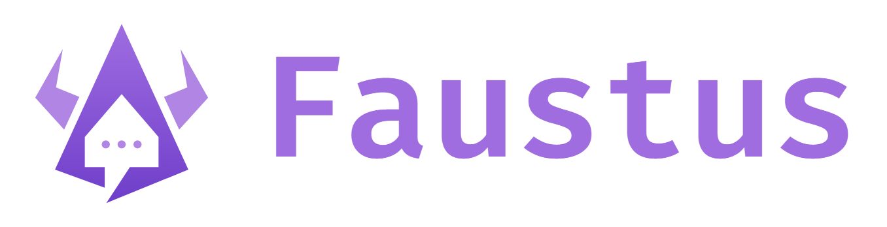
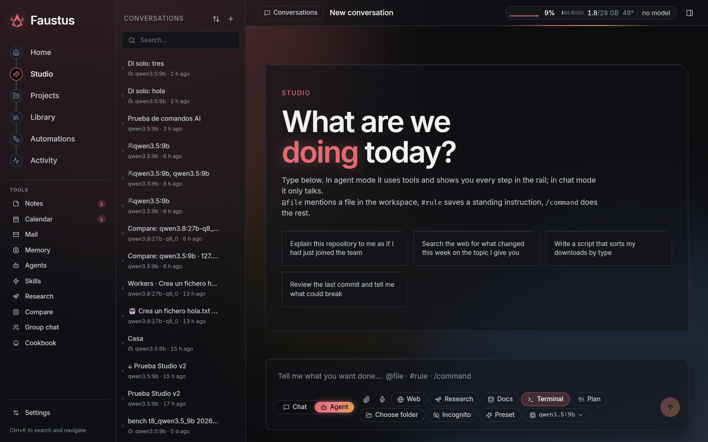
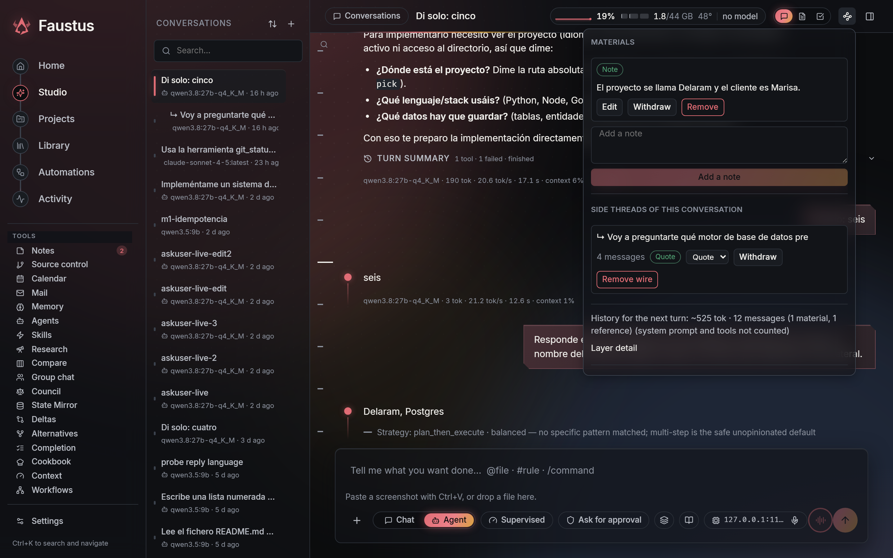
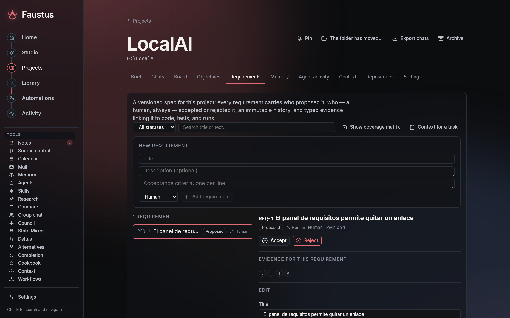
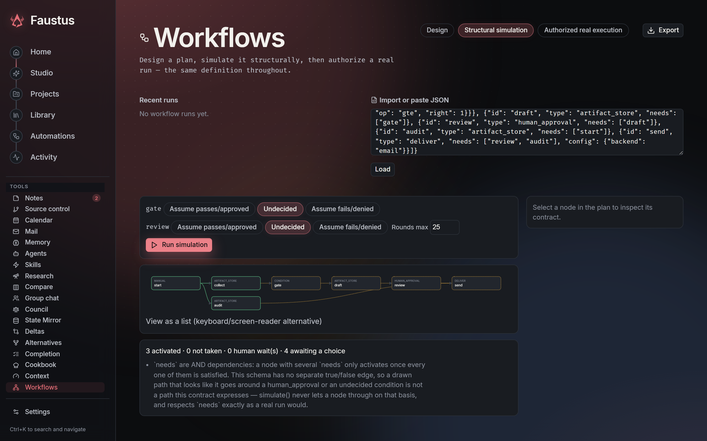
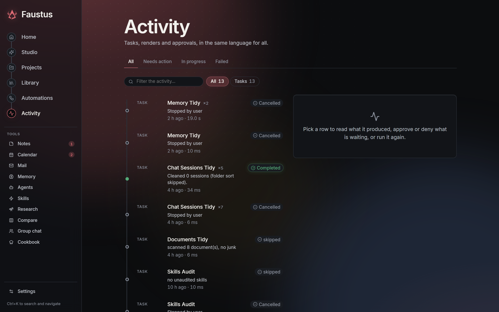
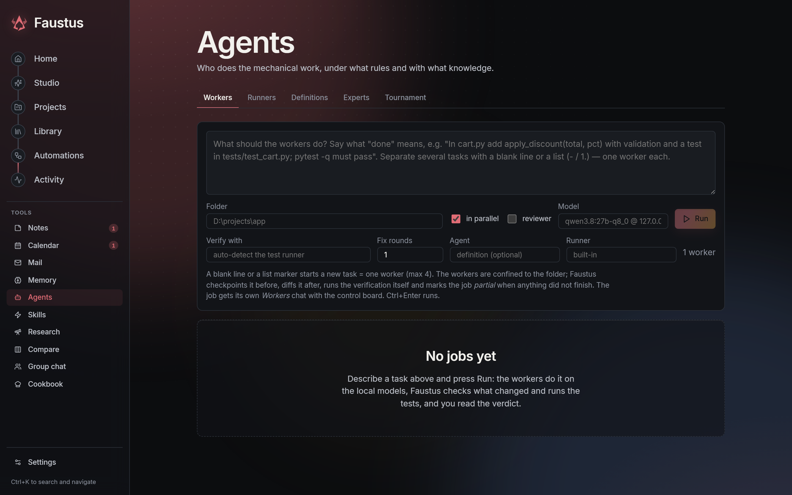
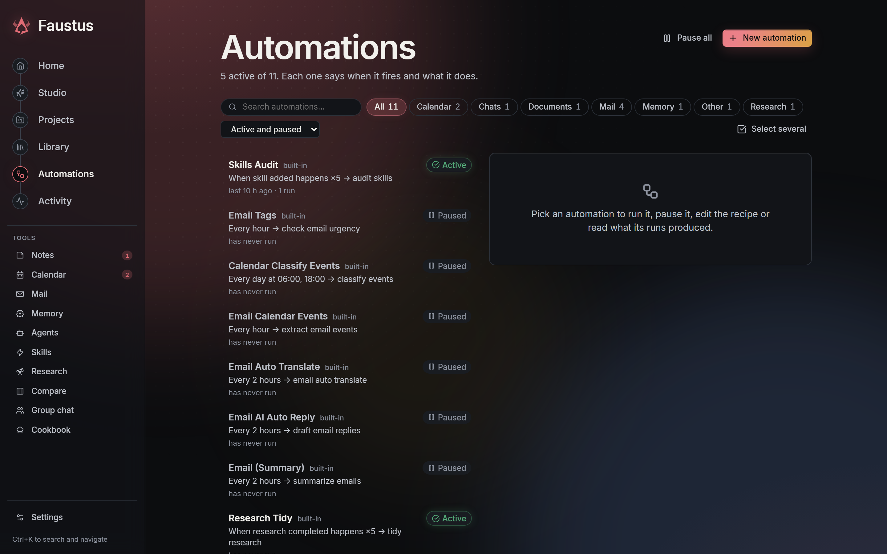

<p align="center">
  
</p>

<p align="center">A self-hosted AI workstation for local models, cloud providers and agent teams.</p>

<p align="center">
  <a href="README.es.md">Español</a> ·
  <a href="#quick-start">Quick start</a> ·
  <a href="#what-you-can-do">Capabilities</a> ·
  <a href="#architecture">Architecture</a> ·
  <a href="website/setup.md">Setup guide</a>
</p>



## What Faustus is

Faustus brings chat, coding agents, research, writing, image and video workflows, voice, and project knowledge into one workspace. It is a personal [Odysseus](https://github.com/odysseus-dev/odysseus) fork, with a Python/FastAPI backend and a React/TypeScript interface (Studio).

Use local models through Ollama, llama.cpp and other OpenAI-compatible servers, or connect cloud APIs. Configure an orchestrator and its specialist agents inside a conversation. Keep work, sources, generated files and project context together, and see what is running rather than guessing whether a model has frozen.

Local-first means you choose where inference happens. Cloud APIs and authenticated official clients use their provider's billing or subscription quota; local inference uses your own hardware. Selecting a remote provider sends it the context needed for that request.

This page is the overview. [FAUSTUS.md](FAUSTUS.md) describes every capability in detail, and the API and design documents live under [docs/](docs/).

## Quick start

Install Docker and Docker Compose, then:

```bash
git clone https://github.com/Luissalet/Faustus.git
cd Faustus
cp .env.example .env
docker compose up -d --build
```

On PowerShell, use `Copy-Item .env.example .env` instead of `cp`.

Open **http://localhost:7000**. The initial administrator password is printed in `docker compose logs odysseus`. Compose includes the search and vector-store services; it does not download a language model for you.

1. Connect your model server in Settings or Cookbook. For Ollama running on the Docker host, configure its reachable address using the [setup guide](website/setup.md).
2. Create a project and attach the files, documents or sources it should know.
3. Start a conversation. Choose **Chat** for conversation or **Agent** for tools and actions.
4. Use **Activity** to follow running conversations, workflows, renders and approvals.
5. Add image/video engines, voice services or external agent clients when you need them.

On Windows without Docker, `Start-Faustus-Desktop.bat` opens the native desktop window and `Start-Faustus.bat` starts the server and opens the web interface; both prepare missing dependencies on first run. Native installation on other systems, GPU setup, HTTPS and environment configuration: [setup guide](website/setup.md). Preserve your `data/` directory and back it up before upgrades.

## What you can do

### Chat and a persistent workbench

- Switch between local and API models per conversation; connect cloud providers through guided setup with connection testing.
- Paste screenshots, upload attachments and reference workspace files with `@`.
- Read generated documents beside the chat, edit them and save with conflict detection.
- Keep files, outputs, sources, project context, agent activity and browser captures in a resizable side panel.
- Annotate the agent's plan, a Markdown or HTML file, a document or a local web page served live from `localhost` (hot reload included): select text or pick an element, leave comments, suggested changes, deletions and questions, and send them all back to the agent as one message (`/anotar`). Review uncommitted changes or a branch diff with notes per line and a guided reading order in chapters (`/revisar`).
- Leave a conversation while the server keeps its turn running; see queue position, current activity, tool use and approval requests, and reconnect to the same work.
- Branch a side thread from any passage and wire references, documents and notes into a turn explicitly.
- Read a long answer or tool output at five levels of detail (full, key sentences, key idea, one line per section, topics) with a slider or the keys 1-5, and open the original of any fragment; the same levels are available to agents through MCP.
- Search and navigate with **Ctrl+K**. English and Spanish, themes, density, adjustable text and reduced motion.
- Install Studio on a phone as a PWA with push notifications, or open a floating quick-question window from any Windows app.

### Coding, tools and agent teams

- Define an orchestrator and its workers from the chat, choosing models, roles and tool restrictions.
- Delegate to child conversations with file ownership, progress, cancellation and steering. Named delegation routes (a name and a one-line description over a model, endpoint, effort, agent profile, tool category and skills) let the coordinator pick how each worker runs without seeing model ids.
- Import instructions, memories, MCP servers, skills and agent definitions from Claude Code, Codex CLI and Cursor, with a per-item preview and a re-sync that brings in what changed there.
- Use Council for blind first rounds, critique and synthesis across several models, with a designated executor for actions.
- Use skills, MCP servers, filesystem tools, shell execution, browser control and desktop control under the configured permissions.
- Install procedures from a bundled skill library (engineering habits, research, planning, writing, marketing, an eleven-step startup fundraising pipeline) with their licences credited. Interfaces the agent builds are accessible by default: an accessibility skill joins every turn that builds one, installed or not, and ships with skills for a UI behaviour library and for anime, cartoon and pixel-art control styles. For web UI, the agent reads a local copy of the Chrome team's modern web guidance before writing HTML, CSS or client-side JS: the `web_guidance` tool, the built-in MCP server and `/api/web-guidance` search it by capability, and `scripts/update_web_guidance.py` refreshes it.
- Build a personal text benchmark from rated conversations, compare models on frozen cases, and optimize prompt sections or skills with reversible, measured edits. See [improvement cycles](docs/api/improvement_cycles.md).
- Connect official command-line coding agents as workers through the runner and dispatch system, with an explicit subscription or API choice for each.
- Change the agent that works a conversation mid-thread, between Faustus's own model and a command-line agent such as Claude Code or Codex, which then receives the composer's messages with the thread context and resumes its own session on later turns. "Hand off to…" passes one task to another agent, Faustus itself included (a subagent on the thread's model or another one), with a summary of the thread and returns the result to the same thread. When Faustus runs on a Spark, the command-line agents installed on the PC run there through the Hub, and the agent list says where each one lives. A thread can own a git worktree on its own branch, with its diff, commit, push and pull request. The same controls are available as the `thread_agents` MCP server.
- Watch each running turn as a live agent loop: a ring with plan, act and observe lit by the turn's own events (model text, tool call, tool result), with the tool in flight, lap, time and tokens, the steps taken and a checklist of work practices (tests, browser check, docs, commit identity, no evidence files, Agora delivery) marked from what the tools ran. Sub-agent cards carry the same ring and `thread_loop` returns it over MCP.
- Inspect tool evidence, syntax checks, project tests and review results. Shadow-git checkpoints give diffs and restoration without touching the project's own repository.
- Work with repositories from the Git panel, and track typed issues on a project board that agents can read and update.
- A model router picks a local or remote model per turn from measured speed and history, and never moves to a paid route without an explicit allowance. See the [router API](docs/api/model_router.md).

### Project knowledge and memory

- Projects hold files, documents, sources, objectives and instructions independently of the sidebar folder name.
- The context engine retrieves, ranks and budgets material from project sources, history and memory, and shows what a turn was built from. Persistent storage extends what can be retrieved, not the model's native context window.
- The second brain is a markdown vault of notes and typed entities with wiki links, backlinks, time-windowed relations and a graph view, synced both ways with the filesystem. Facts, entities and notes can be ratified by their owner, which makes them win over what agents filed; a review lists contradictions and expired content with one-click actions; and a galaxy view shows projects, chats, agents, outputs and entities as navigable point clouds. The same store is readable and writable from other agents through the `brain` MCP server. See the [brain API](docs/api/brain.md).
- Search imported history from other assistants alongside local knowledge.

### Research, documents and everyday work

- Research with source tracking, citation checks and report export; answers show source links beside their claims.
- Write and edit documents and export to Markdown, text, HTML, PDF, DOCX or JSON.
- Notes, tasks and calendars; email through IMAP/SMTP and calendars through CalDAV.
- Messaging connections for reading and sending in team chat services. See [channel connections](docs/api/channel_connections.md).
- Talk to Faustus from Telegram, or from your own direct-message chat with yourself on X (end-to-end encrypted with X's Chat XDK).
- Faustus chats and WhatsApp chats are available to other coding agents as an MCP server: list, read, wait for new messages and send.
- Spotify playback, devices, queue, search, playlists, albums and library through your own Spotify developer app.
- Meeting notes from a recording: summary, decisions, action items and the timestamped transcript.
- Scheduled tasks with time zones, run windows and a history of every run. See [scheduled tasks](docs/api/scheduled_tasks.md).

### Images, video and audio

- Plan and run approved ComfyUI recipes for images, reference editing and short video, and edit an attached image by describing the change.
- With several engines configured, renders are placed by availability, queue and capacity.
- Generated artifacts keep their recipe, seed, model licence and input digest. Renders are collected by the server even with no chat open.
- Convert and resize images, extract audio, transcribe and subtitle local video.

ComfyUI is a separate service; model weights, custom nodes and their licences are not bundled. See [media recipes](config/media_workflows/) and the [workers documentation](website/fable-workers.md).

### Durable workflows

Compose triggers, conditions, waits, human approvals, media steps, script steps and stored reports on a canvas. The server advances started workflows and wakes timed steps; attempts hold leases so a late result cannot overwrite a cancellation or a newer attempt. Script steps run in Docker with permissions bound to the exact code and command. See [script skill setup](docs/design/workflow-script-skills.md).

### Voice

A voice session with English and Spanish recognition, spoken replies, interruption and a reactive sphere, using browser, system or local speech engines. Voice input goes through the same conversation and tool-permission flow as typed input. On the Windows desktop app, a global hotkey dictates into any program. See the [voice guide](docs/design/voice-jarvis.md).

### Agora

Projects have a shared space where several agents and models take tasks, discuss, review each other's work and record decisions, with roles and a task board. Each agent has a page (activity, instructions, memory, routines, use) and can be told something directly; its proposed changes to its own instructions wait for the person to accept or discard. What the person writes without naming anyone is routed to the agents that should answer it, shown under the message and set per server. See the [Agora API](docs/api/agora.md).
Projects have a shared space where several agents and models take tasks, discuss, review each other's work and record decisions, with roles and a task board. Each agent has a page (activity, instructions, memory, routines, use) and can be told something directly; its proposed changes to its own instructions wait for the person to accept or discard. A message or a stretch of messages can start a thread (with a suggested title), threads can be followed, closed and archived, messages can be pinned, and `[[Page]]` in a message or task links to the Brain, whose pages list where the Agora cites them. See the [Agora API](docs/api/agora.md).

### Hoard apps

Faustus connects to a family of separate local apps (the Hoards) through plugins and MCP: finance, links, people, data analysis, design, model benchmarking, GPU cluster management and others. Each one lives in its own repository and documents itself there. In Connectors, download a Hoard with one button or link an existing folder; the Hoard Hub starts apps on demand and shares one loaded local model among them. Per-app agent procedures are listed in the [agent flows catalogue](docs/AGENT-FLOWS.md). Each app's own skills are collected when it connects and offered to the agent when that app is in play; Connectors and Skills show them next to the library.

### Running on other machines

Faustus can use DGX Spark machines as its model backend, and the Hoard Hub can move the Faustus server itself to a Spark and back, so phone and laptop keep working with the PC switched off.

## Architecture

| Area | Code |
| --- | --- |
| HTTP application and persistence | [app.py](app.py), [routes](routes/), [core](core/) |
| Studio interface and state | [studio/src](studio/src/) |
| Desktop app | [desktop](desktop/) |
| Model transport and routing | [llm_core.py](src/llm_core.py), [model_router.py](src/model_router.py) |
| Context engine and second brain | [context_engine](src/context_engine/), [brain](src/brain/) |
| Worker dispatch and process supervision | [dispatch.py](src/dispatch.py), [external_worker.py](src/external_worker.py) |
| Council | [council](src/council/) |
| Durable workflows | [workflows](src/workflows/) |
| Media engines | [media_runs.py](src/media_runs.py) |
| Artifacts | [artifact_store.py](src/artifact_store.py) |
| Built-in MCP servers and plugins | [mcp_servers](mcp_servers/), [plugins](plugins/) |
| Regression and interface checks | [tests](tests/), [studio/checks](studio/checks/) |

Internal names such as `odysseus`, `ODYSSEUS_*`, existing API paths and storage keys are retained for compatibility. The product name is Faustus.

## Development and verification

Use the project's configured Python environment and install the development dependencies described in [tests/README.md](tests/README.md).

```bash
python -m pytest
npm ci
npx tsc --noEmit
npm run build
python -m src.doctor
```

The suite covers owner isolation, persistence, concurrency, cancellation, migration, HTTP integration and headless interface checks. Hardware engines and account integrations also need tests in their configured environment. Open items are listed in [PENDIENTES.md](PENDIENTES.md).

## Screens

<details>
<summary>Context wires, requirements and workflows</summary>







</details>

<details>
<summary>Activity, agents and automations</summary>







</details>

## Security and data

Keep `AUTH_ENABLED=true` for any network-accessible deployment.
Keep `LOCALHOST_BYPASS=false` outside local development.

The managed local launchers bind to localhost and run as a single user without a login. Do not expose unauthenticated model, ComfyUI or internal service ports publicly. Keep credentials and private `data/` files out of Git.

Stored credentials are encrypted and write-only: settings show a key masked, and it never travels back to a browser. Protect `data/.app_key`; encryption does not protect against a compromised host.

Tool permissions, per-agent restrictions, approval gates, sandbox settings and process supervision are separate controls. Content from web pages, email, documents and remote MCP servers is treated as untrusted. Third-party MCP servers and imported skills are scanned before they can be trusted.

See the [threat model](THREAT_MODEL.md), [security policy](SECURITY.md) and [setup security notes](website/setup.md#security-notes).

## Credits and licence

Faustus builds on [Odysseus](https://github.com/odysseus-dev/odysseus). See [ACKNOWLEDGMENTS.md](ACKNOWLEDGMENTS.md) for additional credits, [CONTRIBUTING.md](CONTRIBUTING.md) for contribution guidance and [LICENSE](LICENSE) for **AGPL-3.0-or-later**.
